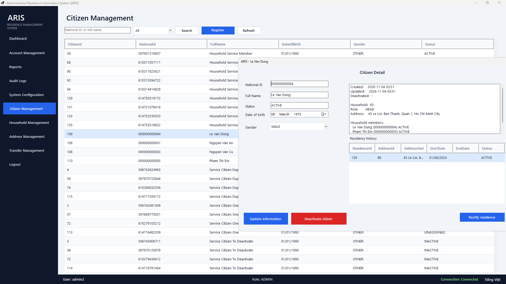
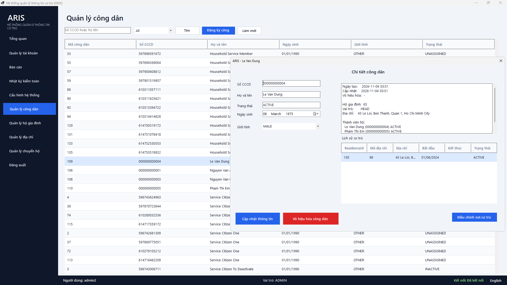

# ARIS — Administrative Residence Information System

A Windows desktop application for local residence-management officers: citizen records,
household management, address lineage, and maker-checker relocation workflows with an
append-only historical audit trail.

> Academic prototype for a Windows Programming course. It is **not** a production
> population registry and does not integrate with any national database or VNeID.

## Screenshots

| English | Tiếng Việt |
|---|---|
|  |  |

*Citizen directory and profile: household context, canonical address, residency history,
and the residence rectification action.*

## Tech stack

| Component | Version / choice |
|---|---|
| Language / runtime | .NET 10 (C#) |
| SDK | .NET SDK `10.0.401` (pinned in `global.json`) |
| IDE | Microsoft Visual Studio 2026 or the .NET CLI |
| UI framework | Windows Forms (WinForms) |
| ORM | Entity Framework Core 10 |
| Database | Microsoft SQL Server 2022 Developer Edition, local Docker container |
| Database host | `localhost,1433`, database `ArisDb`, persisted in the `mssql-data` volume |
| Version control | Git (`feature/*` → `develop` → `main`) |

## Current status

| Area | Status |
|---|---|
| Database schema, domain model, EF Core mappings | Complete |
| Audit trail, authentication, accounts, configuration, reports | Complete |
| Citizen slice (`CIT-01`–`CIT-04`, `SRCH-01`) | Complete |
| Household slice (`HH-01`, `HH-02`, `HH-04`, `HH-06`, `SRCH-02`) | Complete |
| Maker-checker transfer (`UC-06`) | Complete |
| Address management (`ADR-01`–`ADR-03`, `SRCH-03`) | Complete |
| Historical rectification (`HIST-01`) | Complete |
| UI language | Vietnamese by default; English/Vietnamese switch for static UI |
| Tests | 139 with a database; 107 passed + 32 skipped without |

## Documentation

The architecture documentation follows the **arc42** template. Start at the
[**Documentation Hub**](docs/README.md).

| Section | Document |
|---|---|
| 1. Introduction and goals | [`docs/01-introduction-and-goals.md`](docs/01-introduction-and-goals.md) |
| 2. Constraints | [`docs/02-constraints.md`](docs/02-constraints.md) |
| 3. Context and scope | [`docs/03-context-and-scope.md`](docs/03-context-and-scope.md) |
| 4. Solution strategy | [`docs/04-solution-strategy.md`](docs/04-solution-strategy.md) |
| 5. Building block view | [`docs/05-building-block-view.md`](docs/05-building-block-view.md) |
| 6. Runtime view | [`docs/06-runtime-view.md`](docs/06-runtime-view.md) |
| 7. Deployment view | [`docs/07-deployment-view.md`](docs/07-deployment-view.md) |
| 8. Crosscutting concepts | [`docs/08-crosscutting-concepts.md`](docs/08-crosscutting-concepts.md) |
| 9. Architecture decisions | [`docs/09-architecture-decisions.md`](docs/09-architecture-decisions.md) |
| 10. Quality requirements | [`docs/10-quality-requirements.md`](docs/10-quality-requirements.md) |
| 11. Risks and technical debt | [`docs/11-risks-and-technical-debt.md`](docs/11-risks-and-technical-debt.md) |
| 12. Glossary | [`docs/12-glossary.md`](docs/12-glossary.md) |
| Appendices | [Domain model](docs/appendix/A-domain-model.md) · [Database reference](docs/appendix/B-database-reference.md) · [Coding standards](docs/appendix/C-coding-standards.md) · [Team workflow](docs/appendix/D-team-workflow.md) · [Smoke-test checklist](docs/appendix/E-smoke-test-checklist.md) |
| Canonical schema | [`docs/aris_schema_v2.sql`](docs/aris_schema_v2.sql) |
| ERD | [`docs/erd_v2.svg`](docs/erd_v2.svg) |

## Repository layout

```text
Aris.slnx
Directory.Build.props          # shared MSBuild settings
global.json                    # pinned .NET SDK + test runner
docker-compose.yml             # local SQL Server 2022 container
.env.example                   # template for the local sa password
src/
  Aris.Domain/                 # entities, enums, invariants
  Aris.Application/            # use cases, DTOs, validators, Result<T>
  Aris.Infrastructure/         # EF Core, services, repositories, auditing, resilience
  Aris.UI/                     # WinForms shell, screens, EN/VI localization
tests/
  Aris.UnitTests/              # validators, audit rules, EF mapping; no database
  Aris.Tests/                  # integration tests against real SQL Server
scripts/
  deploy_database.ps1          # create ArisDb, apply schema, create aris_officer
  create_aris_test_connection.ps1  # load ARIS_TEST_CONNECTION from .env
  delete_aris_test_connection.ps1  # clear ARIS_TEST_CONNECTION
docs/                          # arc42 documentation + canonical DDL + ERD
```

### Layering rule

`UI → Application → Domain`, and `Infrastructure → Application/Domain`. The UI talks only
to Application services through DTOs and `Result<T>`. No EF Core or SQL in UI code.

## Prerequisites

- .NET SDK **10.0.401** (`dotnet --version`)
- Visual Studio 2026 or the .NET CLI
- Docker Desktop (running, WSL 2 backend, at least 4 GB memory)
- PowerShell 5.1+
- Git

No Azure account, firewall rule, or host `sqlcmd` installation is required.

## Getting started

```powershell
# 1. Local database password
Copy-Item .env.example .env
# Edit .env and set a strong MSSQL_SA_PASSWORD

# 2. Start SQL Server 2022
docker compose up -d
docker logs aris-sqlserver        # wait for "ready for client connections"

# 3. Create ArisDb, apply the schema, create the app login
.\scripts\deploy_database.ps1

# 4. Configure the application (secret stays outside Git)
cd src/Aris.UI
dotnet user-secrets set "ConnectionStrings:ArisDb" "Server=localhost,1433;Database=ArisDb;User Id=aris_officer;Password=<generated>;TrustServerCertificate=True;Connect Timeout=30;"
cd ../..

# 5. Build and run
dotnet build Aris.slnx
dotnet run --project src/Aris.UI
```

### First run

A fresh database has no accounts, so the login screen offers **Create first
administrator**. Create that `ADMIN`, sign in, then open **Accounts → Seed demo data** to
add a consistent demo dataset: 2 addresses, 6 citizens, 2 households, and 1 unassigned
citizen. The seed is idempotent and respects the Golden Invariant.

The **Citizen** screen supports search by National ID, name, or status; registration as
`UNASSIGNED`; a profile with household, canonical address, and residency timeline;
demographic updates; and deactivation, including successor-head handling.

The **Household** screen supports registration (head + active address), adding an
UNASSIGNED member, changing the head with close-and-open tenures, and viewing member and
address history.

The **Address** screen supports search by code, street, ward, district, province, or
status; a profile with canonical lineage, current households and residents; registration;
and retirement with an active successor. Addresses can also be registered from the
household form.

The **Transfer** screen is the maker-checker inbox. An officer creates a
`JOIN_EXISTING`, `NEW_HOUSEHOLD`, or `HOUSEHOLD_MOVE` request; a different officer
approves or rejects each item, and the tenures move in one serializable transaction. The
demo needs two accounts: create the second officer in **Accounts**.

The **Citizen** and **Household** detail screens expose **Rectify** actions for the
append-only membership, residence, and household-address history. A correction voids the
erroneous row, inserts a linked replacement with the corrected values, and requires a
reason. Active rows are limited to start-date corrections; current-state changes still go
through transfer, change-head, or deactivation.

The **Accounts** and **System Configuration** screens audit every mutation — create,
lock/unlock, password reset, self-service password change, and configuration update — with
the acting administrator and before/after details. Passwords and hashes never enter the
audit log.

The **Audit Logs** screen filters immutable audit entries by date, actor, entity, action,
and result, and shows the selected row's IDs, correlation ID, and JSON details in a
read-only panel.

### Language

The application starts in **Vietnamese**. Use the **English / Tiếng Việt** button on the
login screen or in the main status bar to switch. Labels, buttons, form titles, grid
headers and the shell status text switch immediately. Domain validation errors coming
from the service layer remain English.

Full setup, reset, and troubleshooting: [`docs/07-deployment-view.md`](docs/07-deployment-view.md).

## Configuration and secrets

Connection strings and passwords are **never** committed (`CON-SEC-02`).

- The local `sa` password lives in the git-ignored `.env` file.
- The application connection string lives in .NET user-secrets under
  `ConnectionStrings:ArisDb`.
- `src/Aris.UI/appsettings.json` contains only the non-secret key.
- Tests read `ARIS_TEST_CONNECTION` from the environment.

The application connects as `aris_officer`, a member of the least-privilege role
`aris_app`. `sa` is used only by the deployment script.

## Testing

```powershell
.\scripts\create_aris_test_connection.ps1   # reads the sa password from .env
dotnet test Aris.slnx
.\scripts\delete_aris_test_connection.ps1    # clear it when finished
```

Without `ARIS_TEST_CONNECTION`, integration tests **skip** — that is not a release pass.
CI builds with `-p:TreatWarningsAsErrors=true`, so the 0-warning gate is enforced.
The current suite is **139 passed, 0 failed, 0 skipped** with a database, or
**107 passed, 32 skipped** without one. Integration test classes run sequentially because
they share one local database.

| Suite | Purpose |
|---|---|
| `Aris.UnitTests` | `Result<T>`, audit validation, citizen/household/transfer/address validators, EF model vs DDL |
| `RectificationTests` | Void-and-replace, overlap/no-op guards, active-state limits, correlated audit, and the Golden Invariant |
| `AdministrationAuditTests` | Account and configuration mutations persist audit rows with the admin actor and no secrets |
| `AuditQueryFilterTests` | Audit filters by date, actor, entity, action, and result against real SQL Server |
| `AuditQueryServiceTests` | Audit viewer authorization, criteria validation, and filter normalization |
| `OptimisticConcurrencyTests` | A stale `RowVersion` raises `DbUpdateConcurrencyException` without overwriting |
| `SchemaInventoryTests` | The deployed database has 11 tables, 5 triggers, 3 views, `aris_app`, and 4 seed rows |
| `CitizenServiceTests`, `HouseholdServiceTests`, `TransferServiceTests` | Service flows, authorization, audit metadata, and transfer lineage against real SQL with a recording audit double |
| `EndToEndWorkflowTests` | Citizen → household → transfer → rectification → audit, ending with a clean Golden Invariant |
| `AccountServiceTests`, `SystemConfigurationServiceTests` | Result-based admin services, authorization, audit metadata, and failure paths with fakes |
| `GoldenInvariant_HasNoViolations` | The core contract: the violations view returns 0 rows |
| `GoldenInvariant_DetectsDeliberateViolation` | Negative control: a deliberately invalid citizen is detected |
| `Database_IsReachable_And_SchemaIsDeployed` | Diagnoses missing database/schema |
| `AddressCanonicalTests` | Retiring an address preserves historical residences through the canonical view |
| `AuditServiceTests` | Success audit commits inside the caller's transaction; failure audit survives on an independent connection |
| `SqlResilienceTests` | Only the documented local-container transient errors are retried; Azure service-tier and business errors are not |

> **Do not pass `--nologo` to `dotnet test`.** .NET 10 routes `dotnet test` through
> Microsoft.Testing.Platform, which forwards unknown flags to the xUnit executable and
> produces a misleading `Zero tests ran`.

## Golden Invariant

After every committed operation, this query must return **0 rows**:

```sql
SELECT * FROM dbo.vw_GoldenInvariantViolations;
```

Every `ACTIVE` citizen must have exactly one active membership, exactly one active
residence, and the residence's canonical address must equal the household's active
canonical address. See
[`docs/08-crosscutting-concepts.md`](docs/08-crosscutting-concepts.md#86-the-golden-invariant).

## Branching

Never commit directly to `main` or `develop`. Branch from `develop`:

```text
develop
  └── feature/<task-id>
```

Open a PR into `develop`; the Team Leader reviews against
[Appendix C §C.10](docs/appendix/C-coding-standards.md#c10-pr-review-checklist). See
[Appendix D](docs/appendix/D-team-workflow.md) for roles, roadmap, and task briefs.
