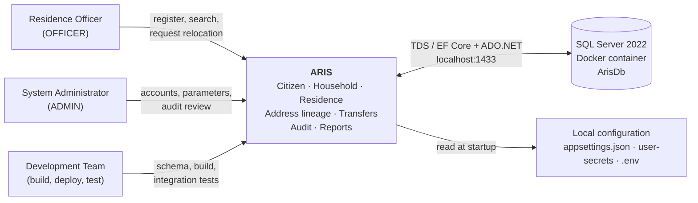
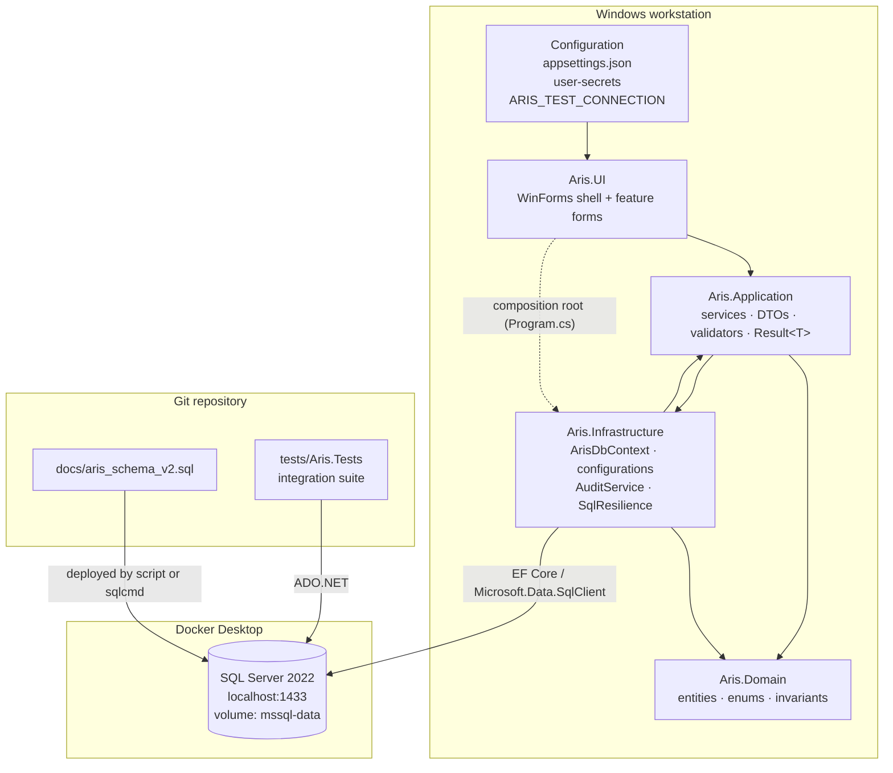

# 3. Context and Scope

> **arc42 §3** · ARIS 3.0 · [Documentation hub](README.md)

## 3.1 Business context

ARIS is a single-user-at-a-time desktop application used inside one administrative
office. Officers register and maintain residence records. Administrators manage accounts,
configuration, and audit inspection. There is no server tier, no public API, and no
external identity provider.

### Business actors

| Actor | Responsibility | Relevant requirements |
|---|---|---|
| Residence officer | Maintains citizens, households, addresses; creates transfer requests; approves requests made by someone else | `CIT-*`, `ADR-*`, `HH-*`, `UC-06`, `SRCH-*`, `RPT-*` |
| System administrator | Manages accounts and system parameters; reviews audit entries | `ACC-01`, `SYS-01`, `AUD-01`, `PERM-01` |
| Development team | Deploys the schema, runs the application, verifies the invariant | §7, Appendix D |

There are no external business systems in scope. VNeID, national population databases,
civil registries, payment systems, and identity providers are explicitly excluded.

---

## 3.2 Technical context

### Technical interfaces

| ID | Interface | Direction | Technology | Purpose |
|---|---|---|---|---|
| `IF-01` | UI → Application | In-process, synchronous/async calls | C# interfaces, DTOs, `Result<T>` | The only way the presentation layer reaches business logic |
| `IF-02` | Application/Infrastructure → SQL Server | Outbound | EF Core 10 + `Microsoft.Data.SqlClient` | Persistence, transactions, queries |
| `IF-03` | Infrastructure → SQL Server (audit failure) | Outbound, independent connection | ADO.NET via `SqlResilience` | Survives the business transaction rollback |
| `IF-04` | Application configuration | Inbound at startup | `appsettings.json`, user-secrets, environment variables | Connection string and environment settings |
| `IF-05` | Schema deployment | Outbound, administrative | `sqlcmd` inside the container, driven by `deploy-database.ps1` | Creates tables, constraints, triggers, views, role, seed configuration |
| `IF-06` | Integration tests → SQL Server | Outbound | ADO.NET | Verifies schema, triggers, and the Golden Invariant against real SQL Server |
| `IF-07` | Docker volume → SQL Server | Infrastructure | Named volume `mssql-data` | Persists data across container restarts |

### Configuration keys

| Key | Where | Example |
|---|---|---|
| `ConnectionStrings:ArisDb` | `appsettings.json` (placeholder), user-secrets (real value) | `Server=localhost,1433;Database=ArisDb;User Id=aris_officer;Password=…;TrustServerCertificate=True` |
| `ARIS_TEST_CONNECTION` | Environment variable for tests | `Server=localhost,1433;Database=ArisDb;User Id=sa;Password=…;TrustServerCertificate=True` |
| `MSSQL_SA_PASSWORD` | `.env`, consumed by `docker-compose.yml` | Strong local password |
| `PASSWORD_MIN_LENGTH` | `SystemConfiguration` table | `8` |
| `MAX_FAILED_LOGINS` | `SystemConfiguration` table | `5` |
| `LOCKOUT_MINUTES` | `SystemConfiguration` table | `15` |
| `SESSION_TIMEOUT_MINUTES` | `SystemConfiguration` table | `15` |

---

## 3.3 Scope boundaries

| Boundary | Inside ARIS | Outside ARIS |
|---|---|---|
| Data | Citizens, households, addresses, memberships, residences, transfers, accounts, audit | Vital records, biometrics, tax, land titles |
| Process | Registration, relocation approval, deactivation, rectification | Legal adjudication, appeals, notifications |
| Users | Local officers and administrators | Citizens (no self-service), external agencies |
| Deployment | One Windows workstation + one local SQL Server container | Central server, cloud hosting, multi-office sync |
| Integration | Local database only | VNeID, national APIs, email, SMS, payment gateways |
| Authentication | Local accounts with salted hashes | SSO, OAuth/OIDC, Active Directory |

---

## 3.4 What the system owns vs what it delegates

| Concern | Owner | Mechanism |
|---|---|---|
| Business rules and orchestration | Application layer | Services, validators, `Result<T>` |
| Data shape and identity rules | Domain + database | Entities, CHECK constraints, FKs |
| Temporal history rules | Database + Application | Guard triggers + close-and-open services |
| Cross-record consistency | Application + database view | Atomic transactions + `vw_GoldenInvariantViolations` |
| Authentication | Application + Infrastructure | `AuthenticationService`, PBKDF2/BCrypt, `UserAccount` |
| Authorization | Application | Role checks in services |
| Audit durability | Infrastructure + database | `AuditService`, independent connection, append-only trigger |
| Configuration | Database + local config | `SystemConfiguration`, user-secrets |
| Current household address | Database view | `vw_HouseholdCurrent` |
| Canonical address after boundary change | Database view | `vw_AddressCanonical` |

No business rule is intentionally duplicated "just in case". Where a rule is enforced in
more than one place (for example append-only history: application pattern **and** trigger),
the database is the backstop and the application exists to produce a friendly error
before the database has to reject the operation.
