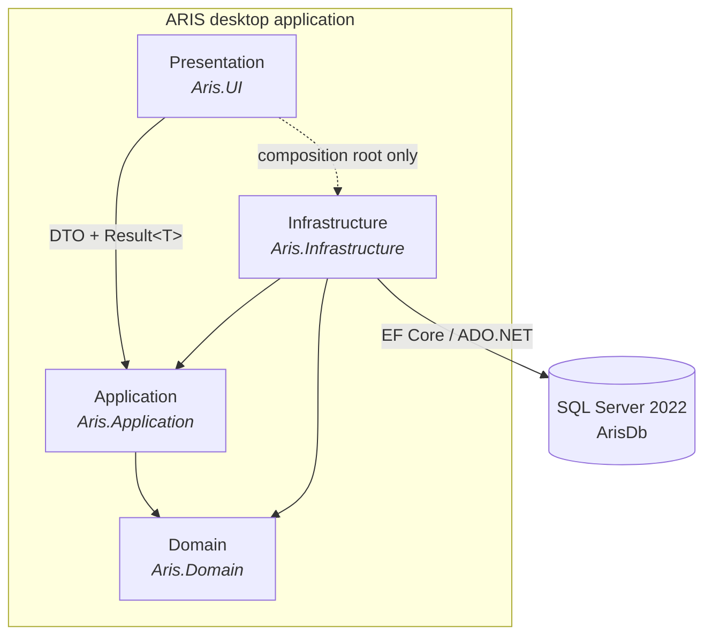
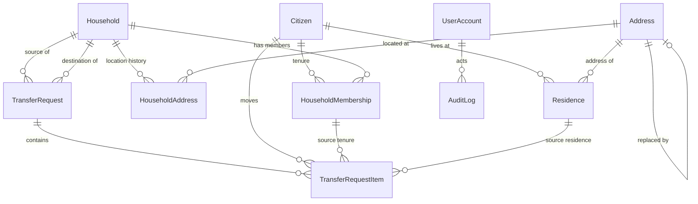

# 5. Building Block View

> **arc42 §5** · ARIS 3.0 · [Documentation hub](README.md)

The view is described at three levels: the system as a whole, the layers and their
components, and the database objects. Entity columns live in
[`appendix/A-domain-model.md`](appendix/A-domain-model.md); database objects live in
[`appendix/B-database-reference.md`](appendix/B-database-reference.md).

---

## 5.1 Level 1 — the system



| Block | Responsibility | Must not |
|---|---|---|
| `Aris.UI` | Windows shell, screens, view models, user session, input presentation | Contain SQL, `DbContext`, or business rules |
| `Aris.Application` | Use cases, orchestration, validation, DTO mapping, authorization, auditing calls | Reference WinForms or `System.Data.SqlClient` |
| `Aris.Domain` | Entities, lifecycle states, invariants that are pure C# | Reference any other project or infrastructure type |
| `Aris.Infrastructure` | EF Core context and mappings, audit persistence, connection resilience, DI registration | Contain business decisions |
| SQL Server | Schema, constraints, triggers, views, role security, seed configuration | — |

> **Composition-root exception.** `Aris.UI` has a project reference to
> `Aris.Infrastructure` solely so `Program.cs` can call `AddInfrastructure(...)`. No form,
> view model, or control may use a type from Infrastructure. This is the only permitted
> exception to `UI → Application`.

---

## 5.2 Level 2 — layers and components

### 5.2.1 Presentation layer (`src/Aris.UI/`)

| Component | Responsibility | Status |
|---|---|---|
| `Program` | Composition root: configuration (including user-secrets), DI, start the shell | Implemented (shell stub) |
| `MainForm` + `MainForm.Designer` | Sidebar navigation, content host, status bar (user, role, connection) | Stub |
| `IUserSession` implementation | Holds the authenticated user for the lifetime of the shell | Planned (`P1-C3`) |
| `CitizenDirectoryForm`, `CitizenProfileForm`, `CitizenEditDialog` | Citizen slice screens | Planned (`P2-UI1`, `P3-C1`) |
| `HouseholdDirectoryForm`, `HouseholdDetailForm` | Household and member screens | Planned |
| `TransferRequestForm`, `TransferInboxForm` | Maker wizard and checker inbox | Planned (`P4-C2`) |
| `LoginForm`, `ChangePasswordForm` | Authentication screens | Planned (`P5-C3A`) |
| `AdministrationForm`, `AuditLogForm`, `SystemConfigForm` | Admin screens | Planned (`P5-C3B`) |
| `ReportsForm` | Report selection, preview, CSV export | Planned (`P5-C3C`) |
| Feature view models | Async orchestration, `Result<T>` presentation, no business rules | Planned |

**Rule:** every screen is registered as a transient in `Program.cs`; the shell resolves
it and hosts it in `contentPanel`. A screen never opens another top-level window for
navigation.

### 5.2.2 Application layer (`src/Aris.Application/`)

| Component | Responsibility | Status |
|---|---|---|
| `Common/Result`, `Result<T>` | Explicit success/failure outcome without exceptions | Implemented |
| `Common/ValidationException` | Thrown only for malformed input or programmer error | Implemented |
| `Common/BaseService` | Shared service scaffolding | Implemented |
| `Common/IUserSession` | Session contract used by services and view models | Planned |
| `Auditing/IAuditService`, `AuditEntry`, `AuditFailureEntry` | Audit contract | Implemented |
| `Auditing/AuditEntryValidator` | Enforces column widths and required actor before SQL sees the row | Implemented |
| `Citizens/ICitizenService` + DTOs + validators | `CIT-01`–`CIT-04`, `SRCH-01` | Planned (`P1-C1`, `P2-C1`) |
| `Addresses/IAddressService` + DTOs | `ADR-01`–`ADR-03`, `SRCH-03` | Planned |
| `Households/IHouseholdService` + DTOs | `HH-01`, `HH-02`, `HH-04`, `HH-06` | Planned (`P1-C2`, `P3-C2`) |
| `Residences/IResidenceService` | `RES-03` query only | Planned (`P1-C2`) |
| `Transfers/ITransferService` + DTOs | `UC-06` maker and checker phases | Planned (`P4-C2`) |
| `Authentication/IAuthenticationService` | `AUTH-01`, lockout, password change | Planned (`P5-C3A`) |
| `Administration/IAccountService`, `IAuditQueryService`, `ISystemConfigService` | `ACC-01`, `AUD-01`, `SYS-01` | Planned |
| `Reporting/IReportService` | `RPT-01`–`RPT-03` | Planned |

Application services follow the canonical pattern in
[`appendix/C-coding-standards.md`](appendix/C-coding-standards.md): validate first, open
one transaction, mutate, audit, commit, and log failures independently after rollback.

### 5.2.3 Domain layer (`src/Aris.Domain/`)

| Component | Responsibility |
|---|---|
| `Common/EntityBase` | `RowVersion` for the nine mutable entities |
| `Entities/Citizen` | Person identity and lifecycle (`UNASSIGNED`, `ACTIVE`, `INACTIVE`) |
| `Entities/Household` | Legal family unit (`ACTIVE`, `INACTIVE`) |
| `Entities/Address` | Normalized location, validity, successor link, computed text |
| `Entities/HouseholdAddress` | Append-only household location history |
| `Entities/HouseholdMembership` | Append-only citizen–household tenure and role |
| `Entities/Residence` | Append-only citizen–address tenure |
| `Entities/TransferRequest` | Relocation header, maker-checker state |
| `Entities/TransferRequestItem` | One moving citizen per line, partial approval |
| `Entities/UserAccount` | Local account, role, lockout, password state |
| `Entities/SystemConfiguration` | Key/value operational parameters (no `RowVersion`) |
| `Entities/AuditLog` | Append-only audit record (no `RowVersion`) |
| `Enums/` | Strongly typed lifecycle values (planned refinement of string columns) |

The Domain layer contains no EF Core attributes and no database code.

### 5.2.4 Infrastructure layer (`src/Aris.Infrastructure/`)

| Component | Responsibility | Status |
|---|---|---|
| `Persistence/ArisDbContext` | Eleven `DbSet`s, applies configurations from assembly | Planned (`P1-DB2`) |
| `Persistence/Configurations/*Configuration` | Table names, keys, lengths, triggers, row versions, computed column, FKs, delete behaviour | Planned (`P1-DB2`) |
| `Auditing/AuditService` | `LogAsync` in the caller's transaction; `LogFailureIndependentAsync` on a new connection | Planned (`P1-DB2`) |
| `Resilience/SqlResilience` | Opens connections with exponential backoff for genuinely transient SQL errors | Implemented |
| `DependencyInjection.AddInfrastructure` | Registers `ArisDbContext` (with `EnableRetryOnFailure`) and `IAuditService` | Stub |

Mapping rules are normative and listed in
[`appendix/B-database-reference.md`](appendix/B-database-reference.md#b6-ef-core-mapping-requirements).

### 5.2.5 Database layer (`docs/aris_schema_v2.sql` + running instance)

| Object group | Members |
|---|---|
| Mutable tables (9) | `UserAccount`, `Citizen`, `Address`, `Household`, `HouseholdAddress`, `HouseholdMembership`, `Residence`, `TransferRequest`, `TransferRequestItem` |
| Non-versioned tables (2) | `SystemConfiguration`, `AuditLog` |
| Enforcement triggers (5) | `trg_Residence_Guard`, `trg_Membership_Guard`, `trg_HouseholdAddress_Guard`, `trg_TransferRequest_Frozen`, `trg_AuditLog_AppendOnly` |
| Views (3) | `vw_AddressCanonical`, `vw_HouseholdCurrent`, `vw_GoldenInvariantViolations` |
| Security | Role `aris_app`, user `aris_officer`, `DENY DELETE`, `DENY UPDATE` on `AuditLog` |
| Seed | Four `SystemConfiguration` rows |

---

## 5.3 Level 3 — database structure

The table-level structure is owned by the DDL. Read it together with:

- [`appendix/A-domain-model.md`](appendix/A-domain-model.md) — entities, columns, state machines
- [`appendix/B-database-reference.md`](appendix/B-database-reference.md) — constraints, triggers, views, error codes, mapping rules
- [`erd_v2.svg`](erd_v2.svg) — visual entity relationship diagram



---

## 5.4 Dependency and communication rules

| From → To | UI | Application | Domain | Infrastructure | Database |
|---|:---:|:---:|:---:|:---:|:---:|
| UI | — | ✔ DTO/`Result<T>` | ✘ | ✔ only `Program.cs` | ✘ |
| Application | ✘ | — | ✔ | via interfaces | ✘ |
| Domain | ✘ | ✘ | — | ✘ | ✘ |
| Infrastructure | ✘ | ✔ | ✔ | — | ✔ EF Core/ADO.NET |
| Database | ✘ | ✘ | ✘ | ✘ | — |

**Allowed call sequence for a use case:**

```text
Form → ViewModel → I<Module>Service (Application) → ArisDbContext / IAuditService (Infrastructure)
                                                          ↓
                                                    SQL Server
```

A form never calls Infrastructure. A service never calls a form. A domain entity never
calls a service.

---

## 5.5 Implementation status

This documentation describes the **target architecture**. The repository is at the end
of the Phase 1 baseline, before `P1-DB2`.

| Area | Implemented | Missing / next |
|---|---|---|
| Solution structure, 4 projects | ✔ | — |
| `Result<T>`, `ValidationException`, `BaseService` | ✔ | — |
| `EntityBase` | ✔ | — |
| `IAuditService` + `AuditEntryValidator` | ✔ | `AuditService` implementation |
| `SqlResilience` | ✔ | — |
| DI composition | Stubs | `AddInfrastructure` registration |
| Domain entities | ✘ | All 11 (`P1-DB2`) |
| `ArisDbContext` + configurations | ✘ | All (`P1-DB2`) |
| EF Core SQL Server provider | ✘ | Add package (`P1-DB2`) |
| Citizen slice | ✘ | `P1-C1` → `P2-C1` → `P2-UI1` |
| Household/transfer engine | ✘ | `P3-C2` → `P4-C2` |
| Auth/admin/reports | ✘ | `P1-C3`, `P5-C3` |
| Database schema | ✔ deployed by script | — |
| Golden-invariant integration tests | ✔ | Extend for new rules as they land |

The critical path is `P1-DB2 → P2-C1 → P2-TL1 → P3-C2A → P4-C2A/B`. See
[`appendix/D-team-workflow.md`](appendix/D-team-workflow.md).
