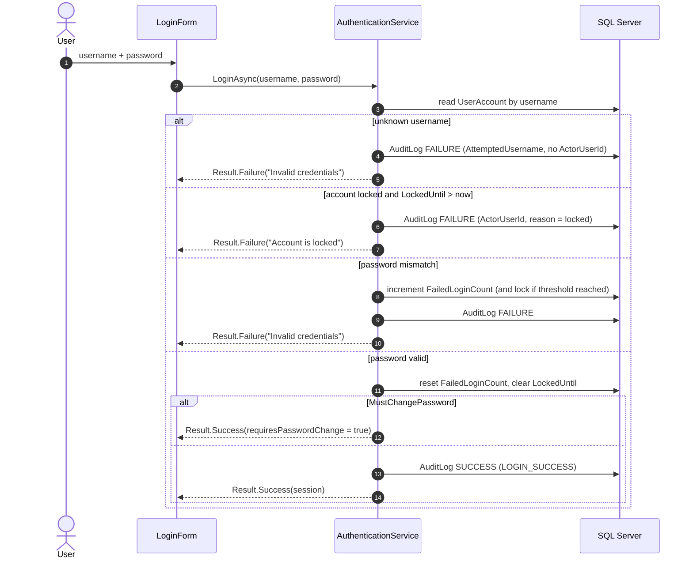
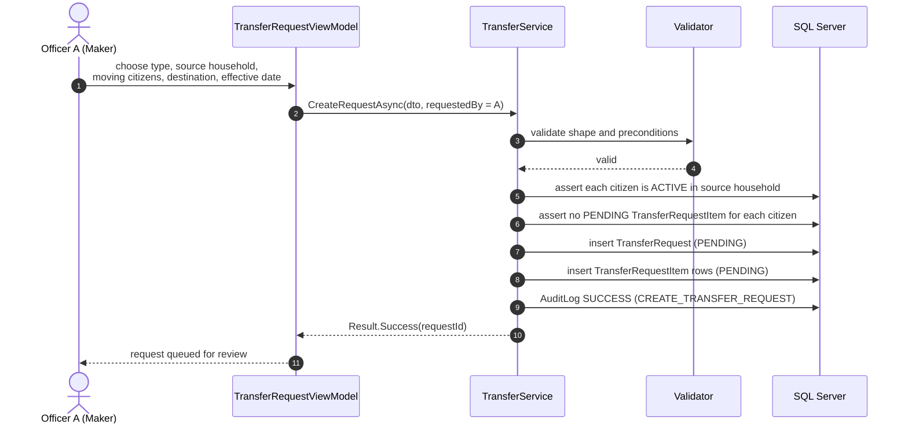
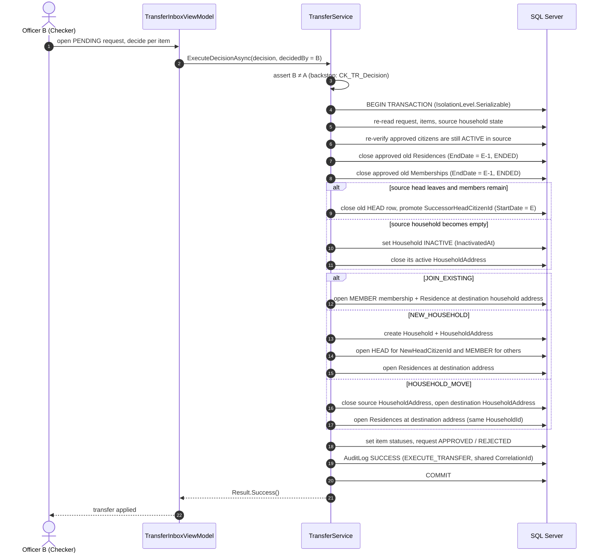
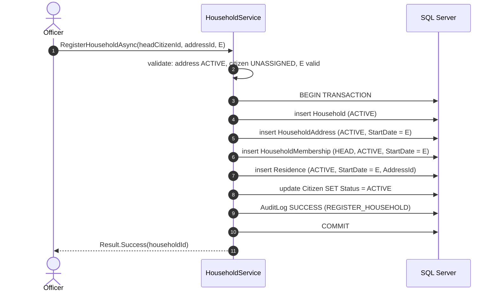
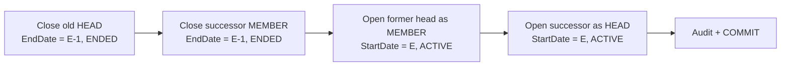
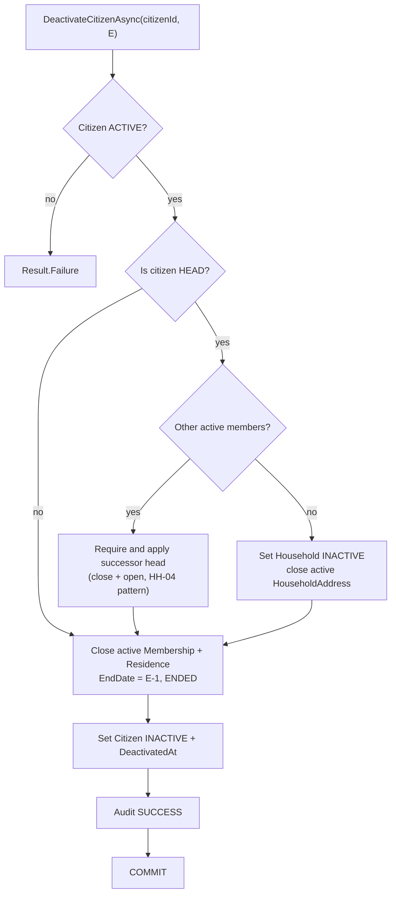
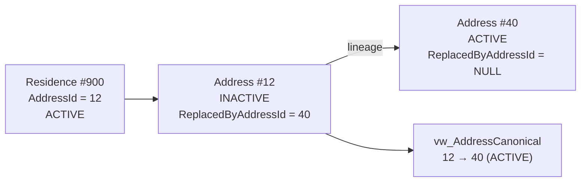
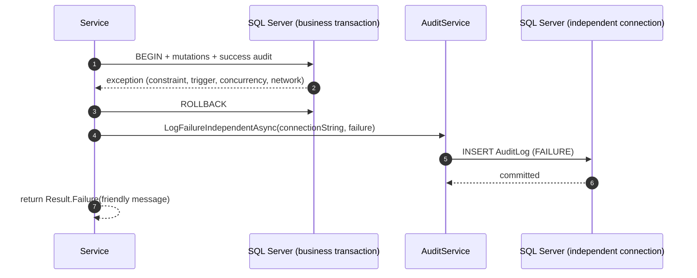

# 6. Runtime View

> **arc42 §6** · ARIS 3.0 · [Documentation hub](README.md)

This section shows how the important use cases execute across the layers. All sequences
assume an authenticated session and a working local SQL Server.

Notation: `E` is the **effective date** supplied by the user. Any row being closed must
satisfy `E > StartDate`; the closed row gets `EndDate = E - 1`.

---

## 6.1 Login and lockout (`AUTH-01`)

Rules:

- Passwords are verified against a salted PBKDF2/BCrypt hash; neither the password nor
  the hash is ever written to the audit log.
- `MAX_FAILED_LOGINS`, `LOCKOUT_MINUTES`, `PASSWORD_MIN_LENGTH`, and
  `SESSION_TIMEOUT_MINUTES` are read from `SystemConfiguration`, not hardcoded.
- Failed logins are expected business outcomes (`Result.Failure`), not exceptions.
- A failure for an unknown username uses `AuditFailureEntry` with
  `AttemptedUsername`, because `CK_Audit_Actor` requires an actor or an attempted name.

---

## 6.2 `UC-06` — maker-checker transfer

This is the critical scenario. It is intentionally split into two independent
transactions, separated by human review.

### Phase 1 — Maker creates the request

**No business state changes in Phase 1.** The household, memberships, residences, and
addresses are untouched while the request is `PENDING`.

Preconditions:

1. Requester is authenticated and authorized as `OFFICER`.
2. Every candidate is `ACTIVE` and holds an active membership and residence in the source
   household.
3. No candidate has another open `TransferRequestItem` (`UX_TRI_OneOpenPerCitizen`).
4. `E` is strictly greater than the `StartDate` of every row that will be closed.
5. Shape matches `CK_TR_Shape`:
   - `JOIN_EXISTING`: destination household required, different from source; no destination address, no new head.
   - `NEW_HOUSEHOLD`: destination address and `NewHeadCitizenId` required; no destination household.
   - `HOUSEHOLD_MOVE`: destination address required; no destination household, no new head, no successor head; the request must contain **all** active members.
6. If the source head is leaving while other members remain, `SuccessorHeadCitizenId` is required.

### Phase 2 — Checker decides

Rules and branches:

- **Partial approval.** Rejected items remain in the source household; their status becomes
  `REJECTED` with a non-null `RejectReason` (`CK_TRI_Reject`). Approved items proceed.
- **Rejected request.** If no item is approved, the request is `REJECTED`; no tenures move.
- **Entire household moves.** `HOUSEHOLD_MOVE` keeps the `HouseholdId`; only
  `HouseholdAddress` and member `Residence` rows change.
- **New household.** `NEW_HOUSEHOLD` creates a new `Household`, assigns
  `NewHeadCitizenId` as `HEAD`, and opens the destination address for the household.
- **Join existing.** `JOIN_EXISTING` adds members to an existing active household and
  reuses that household's active address.
- **Cancellation.** A maker may cancel a pending request. `CK_TR_Decision` requires
  `DecidedBy` and `DecidedAt` for `CANCELLED`; record who cancelled.
- **Frozen after decision.** `trg_TransferRequest_Frozen` rejects any later update to a
  request whose prior status was not `PENDING` (error `51040`).

### Why `Serializable`

The overlap triggers inspect committed rows. Two checkers approving overlapping moves at
the same time could each see a valid state and commit a combined overlap. `Serializable`
makes the two executions mutually exclusive. Because every mutation owns an explicit
transaction, EF's retrying execution strategy is **not** enabled on the application
context; `SqlResilience` still retries the independent failure-audit connection.
Constraint and trigger violations are **never** retried.

---

## 6.3 Register household (`HH-01`)

All five writes are one transaction. A partial write would violate `C1`, `C2`, `H1`,
`H2`, or `H3`. The new citizen is `UNASSIGNED` until this operation succeeds.

---

## 6.4 Add a member (`HH-02`)

1. Validate the citizen is `UNASSIGNED` and the household is `ACTIVE` with an active
   address.
2. Insert `HouseholdMembership(MEMBER, ACTIVE, StartDate = E)`.
3. Insert `Residence(ACTIVE, StartDate = E)` at the household's active address.
4. Set `Citizen.Status = 'ACTIVE'`.
5. Audit and commit in the same transaction.

`UX_HM_OneActivePerCitizen` and `UX_Res_OneActivePerCitizen` reject a citizen who already
has an active tenure. Removal is not a standalone operation: it happens through a
transfer or deactivation.

---

## 6.5 Change the head (`HH-04`)

This is the classic invariant trap. It is four writes, and the order matters:

- All four rows are in one transaction.
- Closes must be persisted **before** the new `HEAD` insert. Otherwise
  `UX_HM_OneActiveHeadPerHousehold` sees two active heads and rejects the batch.
- The `Role` column is never updated in place; doing so raises trigger error `51011`.
- The successor must be an active `MEMBER` of the same household.

---

## 6.6 Deactivate a citizen (`CIT-04`)

If the citizen is the sole member, the household becomes `INACTIVE` and its active
`HouseholdAddress` is closed. Leaving an empty household `ACTIVE`, or leaving an
`INACTIVE` citizen with an active tenure, violates `H2`/`H4` or `C4`.

---

## 6.7 Address lineage resolution (`ADR-03`, `C5`, `H3`)

When an administrative boundary changes, a new address is created and the old one is
marked `INACTIVE` with `ReplacedByAddressId` pointing to the successor. Historical
residences keep pointing at the old ID.

`vw_AddressCanonical` follows the chain up to 20 levels and returns the terminal address.
The Golden Invariant compares the **canonical** address of the residence with the
**canonical** address of the household, so a valid historical ID does not break `C3`.
A broken or inactive terminal address raises `C5` / `H3`.

---

## 6.8 Failure path — rollback and independent audit

Every mutating service follows the same failure choreography.

- The failure audit must **not** use the rolled-back transaction; it would disappear with
  it.
- `LogFailureIndependentAsync` must not throw for business reasons. Losing a failure audit
  must not replace the original error the user needs to see.
- Trigger errors (`51001`–`51040`) and constraint violations are not transient and are
  not retried. `SqlResilience` retries only known transient connection errors.

---

## 6.9 Optimistic concurrency conflict (`CON-CONC-01`)

1. Officer A opens a citizen record; EF tracks its `RowVersion`.
2. Officer B updates the same row and commits.
3. Officer A saves; SQL Server finds no row with the original `RowVersion`.
4. EF raises `DbUpdateConcurrencyException`.
5. The service rolls back, logs the failure independently, and returns a
   `Result.Failure` asking the user to reload.
6. The UI reloads the record and lets the officer reapply the change.

No automatic merge is attempted. Silently overwriting a colleague's edit is worse than
asking the user to retry.

---

## 6.10 Scenario-to-component map

| Scenario | UI | Application | Infrastructure | Database |
|---|---|---|---|---|
| Login | `LoginForm` | `AuthenticationService` | `ArisDbContext`, `AuditService` | `UserAccount`, `SystemConfiguration`, `AuditLog` |
| Register household | `HouseholdEditForm` | `HouseholdService` | `ArisDbContext`, `AuditService` | `Household`, `HouseholdAddress`, `HouseholdMembership`, `Residence`, `Citizen` |
| Change head | `HouseholdDetailForm` | `HouseholdService` | `ArisDbContext`, `AuditService` | `HouseholdMembership` (close + open) |
| Create transfer | `TransferRequestForm` | `TransferService` | `ArisDbContext`, `AuditService` | `TransferRequest`, `TransferRequestItem`, `AuditLog` |
| Execute transfer | `TransferInboxForm` | `TransferService` | `ArisDbContext`, `AuditService` | nine tables in one serializable transaction |
| Deactivate citizen | `CitizenProfileForm` | `CitizenService` | `ArisDbContext`, `AuditService` | `Citizen`, `HouseholdMembership`, `Residence`, `Household`, `HouseholdAddress` |
| Address lineage | `AddressForm` | `AddressService` | `ArisDbContext` | `Address`, `vw_AddressCanonical` |
| Invariant verification | test runner | — | ADO.NET | `vw_GoldenInvariantViolations` |
