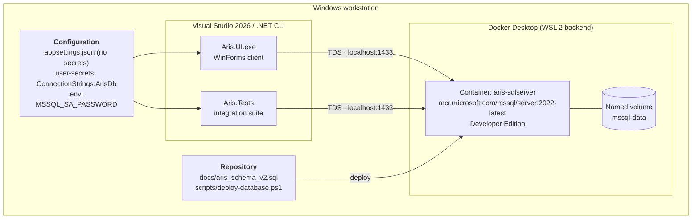

# 7. Deployment View

> **arc42 §7** · ARIS 3.0 · [Documentation hub](README.md)

## 7.1 Development topology

Everything runs on one Windows workstation. There is no cloud dependency.



| Element | Value |
|---|---|
| Host OS | Windows 10/11 (x64) |
| Runtime | .NET SDK `10.0.401` |
| Database | SQL Server 2022 Developer Edition, container `aris-sqlserver` |
| Database host/port | `localhost,1433` |
| Database name | `ArisDb` |
| Persistence | Docker named volume `mssql-data` (`/var/opt/mssql`) |
| Application login | `aris_officer` (member of `aris_app`) |
| Administrative login | `sa` (schema deployment only) |
| Application config | `ConnectionStrings:ArisDb` via user-secrets |
| Test config | `ARIS_TEST_CONNECTION` environment variable |

> **TrustServerCertificate.** The container uses a self-signed certificate, so every
> local connection string sets `TrustServerCertificate=True`. This is correct for a
> disposable local developer database and must not be copied to a production system.

---

## 7.2 Prerequisites

| Requirement | Check |
|---|---|
| .NET SDK `10.0.401` | `dotnet --version` |
| Visual Studio 2026 **or** the .NET CLI | `dotnet build Aris.slnx` |
| Docker Desktop with WSL 2 backend, running | `docker version` |
| At least 4 GB assigned to Docker | Docker Desktop → Settings → Resources |
| PowerShell 5.1+ | `$PSVersionTable.PSVersion` |
| Git | `git --version` |

`sqlcmd` on the Windows host is **not** required. The deployment script runs `sqlcmd`
inside the container. It is only needed if you choose the manual fallback in §7.4.

---

## 7.3 First-time setup

### Step 1 — Clone and configure the local password

```powershell
git clone <repo-url>
cd ARIS

Copy-Item .env.example .env
# Edit .env and replace the placeholder with a strong password.
```

`MSSQL_SA_PASSWORD` must satisfy SQL Server complexity: at least 8 characters with upper
case, lower case, digits, and a symbol. `.env` is git-ignored (`CON-SEC-02`).

### Step 2 — Start the database

```powershell
docker compose up -d
docker compose ps
```

The first start pulls the SQL Server image and can take several minutes. The container is
ready when its log contains `SQL Server is now ready for client connections`:

```powershell
docker logs aris-sqlserver
```

### Step 3 — Deploy the schema and application login

```powershell
# Show the plan without changing anything
.\scripts\deploy-database.ps1 -WhatIf

# Deploy
.\scripts\deploy-database.ps1
```

The script is idempotent and safe to re-run. It:

1. verifies Docker, the container, and `docs/aris_schema_v2.sql`;
2. starts the container if it is not running, then waits for SQL Server to accept
   connections;
3. creates `ArisDb` if it does not exist;
4. copies the DDL into the container and applies it as `sa`;
5. creates the server login `aris_officer` (if missing) and the database user mapped to
   it, then adds the user to `aris_app`;
6. generates and prints a password for `aris_officer` **once** when the login is first
   created; re-runs leave an existing login's password unchanged unless `-AppPassword`
   is supplied;
7. verifies that `aris_officer` can connect, that `UPDATE dbo.AuditLog` is **denied**, and
   that `DELETE` on a business table is **denied**.

Record the generated `aris_officer` password. Never use `sa` from the application.

### Step 4 — Point the application at the database

```powershell
cd src/Aris.UI
dotnet user-secrets set "ConnectionStrings:ArisDb" "Server=localhost,1433;Database=ArisDb;User Id=aris_officer;Password=<generated password>;TrustServerCertificate=True;Connect Timeout=30;"
cd ../..
```

`appsettings.json` keeps a non-secret placeholder. The real value lives in user-secrets,
outside the repository.

### Step 5 — Build, test, run

```powershell
dotnet build Aris.slnx                 # 0 errors, 0 warnings
dotnet run --project src/Aris.UI
```

**First run.** With no accounts in the database, the login screen offers **Create first
administrator**. After signing in, open **Accounts → Seed demo data** to load the demo
dataset. The application starts in Vietnamese; use the **English / Tiếng Việt** button on
the login screen or in the main status bar to switch.

To run the integration tests against the same database:

```powershell
$env:ARIS_TEST_CONNECTION = "Server=localhost,1433;Database=ArisDb;User Id=sa;Password=<from .env>;TrustServerCertificate=True"
dotnet test Aris.slnx                  # never pass --nologo
```

Using `sa` for tests is acceptable because the tests may need to create deliberate
invalid rows and roll them back. For a least-privilege check, point the variable at
`aris_officer` instead; the suite must still pass except for tests that require
administrative permissions.

---

## 7.4 Manual schema deployment (fallback)

Use this only if the script is unavailable.

```powershell
# Read the password from .env into a variable
$sa = (Get-Content .env | Where-Object { $_ -match '^MSSQL_SA_PASSWORD=' }) -replace '^MSSQL_SA_PASSWORD=', ''

# 1. Create the database
docker exec -i aris-sqlserver /opt/mssql-tools18/bin/sqlcmd `
  -S localhost -U sa -P $sa -C `
  -Q "IF DB_ID(N'ArisDb') IS NULL CREATE DATABASE ArisDb;"

# 2. Copy and apply the DDL
docker cp docs/aris_schema_v2.sql aris-sqlserver:/tmp/aris_schema_v2.sql
docker exec -i aris-sqlserver /opt/mssql-tools18/bin/sqlcmd `
  -S localhost -U sa -P $sa -C -d ArisDb -i /tmp/aris_schema_v2.sql

# 3. Create the application login and user
docker exec -i aris-sqlserver /opt/mssql-tools18/bin/sqlcmd `
  -S localhost -U sa -P $sa -C -d master `
  -Q "IF SUSER_ID(N'aris_officer') IS NULL CREATE LOGIN aris_officer WITH PASSWORD = N'<strong password>', CHECK_POLICY = ON;"

docker exec -i aris-sqlserver /opt/mssql-tools18/bin/sqlcmd `
  -S localhost -U sa -P $sa -C -d ArisDb `
  -Q "IF DATABASE_PRINCIPAL_ID(N'aris_officer') IS NULL CREATE USER aris_officer FOR LOGIN aris_officer; ALTER ROLE aris_app ADD MEMBER aris_officer;"
```

Verify the append-only guarantee (this must fail):

```powershell
docker exec -i aris-sqlserver /opt/mssql-tools18/bin/sqlcmd `
  -S localhost -U aris_officer -P "<app password>" -C -d ArisDb `
  -Q "UPDATE dbo.AuditLog SET Result = Result;"
```

---

## 7.5 Everyday commands

| Task | Command |
|---|---|
| Start the database | `docker compose up -d` |
| Stop the database (keep data) | `docker compose stop` |
| Stop and remove the container (keep data) | `docker compose down` |
| View logs | `docker logs -f aris-sqlserver` |
| Open a SQL shell as `sa` | `docker exec -it aris-sqlserver /opt/mssql-tools18/bin/sqlcmd -S localhost -U sa -P "<pw>" -C -d ArisDb` |
| Check the invariant | `SELECT * FROM dbo.vw_GoldenInvariantViolations;` |
| Re-apply the schema | `.\scripts\deploy-database.ps1 -SkipAppUser` |
| Reset to a clean database | `docker compose down -v; docker compose up -d; .\scripts\deploy-database.ps1` |

> **`docker compose down -v` deletes the `mssql-data` volume.** Every citizen,
> household, and audit row is lost. Use it only when you intend a full reset.

---

## 7.6 Database lifecycle and migrations

- The DDL is idempotent only in the sense that it runs on an **empty** database. The
  script does not drop existing objects.
- For a schema change during development, the authoritative sequence is:
  1. edit [`aris_schema_v2.sql`](aris_schema_v2.sql);
  2. reset the local database (`docker compose down -v`);
  3. redeploy with `.\scripts\deploy-database.ps1`;
  4. update the EF configuration and Appendix A/B if columns changed;
  5. run the integration suite.
- **No EF Core migrations.** See `D16` in
  [`09-architecture-decisions.md`](09-architecture-decisions.md).
- Each developer owns their local database. There is no shared state to coordinate, so a
  destructive reset is always safe.

---

## 7.7 Troubleshooting

| Symptom | Cause | Fix |
|---|---|---|
| `port is already allocated` on 1433 | Another SQL Server or container uses the port | Stop it, or change the host port in `docker-compose.yml` and all connection strings |
| `Login failed for user 'sa'` | Wrong `.env` password, or container started with a different password on an existing volume | Use the original password, or reset with `docker compose down -v` |
| `Cannot open database "ArisDb"` | Schema/database not deployed | Run `.\scripts\deploy-database.ps1` |
| `The certificate chain was issued by an authority that is not trusted` | Missing `TrustServerCertificate=True` | Add it to the local connection string |
| Container exits immediately | Password fails complexity, or Docker has too little memory | Check `docker logs aris-sqlserver`; raise Docker memory |
| `Login failed for user 'aris_officer'` | User not created, or wrong generated password | Re-run `.\scripts\deploy-database.ps1`; reset the password if lost |
| Integration tests report skipped | `ARIS_TEST_CONNECTION` unset | Set it, then re-run |
| `dotnet test` says "Zero tests ran" | `--nologo` was passed | Re-run without it |
| `UPDATE` on `AuditLog` succeeds | Role `DENY` not applied | Re-apply the security section of the DDL; re-run the deployment script |
| Golden Invariant returns rows | A service wrote a partial or inconsistent state | Read the violation code, fix the service, reset the affected data |

---

## 7.8 Out of scope: production deployment

ARIS is a course prototype. A production deployment would additionally require:

- a managed SQL Server with backups, point-in-time restore, and high availability;
- encrypted connections with a trusted certificate (`Encrypt=True` without
  `TrustServerCertificate`);
- a secrets manager instead of user-secrets;
- OS-level access control and audit retention policy;
- installer/signing and update distribution for the WinForms client;
- load, penetration, and disaster-recovery testing.

None of these are required for the course, and none should be claimed as delivered.
