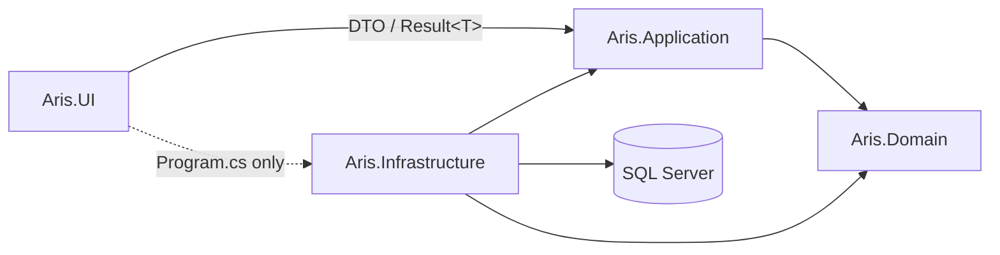
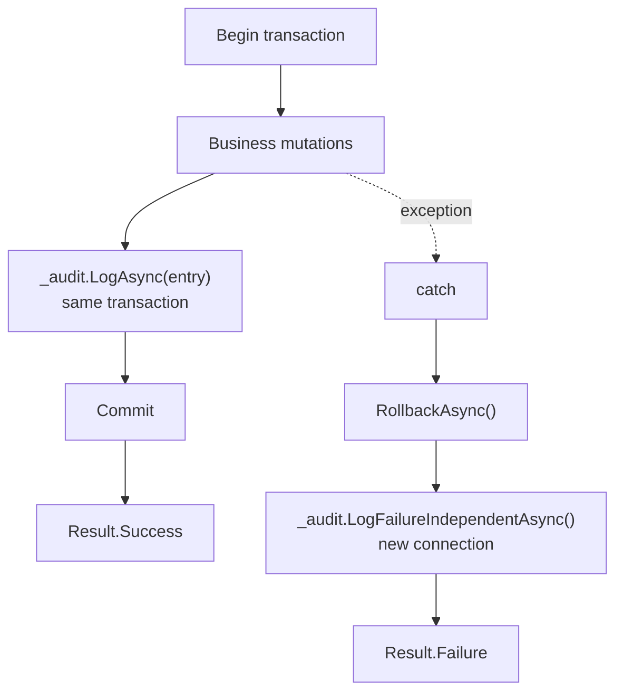

# 8. Crosscutting Concepts

> **arc42 §8** · ARIS 3.0 · [Documentation hub](README.md)

These rules apply to every module. They are not suggestions; the PR checklist enforces
them.

---

## 8.1 Layering and dependency enforcement



| Rule | Enforcement |
|---|---|
| UI must not reference `ArisDbContext` or EF Core | Code review + `using` scan; PR rejection trap #9 |
| UI must not contain SQL strings | Code review |
| Domain must not reference Application/Infrastructure | Project references (Domain has none) |
| Application must not reference WinForms | Project references (Application targets `net10.0`) |
| Application must not use `Microsoft.Data.SqlClient` directly | Code review; persistence goes through Infrastructure |
| Infrastructure may reference Application and Domain | Project references |
| Only `Program.cs` in UI may call `AddInfrastructure` | Code review; composition-root exception |

**Why the exception exists:** someone must compose the object graph. Putting the
composition root in a separate host project would add ceremony without changing the rule
that no form touches Infrastructure.

---

## 8.2 Error handling

| Category | Example | Response |
|---|---|---|
| Expected business failure | Duplicate National ID, citizen already active, invalid relocation shape, self-approval | `Result.Failure(...)` / `Result<T>.Failure(...)`; no exception |
| Malformed input or programmer error | Null DTO, invalid enum in code, missing configuration | `ValidationException` or `ArgumentNullException` |
| Infrastructure failure | Connection lost, deadlock, timeout | Roll back; log failure independently; return `Result.Failure` with a safe message |
| Concurrency conflict | Stale `RowVersion` | `DbUpdateConcurrencyException` is caught, logged, and surfaced as "reload and retry" |

```csharp
public sealed class Result
{
    public bool IsSuccess { get; }
    public bool IsFailure => !IsSuccess;
    public IReadOnlyList<string> Errors { get; }

    public static Result Success();
    public static Result Failure(params string[] errors);
}

public sealed class Result<T> : Result
{
    public T? Value { get; }
    public static Result<T> Success(T value);
    public static new Result<T> Failure(params string[] errors);
}
```

Rules:

- A successful `Result` cannot carry errors; a failed one must carry at least one. The
  constructor enforces this.
- Services never throw for a routine "no" — they return a failure the UI can render.
- The UI displays `result.Errors` in a dialog; it never displays a raw stack trace.
- Exception messages written to the audit log are technical detail; user-facing messages
  are short and actionable.

---

## 8.3 Validation

Validation runs **before** a transaction is opened.

```csharp
var validation = await _validator.ValidateAsync(dto, ct);
if (!validation.IsValid)
{
    return Result<int>.Failure(validation.Errors.Select(e => e.ErrorMessage));
}
```

| Layer | Validates |
|---|---|
| FluentValidation | Required fields, lengths, formats, enum membership, date sanity, cross-field shape |
| Application service | Entity existence, lifecycle state, role authorization, business preconditions |
| Database | Types, CHECK constraints, FKs, unique indexes, triggers, invariants |

Schema-derived rules that must appear in validators:

- `NationalId`: exactly 12 numeric digits (`char(12)`), unique.
- `FullName`: required, ≤ 100 characters.
- `Gender`: `MALE`, `FEMALE`, `OTHER`.
- `DateOfBirth`: required, in the past.
- `RequestType`: `JOIN_EXISTING`, `NEW_HOUSEHOLD`, `HOUSEHOLD_MOVE`, with the exact
  destination fields required by `CK_TR_Shape`.
- Reject reason: required when a transfer item is rejected (`CK_TRI_Reject`).

---

## 8.4 Transactions and isolation

| Operation | Isolation | Why |
|---|---|---|
| Create/update a single aggregate (citizen, address, account) | Default (`ReadCommitted`) + one transaction | Sufficient for a single row or a small consistent set |
| Register household, add member, change head, deactivate citizen | Default + one transaction | Multiple tables must commit together |
| Create transfer request | Default + one transaction | Header and items must commit together |
| **Execute transfer decision** | **`IsolationLevel.Serializable`** | Overlap triggers read committed data; concurrent approvals must not interleave |

```csharp
await using var transaction =
    await _context.Database.BeginTransactionAsync(IsolationLevel.Serializable, ct);
try
{
    // all mutations + success audit
    await transaction.CommitAsync(ct);
}
catch
{
    await transaction.RollbackAsync(ct);
    // independent failure audit, then return Result.Failure
}
```

Rules:

- One use case = one transaction. Never split a composite operation across transactions.
- Never hold a transaction open while waiting for user input. The transfer is split into
  two transactions precisely because a human decision happens between them.
- EF's retrying execution strategy is not enabled on the application context because
  every mutation owns an explicit transaction; `SqlResilience` retries the independent
  failure-audit connection. If EF retry is enabled later, wrap each transaction in
  `Database.CreateExecutionStrategy().ExecuteAsync(...)`.
- Constraint and trigger violations are never retried.
- Never retry a constraint or trigger violation; it will fail again.

---

## 8.5 Append-only temporal model

### Close-and-open

```text
Precondition: E > StartDate of every row being closed
Close:        EndDate = E - 1, Status = 'ENDED', EndedBy = actor, EndedAt = utcNow
Open:         StartDate = E,   Status = 'ACTIVE', CreatedBy = actor, CreatedAt = utcNow
```

Applied to `HouseholdMembership`, `Residence`, and `HouseholdAddress`.

### What may change on an existing row

| Column | May change? |
|---|---|
| `CitizenId`, `HouseholdId`, `AddressId`, `Role`, `StartDate` | **No** |
| `EndDate` (from `NULL` to a date) | Yes, when closing |
| `Status` (`ACTIVE → ENDED`) | Yes, when closing |
| `EndedBy`, `EndedAt` | Yes, when closing |
| `Status` (`ACTIVE`/`ENDED → VOID`) | Yes, rectification only |
| Any column on a `VOID` row | **No** |
| Any column on an `ENDED` row except `Status → VOID` | **No** |

### Rectification (`HIST-01`)

1. Mark the erroneous row `Status = 'VOID'`.
2. Insert a corrected row with `CorrectsMembershipId` / `CorrectsResidenceId` /
   `CorrectsHouseholdAddressId` pointing at the voided row.
3. Audit both actions under one correlation ID.

Voided rows are excluded from overlap checks, so the correcting row can occupy the same
interval legitimately.

### Why not soft delete?

`Status = 'VOID'` is not deletion. The row remains visible, carries its correction link,
and preserves the fact that an error occurred. Soft delete plus a rewritten row would
hide the error.

---

## 8.6 The Golden Invariant

> Every `ACTIVE` citizen has exactly one active membership, exactly one active residence,
> and the residence's canonical address equals the household's active canonical address.

```sql
SELECT * FROM dbo.vw_GoldenInvariantViolations;   -- must return 0 rows
```

| Code | Violation | Typical cause |
|---|---|---|
| `C1` | `CITIZEN_NO_ACTIVE_MEMBERSHIP` | Citizen set `ACTIVE` before `HH-01`/`HH-02` completed |
| `C2` | `CITIZEN_NO_ACTIVE_RESIDENCE` | Membership created without a residence |
| `C3` | `CITIZEN_ADDRESS_MISMATCH` | Member moved but residence still points at the old address |
| `C4` | `CITIZEN_NOT_ACTIVE_BUT_ASSIGNED` | Deactivation left an active membership or residence |
| `C5` | `RESIDENCE_ADDRESS_NOT_ACTIVE` | Address lineage broken or terminal address inactive |
| `H1` | `HOUSEHOLD_ACTIVE_NO_HEAD` | Head change closed the old head and failed to open the new one |
| `H2` | `HOUSEHOLD_ACTIVE_NO_MEMBERS` | Source household emptied but not inactivated |
| `H3` | `HOUSEHOLD_ACTIVE_NO_VALID_ADDRESS` | Move closed the old address without opening the new one |
| `H4` | `HOUSEHOLD_INACTIVE_HAS_MEMBERS` | Household inactivated while members remain |

Verification requirements:

- The positive test asserts zero rows.
- The negative control inserts an invalid `ACTIVE` citizen inside a rolled-back
  transaction and asserts the view reports `C1`. Without the negative control, a broken
  view could silently "pass" the positive test.
- Every composite service must be followed by an invariant check in integration tests.

---

## 8.7 Optimistic concurrency

- `EntityBase.RowVersion` is a `byte[]`.
- Every mutable entity configuration calls `.IsRowVersion()`.
- `AuditLog` and `SystemConfiguration` have no `rowversion` and do not derive from
  `EntityBase`.
- EF includes the original `RowVersion` in the `WHERE` clause of `UPDATE`.
- Zero rows affected → `DbUpdateConcurrencyException`.
- Services catch it, roll back, audit the failure, and return a retryable message.
- The UI reloads the entity before allowing another edit.

Never "fix" a concurrency exception by overwriting the row. That is last-write-wins and
defeats the mechanism.

---

## 8.8 Auditing

### Two patterns



| Method | Connection | When |
|---|---|---|
| `LogAsync(AuditEntry)` | Caller's transaction | Success, before commit |
| `LogFailureIndependentAsync(connectionString, AuditFailureEntry)` | New connection via `SqlResilience` | After rollback |

### Mandatory audit fields

| Field | Rule |
|---|---|
| `ActorUserId` | Required for authenticated actions |
| `AttemptedUsername` | Required instead of actor for unknown-user login failures |
| `Action` | Stable uppercase ≤ 50 chars, e.g. `REGISTER_HOUSEHOLD` |
| `EntityType` | Singular table name ≤ 50 chars, e.g. `Household` |
| `EntityId` | Primary key when available |
| `Result` | `SUCCESS` or `FAILURE` (`CK_Audit_Result`) |
| `Details` | Valid JSON (`ISJSON`); use `JsonSerializer.Serialize` |
| `CorrelationId` | One `Guid` per use case, shared by all its rows |

Never log: passwords, password hashes, connection strings, or full personal data beyond
what the business record already contains. Prefer IDs and changed field names.

### Append-only enforcement

- `trg_AuditLog_AppendOnly` rejects `UPDATE` and `DELETE` with error `51030`.
- `aris_app` has `DENY UPDATE ON dbo.AuditLog` and `DENY DELETE ON SCHEMA::dbo`.
- The application never issues `UPDATE`/`DELETE` against `AuditLog`.

---

## 8.9 Security

### Authentication

- Local `UserAccount` rows only.
- Passwords hashed with a per-user salt using PBKDF2 (≥ 100,000 iterations) or BCrypt.
- Verify with a constant-time comparison.
- Lockout after `MAX_FAILED_LOGINS`, for `LOCKOUT_MINUTES`.
- `MustChangePassword` forces a change before any business screen opens.
- Session timeout is driven by `SESSION_TIMEOUT_MINUTES`.
- Login outcomes are audited; credentials are never audited.

### Authorization

- `OFFICER` and `ADMIN` roles.
- Authorization is checked in the **service**, using `IUserSession`, not only by hiding
  navigation buttons.
- Administration screens are additionally hidden from officers (defence in depth).

### Database least privilege

```sql
GRANT SELECT, INSERT, UPDATE ON SCHEMA::dbo TO aris_app;
DENY  DELETE ON SCHEMA::dbo TO aris_app;
DENY  UPDATE ON dbo.AuditLog TO aris_app;
```

`DENY` overrides `GRANT`. The application cannot delete history or rewrite audit rows even
if a bug attempts it.

### Secrets

- `.env` for the local `sa` password; git-ignored.
- user-secrets for `ConnectionStrings:ArisDb`; outside the repository.
- Environment variable `ARIS_TEST_CONNECTION` for tests; per-shell.
- Never commit a real connection string, password, token, or `.env` file.
- Never log a connection string.

---

## 8.10 Address canonicalization

`vw_AddressCanonical` resolves the terminal address of a lineage chain:

```sql
WITH chain AS (
    SELECT a.AddressId AS OriginId, a.AddressId AS CurrentId,
           a.ReplacedByAddressId AS NextId, 0 AS Depth
    FROM dbo.Address a
    UNION ALL
    SELECT c.OriginId, n.AddressId, n.ReplacedByAddressId, c.Depth + 1
    FROM chain c
    JOIN dbo.Address n ON n.AddressId = c.NextId
    WHERE c.Depth < 20
)
SELECT c.OriginId AS AddressId,
       c.CurrentId AS CanonicalAddressId,
       a.Status    AS CanonicalStatus
FROM chain c
JOIN dbo.Address a ON a.AddressId = c.CurrentId
WHERE c.NextId IS NULL;
```

Rules:

- An address is retired, never repurposed: `Status = 'INACTIVE'`, `ValidTo` set,
  `DeactivatedAt` set, `ReplacedByAddressId` points at the successor.
- Historical `Residence` and `HouseholdAddress` rows keep the old `AddressId`.
- Comparisons (Golden Invariant `C3`, household validation `H3`) use the canonical ID,
  not the raw ID.
- A cycle or a chain longer than 20 levels is a data error; the depth limit prevents an
  infinite recursion.
- Splits (one old address → many new addresses) are out of scope. Only N → 1 mergers are
  supported.

---

## 8.11 UI conventions

- The shell owns navigation: sidebar, content panel, status strip.
- Screens are hosted as non-top-level forms inside `contentPanel`; no nested main windows.
- Event handlers delegate to an `async` view-model method. Never `.Result` or `.Wait()`.
- Long operations show a busy indicator and disable the triggering control.
- Expected failures display `result.Errors` in a friendly dialog.
- Unexpected failures display a generic message and are recorded in the audit trail; no
  stack traces.
- Administration navigation is hidden for `OFFICER` accounts and rejected by the service.
- The status bar shows the current user, role, and connection state.

See [`appendix/C-coding-standards.md`](appendix/C-coding-standards.md#c6-ui-pattern) for a
reference view model.

---

## 8.12 Configuration

| Source | Purpose | Committed? |
|---|---|---|
| `src/Aris.UI/appsettings.json` | Non-secret defaults and key names | Yes |
| user-secrets | Real connection string | No |
| `.env` | `MSSQL_SA_PASSWORD` for Docker Compose | No |
| Environment variables | `ARIS_TEST_CONNECTION` for tests | No |
| `SystemConfiguration` table | Runtime operational parameters | Seeded by the DDL |

Precedence: user-secrets/environment override `appsettings.json`. `Program.cs` loads
user-secrets explicitly because a WinForms launch does not set the `Development`
environment by default.

---

## 8.13 Testing

| Project | Scope | Database | Speed |
|---|---|---|---|
| `tests/Aris.UnitTests` | Validators, pure domain rules, DTO mapping, `Result<T>`, audit entry validation | None / EF InMemory for mapping only | Milliseconds |
| `tests/Aris.Tests` | Triggers, CHECK constraints, filtered indexes, views, Golden Invariant, `rowversion` | Real SQL Server via `ARIS_TEST_CONNECTION` | Seconds |

Rules:

- **In-memory providers do not enforce triggers, CHECK constraints, filtered unique
  indexes, computed columns, or `rowversion`.** Never claim a database rule is tested by
  an in-memory test.
- Integration tests **skip** when `ARIS_TEST_CONNECTION` is unset. A skip is not a pass
  for release; the release run must execute them.
- Destructive tests run inside a transaction that is rolled back.
- The Golden Invariant suite contains both a positive assertion and a negative control.
- Never pass `--nologo` to `dotnet test` under Microsoft.Testing.Platform.

---

## 8.14 Build and repository hygiene

Before every commit:

```powershell
dotnet build Aris.slnx     # 0 errors, 0 warnings
dotnet test  Aris.slnx     # 0 failed (skips allowed only without a DB)
git status                 # no secrets, no bin/obj, no .env
```

- `TreatWarningsAsErrors` is false for local builds, but CI builds with
  `-p:TreatWarningsAsErrors=true`, so a warning fails the PR.
- Never commit `bin/`, `obj/`, `TestResults/`, `.env`, `.local/`, or user-specific files.
- Keep commit messages task-prefixed: `P1-C1: add citizen DTOs and validators`.
- One logical change per commit.

---

## 8.15 Documentation and traceability

- Architecture documentation follows arc42; this file owns crosscutting rules.
- Requirement IDs (`CIT-01`, `HH-04`, `UC-06`, `CON-*`, `D*`, `C1`–`H4`, `510xx`) are
  stable and appear in code comments, tests, and PR descriptions.
- A PR states which requirement IDs it implements and which tests prove them.
- If implementation and documentation disagree, the DDL wins for schema facts and the
  code wins for behaviour; the other document is corrected in the same PR.
