# 10. Quality Requirements

> **arc42 §10** · ARIS 3.0 · [Documentation hub](README.md)

## 10.1 Quality tree

```mermaid
flowchart TD
    Q["ARIS quality"]
    Q --> INT["Integrity"]
    Q --> SEC["Security"]
    Q --> AUD["Auditability"]
    Q --> MNT["Maintainability"]
    Q --> USA["Usability"]
    Q --> TST["Testability"]
    Q --> OPS["Operability"]

    INT --> INT1["Historical truth"]
    INT --> INT2["Cross-record consistency"]
    INT --> INT3["Temporal non-overlap"]

    SEC --> SEC1["Salted credentials"]
    SEC --> SEC2["Least privilege"]
    SEC --> SEC3["No committed secrets"]

    AUD --> AUD1["Every mutation recorded"]
    AUD --> AUD2["Failure survives rollback"]
    AUD --> AUD3["Dual control on relocations"]

    MNT --> MNT1["Four-layer boundaries"]
    MNT --> MNT2["Canonical patterns"]
    MNT --> MNT3["Stable contracts"]

    USA --> USA1["Responsive UI"]
    USA --> USA2["Actionable errors"]

    TST --> TST1["Real-database integration tests"]
    TST --> TST2["Automated invariant check"]

    OPS --> OPS1["One-command local database"]
    OPS --> OPS2["Reproducible schema"]
```

---

## 10.2 Quality scenarios

Each scenario is a measurable acceptance criterion. "Verification" names how it is
proven, not how it is hoped for.

### Integrity

| ID | Scenario | Expected response | Measure | Verification |
|---|---|---|---|---|
| `Q-INT-01` | An officer changes a household head. | Old head and successor rows are closed; two new rows are opened; no identity column is updated. | Historical rows unchanged except `EndDate`/`Status`/`Ended*`; four rows in one commit. | Integration test + trigger `51011` negative test |
| `Q-INT-02` | A household is registered. | Household, address, `HEAD` membership, residence, and citizen status commit together. | `vw_GoldenInvariantViolations` returns 0 rows. | `Aris.Tests` |
| `Q-INT-03` | A transfer is approved for two members. | Both tenures move atomically; a failure moves neither. | Zero rows for both citizens after commit; zero partial rows after rollback. | `Aris.Tests` |
| `Q-INT-04` | Two overlapping residences are inserted for one citizen. | The second insert is rejected. | SQL error `51002`. | Trigger integration test |
| `Q-INT-05` | A residence is edited in place (`AddressId` changed). | The update is rejected. | SQL error `51001`. | Trigger integration test |
| `Q-INT-06` | An address is retired with a successor. | Historical residences still resolve to an active canonical address. | `C3`/`C5`/`H3` absent. | Query test on `vw_AddressCanonical` |

### Security

| ID | Scenario | Expected response | Measure | Verification |
|---|---|---|---|---|
| `Q-SEC-01` | An account is created or a password changed. | Only a salted hash is stored. | No plaintext or reversible encoding in `PasswordHash`. | Unit test of the hasher + code review |
| `Q-SEC-02` | The application tries `DELETE` on a business table. | The database rejects it. | Permission error, not a silent no-op. | Deployment script verification |
| `Q-SEC-03` | The application tries `UPDATE` on `AuditLog`. | The database rejects it. | Permission error / `51030`. | Script verification + integration test |
| `Q-SEC-04` | A repository is scanned before merge. | No secrets, `.env`, or build output. | Zero matches. | PR checklist + `git status` |
| `Q-SEC-05` | An `OFFICER` invokes an admin service. | The service returns an authorization failure. | `Result.Failure`, no mutation. | Service unit test |

### Auditability

| ID | Scenario | Expected response | Measure | Verification |
|---|---|---|---|---|
| `Q-AUD-01` | Any business mutation succeeds. | One `SUCCESS` row with actor, action, entity, JSON details, correlation ID. | Row present after commit. | Integration test per service |
| `Q-AUD-02` | A mutation fails and the transaction rolls back. | A `FAILURE` row exists after rollback. | Row present, business rows absent. | Integration test with forced failure |
| `Q-AUD-03` | A transfer touches several tables. | All audit rows share one correlation ID. | Same `CorrelationId` across rows. | Query test |
| `Q-AUD-04` | A maker tries to approve their own request. | Rejected before commit. | `CK_TR_Decision` violation; no state change. | Integration test |

### Maintainability and testability

| ID | Scenario | Expected response | Measure | Verification |
|---|---|---|---|---|
| `Q-MNT-01` | A developer adds a feature. | It follows the canonical service pattern. | Reviewer can trace validate → transaction → mutate → audit → commit. | PR review |
| `Q-MNT-02` | A form needs data. | It calls an Application service with a DTO. | Zero `DbContext`/SQL references in `Aris.UI`. | `grep` + review |
| `Q-MNT-03` | A schema column changes. | DDL, entity, configuration, and Appendix A/B change together. | No drift; integration tests pass. | Review + test |
| `Q-TST-01` | The team runs the suite without a database. | Unit tests run; integration tests skip. | 0 failed. | `dotnet test` |
| `Q-TST-02` | The team runs the suite with a local database. | All tests execute, including triggers and the invariant. | 0 failed, 0 skipped. | `dotnet test` with `ARIS_TEST_CONNECTION` |
| `Q-TST-03` | The invariant view is broken. | The negative-control test fails. | Test detects the deliberately inserted violation. | `GoldenInvariant_DetectsDeliberateViolation` |

### Usability and operability

| ID | Scenario | Expected response | Measure | Verification |
|---|---|---|---|---|
| `Q-USA-01` | An officer searches 10,000 citizens by name. | Results appear without freezing the UI. | < 2 s; UI thread not blocked. | Manual timing + async review |
| `Q-USA-02` | A business rule rejects an action. | A dialog states what to fix. | Human-readable message; no stack trace. | UI review |
| `Q-USA-03` | An officer lacks the admin role. | Admin navigation is absent and the service rejects the call. | Hidden button + `Result.Failure`. | UI + service test |
| `Q-OPS-01` | A new developer sets up the project. | Database and schema are running from a clean machine. | ≤ 15 minutes excluding the first image pull. | Onboarding dry run |
| `Q-OPS-02` | The local database is corrupted. | It can be reset without affecting anyone else. | `docker compose down -v` + deploy succeeds. | Manual drill |
| `Q-OPS-03` | The DDL is applied to an empty `ArisDb`. | 11 tables, 5 triggers, 3 views, `aris_app`, 4 seed rows. | Counts match. | Deployment verification query |

---

## 10.3 Definition of Done

A feature is done only when all of the following hold.

### Functional

- [ ] Happy path works end to end through the WinForms UI.
- [ ] Negative and boundary flows are covered (invalid input, duplicate, past date,
      self-approval, partial approval).
- [ ] Input is validated with FluentValidation before any transaction.
- [ ] The feature is traceable to requirement IDs in its PR description.

### Architectural

- [ ] UI contains zero SQL and zero `DbContext` references.
- [ ] UI communicates through DTOs and `Result<T>`.
- [ ] Multi-table changes run in one atomic transaction.
- [ ] Transfer execution uses `IsolationLevel.Serializable`.

### Data integrity

- [ ] History is append-only; closed rows use `EndDate = E - 1`, `Status = 'ENDED'`.
- [ ] Overlap triggers pass.
- [ ] `SELECT * FROM dbo.vw_GoldenInvariantViolations;` returns **0 rows**.
- [ ] The new code has an integration test that proves the invariant survives it.

### Quality and hygiene

- [ ] `dotnet build Aris.slnx` → 0 errors, 0 warnings.
- [ ] `dotnet test Aris.slnx` → 0 failed (integration tests executed, not skipped, for
      release).
- [ ] No secrets, `.env`, `bin/`, `obj/`, or `TestResults/` staged.
- [ ] PR reviewed against
      [`appendix/C-coding-standards.md`](appendix/C-coding-standards.md#c10-pr-review-checklist).

---

## 10.4 Release gates

| Gate | Command / check | Blocking? |
|---|---|---|
| Compilation | `dotnet build Aris.slnx` | Yes — any error or warning |
| Unit tests | `dotnet test Aris.slnx` | Yes — any failure |
| Integration tests with local DB | `ARIS_TEST_CONNECTION` set, then `dotnet test` | Yes — before merging to `main` |
| Golden Invariant | `SELECT * FROM dbo.vw_GoldenInvariantViolations;` | Yes — any row |
| Schema object inventory | 11 tables, 5 triggers, 3 views | Yes |
| Secret scan | `git status`, reviewer inspection | Yes |
| Layer scan | no EF Core/SQL under `src/Aris.UI` | Yes |
| Manual smoke test | login → register citizen → register household → transfer → invariant | Yes for release |
