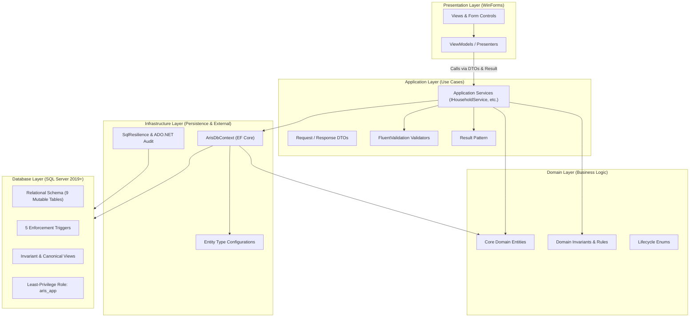

# ARIS Documentation Hub

Welcome to the **Administrative Residence Information System (ARIS)** documentation repository. This directory contains the complete specifications, database designs, architectural guidelines, development standards, and project management workflows for the system.

> [!NOTE]
> **Academic Project Notice:** ARIS is an academic prototype designed for a Windows Programming course (.NET 10 WinForms desktop application). It is not a production national population registry and does not interface with real-world national identity databases or VNeID.

---

## 🗺️ Documentation Directory Map

The documentation repository is structured into four functional modules:

```text
docs/
├── README.md                           # Central Documentation Hub (this document)
├── aris_schema_v2.sql                  # Canonical SQL Server 2019+ DDL & Trigger Deployment Script
├── erd_v2.svg / erd_v2.png             # Visual Entity Relationship Diagrams
│
├── architecture/                       # System Specifications & Domain Logic
│   ├── srs.md                          # Software Requirements Specification (SRS) & Use Cases
│   ├── domain-model.md                 # Domain Entities, Mental Model & Lifecycle States
│   └── golden-invariant.md             # The Residency-Household Invariant & Automated Checks
│
├── database/                           # Persistence & Data Integrity
│   ├── design-rationale.md             # Architectural Decision Records (D1–D14) & Defense Rings
│   └── triggers-and-security.md        # Database Triggers, Error Codes (51001–51040) & Security
│
├── standards/                          # Code Quality & Architectural Boundaries
│   ├── ai-coding-guidelines.md         # Anti-Hallucination Playbook & Prompt Engineering Header
│   ├── coding-conventions.md           # Canonical Service Patterns, Auditing & Testing Strategy
│   └── pr-review-checklist.md          # PR Review Gates, Definition of Done & 12 Auto-Rejections
│
└── workflow/                           # Project Management & Implementation Plan
    ├── onboarding.md                   # 5-Minute Developer Quickstart & Environment Setup
    ├── work-breakdown.md               # Team Roles, RACI Matrix & 7-Phase Roadmap
    └── phase1-tasks.md                 # Actionable Phase 1 Task Briefs per Team Member
```

---

## 🏛️ System Architecture Overview

ARIS enforces a strict 4-layer dependency model designed to guarantee modularity, testability, and enterprise data integrity:



---

## 🎯 Quick Navigation by Role

Find the relevant documents based on your current role and responsibilities:

| I am... | What I need | Where to start |
|---|---|---|
| **A New Team Member** | Getting local environment and Azure DB running in 5 minutes | [`workflow/onboarding.md`](workflow/onboarding.md) |
| **Developing a Feature** | Canonical service pattern, auditing protocol, DTO conventions | [`standards/coding-conventions.md`](standards/coding-conventions.md) |
| **Using AI Coding Assistants** | Prompt header to prevent schema hallucinations & broken triggers | [`standards/ai-coding-guidelines.md`](standards/ai-coding-guidelines.md) |
| **Working on Database / EF Core** | Schema decisions (D1–D14), trigger mechanics, rowversion mapping | [`database/design-rationale.md`](database/design-rationale.md)<br>[`database/triggers-and-security.md`](database/triggers-and-security.md) |
| **Working on Relocations** | Two-phase maker-checker flow (`JOIN_EXISTING`, `NEW_HOUSEHOLD`, `HOUSEHOLD_MOVE`) | [`architecture/srs.md`](architecture/srs.md#5-core-use-case-uc-06--transfer-household--residence-hh-05) |
| **Reviewing a Pull Request** | Definition of Done, 12 automatic rejection traps, verification commands | [`standards/pr-review-checklist.md`](standards/pr-review-checklist.md) |
| **Checking Team Progress** | WBS, critical path, Phase 1 task briefs, RACI matrix | [`workflow/work-breakdown.md`](workflow/work-breakdown.md)<br>[`workflow/phase1-tasks.md`](workflow/phase1-tasks.md) |

---

## 🛡️ The 6 Non-Negotiable Invariants

All team members and AI coding assistants must strictly adhere to these core rules:

1. **Strict 4-Layer Architecture:**  
   `UI → Application → Domain` and `Infrastructure → Application/Domain`. The UI talks only to Application services via DTOs and `Result<T>`. **Zero direct SQL or `DbContext` access in UI forms or event handlers.**
2. **Decoupled Relational Model:**  
   - `Citizen` **never** has a static `HouseholdId` or `AddressId`.
   - `Household` **never** has a static `CurrentAddressId`. Household addresses are tracked chronologically via `HouseholdAddress`.
3. **The Golden Invariant:**  
   Every `ACTIVE` Citizen must possess an `ACTIVE` `HouseholdMembership` in Household $H$, and an `ACTIVE` `Residence` at Address $A$, where $A$ matches $H$'s `ACTIVE` `HouseholdAddress`. View `vw_GoldenInvariantViolations` must return **0 rows** after every committed operation.
4. **Append-Only History:**  
   `HouseholdMembership`, `Residence`, and `HouseholdAddress` are append-only. **Never** run an in-place `UPDATE` on identity columns (`CitizenId`, `HouseholdId`, `AddressId`, `Role`, `StartDate`). Role change = close old row (`EndDate = E - 1, Status = 'ENDED'`) + open new row (`StartDate = E, Status = 'ACTIVE'`).
5. **Maker-Checker Dual Control Transfers:**  
   All relocations (`TransferRequest`) require dual-control verification: Requester $\ne$ Approver (`DecidedBy <> RequestedBy`, enforced by constraint `CK_TR_Decision`). Execution must run inside an atomic transaction at `IsolationLevel.Serializable`.
6. **Immutable Failure-Resistant Auditing:**  
   Every business mutation writes an `AuditLog` row. On failure, the transaction is rolled back first, and the failure audit is logged on an **independent database connection** post-rollback so the record is not discarded.

---

## ⚡ Key Verification Commands

Execute these verification commands locally to validate system health:

```powershell
# 1. Build Solution (must complete with 0 errors and 0 warnings)
dotnet build Aris.slnx

# 2. Run Test Suite (never pass --nologo)
dotnet test Aris.slnx

# 3. Check Golden Invariant in SQL Server (must return 0 rows)
SELECT * FROM dbo.vw_GoldenInvariantViolations;
```
