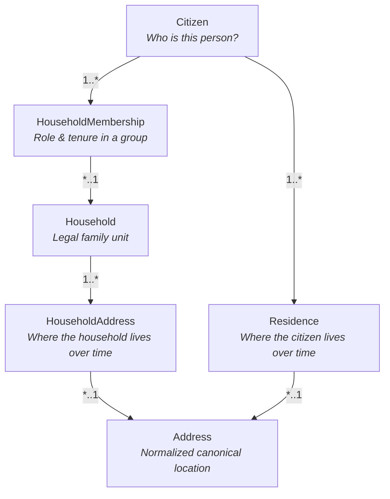
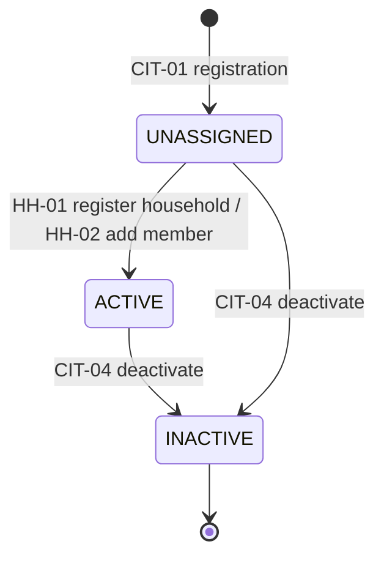
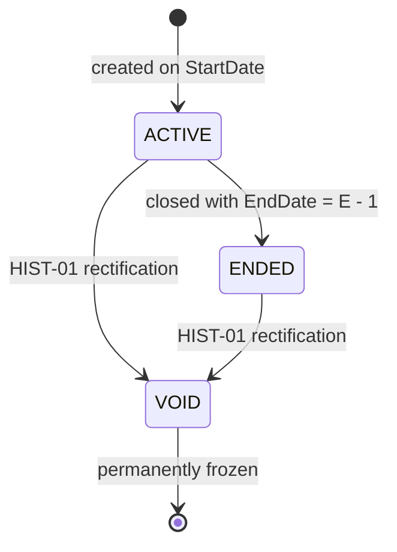
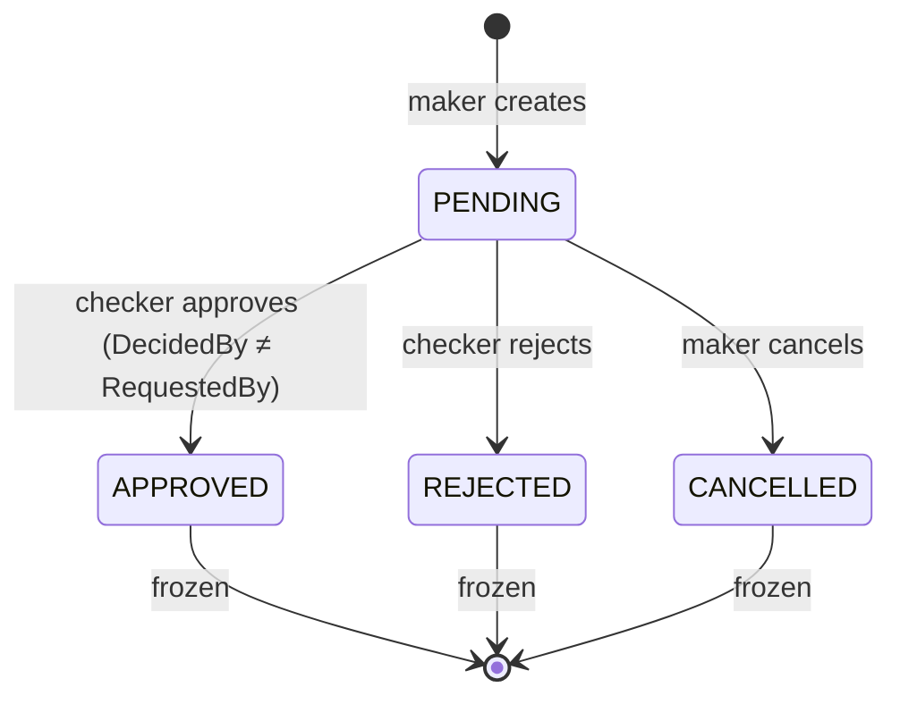
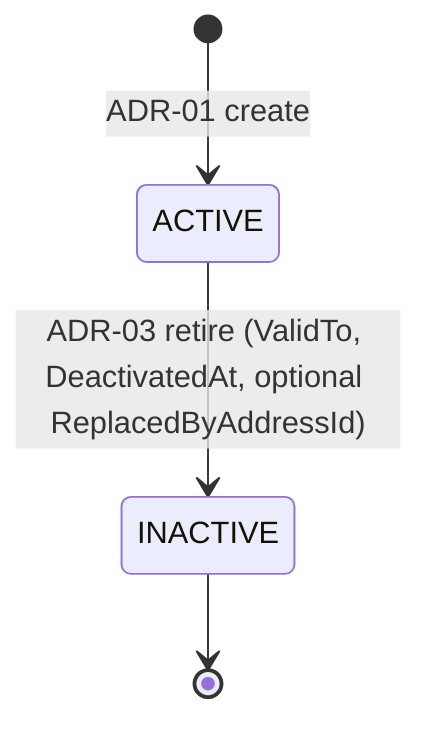

# Appendix A — Domain Model Reference

> ARIS 3.0 · [Documentation hub](../README.md) · Companion: [§5](../05-building-block-view.md) · [Appendix B](B-database-reference.md) · [ERD](../erd_v2.svg)

This appendix is the entity catalogue. The DDL remains the source of truth for names and
types; this page explains meaning and relationships.

---

## A.1 Mental model

Six core concepts, deliberately decoupled:

### Why static keys are prohibited

1. **No `Citizen.HouseholdId`.** A person belongs to different households over time
   (childhood family, adult household, marriage). A static FK overwrites tenure history.
2. **No `Citizen.CurrentAddressId`.** Residency is temporal (`StartDate` → `EndDate`).
3. **No `Household.CurrentAddressId`.** A move would overwrite where the household lived
   before. Address history lives only in `HouseholdAddress`.

---

## A.2 Entities

### A.2.1 `Citizen`

| Property | Type | Null | Constraints / default | Meaning |
|---|---|:---:|---|---|
| `CitizenId` | `int` | No | PK, IDENTITY | Surrogate key |
| `NationalId` | `char(12)` | No | UNIQUE; 12 numeric digits | Canonical national ID |
| `FullName` | `nvarchar(100)` | No | Indexed | Legal full name |
| `DateOfBirth` | `date` | No | — | Date of birth |
| `Gender` | `varchar(10)` | No | `MALE`, `FEMALE`, `OTHER` | Gender |
| `Status` | `varchar(12)` | No | `UNASSIGNED`, `ACTIVE`, `INACTIVE`; default `UNASSIGNED` | Lifecycle |
| `CreatedAt` | `datetime2(3)` | No | `SYSUTCDATETIME()` | Creation timestamp |
| `UpdatedAt` | `datetime2(3)` | No | `SYSUTCDATETIME()` | Last update |
| `DeactivatedAt` | `datetime2(3)` | Yes | Required iff `INACTIVE` | Deactivation timestamp |
| `RowVersion` | `rowversion` | No | Concurrency token | Optimistic concurrency |

`CK_Citizen_Lifecycle` ties `Status = 'INACTIVE'` to a non-null `DeactivatedAt` and
forbids it otherwise.

### A.2.2 `Household`

| Property | Type | Null | Constraints / default | Meaning |
|---|---|:---:|---|---|
| `HouseholdId` | `int` | No | PK, IDENTITY | Surrogate key |
| `Status` | `varchar(10)` | No | `ACTIVE`, `INACTIVE`; default `ACTIVE` | Lifecycle |
| `CreatedAt` | `datetime2(3)` | No | `SYSUTCDATETIME()` | Creation timestamp |
| `InactivatedAt` | `datetime2(3)` | Yes | Required iff `INACTIVE` | Inactivation timestamp |
| `RowVersion` | `rowversion` | No | Concurrency token | Optimistic concurrency |

There is no address column. Current location is derived by `vw_HouseholdCurrent`.

### A.2.3 `Address`

| Property | Type | Null | Constraints / default | Meaning |
|---|---|:---:|---|---|
| `AddressId` | `int` | No | PK, IDENTITY | Surrogate key |
| `AddressCode` | `varchar(30)` | No | UNIQUE | Administrative code |
| `AddressLine` | `nvarchar(200)` | No | — | House number / street / hamlet |
| `Ward` | `nvarchar(100)` | No | — | Ward / commune |
| `District` | `nvarchar(100)` | Yes | Legacy only | District |
| `Province` | `nvarchar(100)` | No | — | Province / city |
| `AddressText` | `nvarchar(500)` | No | Computed: `CONCAT_WS(N', ', AddressLine, Ward, District, Province)` | Display text |
| `Status` | `varchar(10)` | No | `ACTIVE`, `INACTIVE`; default `ACTIVE` | Validity |
| `ValidFrom` | `date` | No | — | Start of validity |
| `ValidTo` | `date` | Yes | Required iff `INACTIVE` | End of validity |
| `ReplacedByAddressId` | `int` | Yes | Self-FK; only when `INACTIVE`; not self | Lineage successor |
| `CreatedAt` | `datetime2(3)` | No | `SYSUTCDATETIME()` | Creation timestamp |
| `DeactivatedAt` | `datetime2(3)` | Yes | Required iff `INACTIVE` | Deactivation timestamp |
| `RowVersion` | `rowversion` | No | Concurrency token | Optimistic concurrency |

`CK_Address_Lifecycle` and `CK_Address_Replacement` enforce the active/inactive shape.
`AddressText` is database-generated; never set it in C#.

### A.2.4 `HouseholdAddress`

Append-only timeline of where a household is located.

| Property | Type | Null | Constraints / default | Meaning |
|---|---|:---:|---|---|
| `HouseholdAddressId` | `int` | No | PK, IDENTITY | Surrogate key |
| `HouseholdId` | `int` | No | FK → `Household` | Household |
| `AddressId` | `int` | No | FK → `Address` | Location |
| `StartDate` | `date` | No | — | Occupancy start |
| `EndDate` | `date` | Yes | ≥ `StartDate` | Occupancy end |
| `Status` | `varchar(10)` | No | `ACTIVE`, `ENDED`, `VOID`; default `ACTIVE` | Tenure status |
| `CreatedBy` | `int` | No | FK → `UserAccount` | Actor who opened it |
| `CreatedAt` | `datetime2(3)` | No | `SYSUTCDATETIME()` | Creation timestamp |
| `EndedBy` | `int` | Yes | FK → `UserAccount` | Actor who closed it |
| `EndedAt` | `datetime2(3)` | Yes | Required iff `ENDED` | Closure timestamp |
| `OpenedByRequestId` | `int` | Yes | FK → `TransferRequest` | Originating transfer |
| `CorrectsHouseholdAddressId` | `int` | Yes | Self-FK | Rectified row |
| `RowVersion` | `rowversion` | No | Concurrency token | Optimistic concurrency |

`UX_HA_OneActivePerHousehold`: at most one `ACTIVE` address per household.

### A.2.5 `HouseholdMembership`

Append-only tenure and role of a citizen in a household.

| Property | Type | Null | Constraints / default | Meaning |
|---|---|:---:|---|---|
| `MembershipId` | `int` | No | PK, IDENTITY | Surrogate key |
| `CitizenId` | `int` | No | FK → `Citizen`; part of `UQ_HM_Id_Citizen` | Citizen |
| `HouseholdId` | `int` | No | FK → `Household` | Household |
| `Role` | `varchar(10)` | No | `HEAD`, `MEMBER` | Role |
| `StartDate` | `date` | No | — | Tenure start |
| `EndDate` | `date` | Yes | ≥ `StartDate` | Tenure end |
| `Status` | `varchar(10)` | No | `ACTIVE`, `ENDED`, `VOID`; default `ACTIVE` | Tenure status |
| `CreatedBy` | `int` | No | FK → `UserAccount` | Actor who opened it |
| `CreatedAt` | `datetime2(3)` | No | `SYSUTCDATETIME()` | Creation timestamp |
| `EndedBy` | `int` | Yes | FK → `UserAccount` | Actor who closed it |
| `EndedAt` | `datetime2(3)` | Yes | Required iff `ENDED` | Closure timestamp |
| `OpenedByRequestId` | `int` | Yes | FK → `TransferRequest` | Originating transfer |
| `CorrectsMembershipId` | `int` | Yes | Self-FK | Rectified row |
| `RowVersion` | `rowversion` | No | Concurrency token | Optimistic concurrency |

- `UX_HM_OneActivePerCitizen`: at most one active membership system-wide.
- `UX_HM_OneActiveHeadPerHousehold`: at most one active head per household.
- `UQ_HM_Id_Citizen`: target of the composite FK from `TransferRequestItem`.

### A.2.6 `Residence`

Append-only occupancy of a citizen at an address.

| Property | Type | Null | Constraints / default | Meaning |
|---|---|:---:|---|---|
| `ResidenceId` | `int` | No | PK, IDENTITY | Surrogate key |
| `CitizenId` | `int` | No | FK → `Citizen`; part of `UQ_Res_Id_Citizen` | Citizen |
| `AddressId` | `int` | No | FK → `Address` | Address |
| `StartDate` | `date` | No | — | Residency start |
| `EndDate` | `date` | Yes | ≥ `StartDate` | Residency end |
| `Status` | `varchar(10)` | No | `ACTIVE`, `ENDED`, `VOID`; default `ACTIVE` | Residency status |
| `CreatedBy` | `int` | No | FK → `UserAccount` | Actor who opened it |
| `CreatedAt` | `datetime2(3)` | No | `SYSUTCDATETIME()` | Creation timestamp |
| `EndedBy` | `int` | Yes | FK → `UserAccount` | Actor who closed it |
| `EndedAt` | `datetime2(3)` | Yes | Required iff `ENDED` | Closure timestamp |
| `OpenedByRequestId` | `int` | Yes | FK → `TransferRequest` | Originating transfer |
| `CorrectsResidenceId` | `int` | Yes | Self-FK | Rectified row |
| `RowVersion` | `rowversion` | No | Concurrency token | Optimistic concurrency |

`UX_Res_OneActivePerCitizen`: at most one active residence per citizen.

### A.2.7 `TransferRequest`

Relocation header.

| Property | Type | Null | Meaning |
|---|---|:---:|---|
| `RequestId` | `int` | No | PK, IDENTITY |
| `RequestType` | `varchar(20)` | No | `JOIN_EXISTING`, `NEW_HOUSEHOLD`, `HOUSEHOLD_MOVE` |
| `SourceHouseholdId` | `int` | No | FK → `Household` |
| `DestinationHouseholdId` | `int` | Yes | FK → `Household`; `JOIN_EXISTING` only |
| `DestinationAddressId` | `int` | Yes | FK → `Address`; `NEW_HOUSEHOLD`/`HOUSEHOLD_MOVE` |
| `EffectiveDate` | `date` | No | Business effective date `E` |
| `NewHeadCitizenId` | `int` | Yes | FK → `Citizen`; `NEW_HOUSEHOLD` only |
| `SuccessorHeadCitizenId` | `int` | Yes | FK → `Citizen`; source head leaves but members remain |
| `ResultHouseholdId` | `int` | Yes | FK → `Household`; created/joined household, set on approval |
| `Status` | `varchar(10)` | No | `PENDING`, `APPROVED`, `REJECTED`, `CANCELLED` |
| `RequestedBy` | `int` | No | FK → `UserAccount` (maker) |
| `RequestedAt` | `datetime2(3)` | No | Creation timestamp |
| `DecidedBy` | `int` | Yes | FK → `UserAccount` (checker) |
| `DecidedAt` | `datetime2(3)` | Yes | Decision timestamp |
| `DecisionNote` | `nvarchar(500)` | Yes | Free-text note |
| `RowVersion` | `rowversion` | No | Concurrency token |

Constraints:

- `CK_TR_Type`, `CK_TR_Status`.
- `CK_TR_Shape`: each request type carries exactly the destination fields it needs.
- `CK_TR_Decision`: pending has no decision; approved/rejected require a different
  decider; cancelled requires decider and timestamp.

### A.2.8 `TransferRequestItem`

One row per moving citizen; supports partial approval.

| Property | Type | Null | Meaning |
|---|---|:---:|---|
| `ItemId` | `int` | No | PK, IDENTITY |
| `RequestId` | `int` | No | FK → `TransferRequest` |
| `CitizenId` | `int` | No | FK → `Citizen` |
| `SourceMembershipId` | `int` | No | Composite FK `(SourceMembershipId, CitizenId)` |
| `SourceResidenceId` | `int` | No | Composite FK `(SourceResidenceId, CitizenId)` |
| `Status` | `varchar(10)` | No | `PENDING`, `APPROVED`, `REJECTED`, `CANCELLED` |
| `RejectReason` | `nvarchar(300)` | Yes | Required when `REJECTED` |
| `RowVersion` | `rowversion` | No | Concurrency token |

- `UQ_TRI_Request_Citizen`: a citizen appears once per request.
- `UX_TRI_OneOpenPerCitizen`: a citizen has at most one `PENDING` item across all requests.
- The composite FKs guarantee the source membership and residence belong to the same
  citizen as the item.

### A.2.9 `UserAccount`

| Property | Type | Null | Meaning |
|---|---|:---:|---|
| `UserId` | `int` | No | PK, IDENTITY |
| `Username` | `nvarchar(50)` | No | UNIQUE login name |
| `PasswordHash` | `varchar(255)` | No | Salted PBKDF2/BCrypt hash; never plaintext |
| `FullName` | `nvarchar(100)` | No | Display name |
| `Role` | `varchar(10)` | No | `OFFICER`, `ADMIN` |
| `Status` | `varchar(10)` | No | `ACTIVE`, `LOCKED`; default `ACTIVE` |
| `FailedLoginCount` | `int` | No | ≥ 0; default 0 |
| `LockedUntil` | `datetime2(3)` | Yes | Lockout expiry |
| `MustChangePassword` | `bit` | No | Default 1 |
| `PasswordChangedAt` | `datetime2(3)` | Yes | Last password change |
| `CreatedAt` | `datetime2(3)` | No | Creation timestamp |
| `RowVersion` | `rowversion` | No | Concurrency token |

### A.2.10 `SystemConfiguration`

Key/value settings. **No `RowVersion`.**

| Property | Type | Null | Meaning |
|---|---|:---:|---|
| `ConfigKey` | `varchar(100)` | No | PK |
| `ConfigValue` | `nvarchar(500)` | No | Value |
| `Description` | `nvarchar(300)` | Yes | Human explanation |
| `UpdatedAt` | `datetime2(3)` | No | Last change |
| `UpdatedBy` | `int` | Yes | FK → `UserAccount` |

### A.2.11 `AuditLog`

Append-only. **No `RowVersion`.**

| Property | Type | Null | Meaning |
|---|---|:---:|---|
| `AuditLogId` | `bigint` | No | PK, IDENTITY |
| `ActorUserId` | `int` | Yes | FK → `UserAccount`; required unless `AttemptedUsername` is set |
| `AttemptedUsername` | `nvarchar(50)` | Yes | Failed login with unknown user |
| `Action` | `varchar(50)` | No | Stable uppercase action name |
| `EntityType` | `varchar(50)` | No | Singular table name |
| `EntityId` | `int` | Yes | Affected primary key |
| `OccurredAt` | `datetime2(3)` | No | Event timestamp |
| `Result` | `varchar(10)` | No | `SUCCESS`, `FAILURE` |
| `Details` | `nvarchar(max)` | Yes | JSON validated by `ISJSON` |
| `CorrelationId` | `uniqueidentifier` | Yes | Groups one business action |

`CK_Audit_Actor` requires `ActorUserId` **or** `AttemptedUsername`.

---

## A.3 Lifecycle state machines

### Citizen

### Append-only tenure entities

Applies to `HouseholdMembership`, `Residence`, and `HouseholdAddress`.

### Transfer request

### Address

---

## A.4 State transition matrix

Transitions not listed here are prohibited.

| Entity | Allowed states | Permitted transitions | Enforcement |
|---|---|---|---|
| `Citizen` | `UNASSIGNED`, `ACTIVE`, `INACTIVE` | `UNASSIGNED → ACTIVE`, `ACTIVE → INACTIVE`, `UNASSIGNED → INACTIVE` | `CK_Citizen_Lifecycle` |
| `Household` | `ACTIVE`, `INACTIVE` | `ACTIVE → INACTIVE` when the last member departs | `CK_Household_Lifecycle`, invariants `H2`/`H4` |
| `HouseholdMembership` | `ACTIVE`, `ENDED`, `VOID` | `ACTIVE → ENDED`, `ACTIVE → VOID`, `ENDED → VOID` | `trg_Membership_Guard` (51011/51012), `CK_HM_Lifecycle` |
| `Residence` | `ACTIVE`, `ENDED`, `VOID` | `ACTIVE → ENDED`, `ACTIVE → VOID`, `ENDED → VOID` | `trg_Residence_Guard` (51001/51002), `CK_Res_Lifecycle` |
| `HouseholdAddress` | `ACTIVE`, `ENDED`, `VOID` | `ACTIVE → ENDED`, `ACTIVE → VOID`, `ENDED → VOID` | `trg_HouseholdAddress_Guard` (51021/51022), `CK_HA_Lifecycle` |
| `Address` | `ACTIVE`, `INACTIVE` | `ACTIVE → INACTIVE` | `CK_Address_Lifecycle`, `CK_Address_Replacement` |
| `TransferRequest` | `PENDING`, `APPROVED`, `REJECTED`, `CANCELLED` | `PENDING → APPROVED/REJECTED/CANCELLED`; decided is frozen | `CK_TR_Decision`, `trg_TransferRequest_Frozen` (51040) |
| `TransferRequestItem` | `PENDING`, `APPROVED`, `REJECTED`, `CANCELLED` | Mirrors the parent resolution; may be rejected individually | `CK_TRI_Status`, `CK_TRI_Reject` |
| `UserAccount` | `ACTIVE`, `LOCKED` | Bidirectional | `CK_UserAccount_Status` |
| `AuditLog` | `SUCCESS`, `FAILURE` rows | Insert only | `trg_AuditLog_AppendOnly` (51030), `DENY UPDATE` |

---

## A.5 Aggregate boundaries

| Aggregate | Root | Members | Transaction boundary |
|---|---|---|---|
| Citizen | `Citizen` | — | Single row (demographics) |
| Address | `Address` | Lineage link | Single row, unless retiring with a successor |
| Household | `Household` | `HouseholdAddress`, `HouseholdMembership` | Register/add/change/deactivate are atomic |
| Residence | `Residence` | — | Only inside a household or transfer operation |
| Transfer | `TransferRequest` | `TransferRequestItem` | Create request and execute decision are separate transactions; execution touches household and residence aggregates |
| Account | `UserAccount` | — | Single row |
| Audit | `AuditLog` | — | Append only; failure path uses an independent connection |

Cross-aggregate consistency (for example a transfer changing a household, memberships,
residences, and audit) is achieved by one database transaction plus the Golden Invariant,
not by a distributed transaction.
