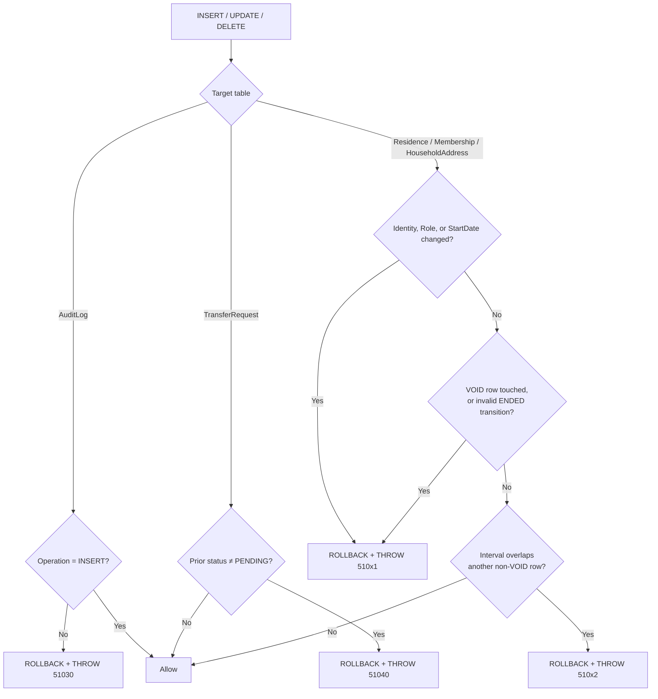

# Appendix B — Database Reference

> ARIS 3.0 · [Documentation hub](../README.md) · Canonical DDL: [`../aris_schema_v2.sql`](../aris_schema_v2.sql) · Companion: [Appendix A](A-domain-model.md) · [§8](../08-crosscutting-concepts.md)

**Engine:** Microsoft SQL Server 2022 Developer Edition, local Docker container,
`localhost,1433`, database `ArisDb`.

---

## B.1 Object inventory

| Object type | Count | Objects |
|---|:---:|---|
| Tables | 11 | `UserAccount`, `SystemConfiguration`, `Citizen`, `Address`, `Household`, `TransferRequest`, `HouseholdAddress`, `HouseholdMembership`, `Residence`, `TransferRequestItem`, `AuditLog` |
| Mutable tables with `rowversion` | 9 | All except `SystemConfiguration` and `AuditLog` |
| Triggers | 5 | `trg_Residence_Guard`, `trg_Membership_Guard`, `trg_HouseholdAddress_Guard`, `trg_TransferRequest_Frozen`, `trg_AuditLog_AppendOnly` |
| Views | 3 | `vw_AddressCanonical`, `vw_HouseholdCurrent`, `vw_GoldenInvariantViolations` |
| Roles | 1 | `aris_app` |
| Seed rows | 4 | `SystemConfiguration` defaults |

Verification:

```sql
SELECT COUNT(*) FROM sys.tables WHERE schema_id = SCHEMA_ID('dbo');       -- 11
SELECT COUNT(*) FROM sys.triggers WHERE parent_class = 1;                 -- 5
SELECT COUNT(*) FROM sys.views WHERE schema_id = SCHEMA_ID('dbo');        -- 3
SELECT * FROM dbo.SystemConfiguration;                                    -- 4 rows
SELECT * FROM dbo.vw_GoldenInvariantViolations;                           -- 0 rows
```

---

## B.2 Tables and integrity rules

| Table | Purpose | Key integrity rules |
|---|---|---|
| `UserAccount` | Local login, role, lockout | Unique username; role/status checks; failed count ≥ 0 |
| `SystemConfiguration` | Runtime parameters | PK `ConfigKey`; `UpdatedBy` FK |
| `Citizen` | Person identity and lifecycle | Unique 12-digit `NationalId`; gender/status checks; status↔`DeactivatedAt` consistency |
| `Address` | Normalized location and lineage | Unique `AddressCode`; computed `AddressText`; lifecycle and replacement checks |
| `Household` | Legal family unit | Status↔`InactivatedAt` consistency |
| `TransferRequest` | Relocation header | Type/status/shape/decision checks; decided requests frozen |
| `HouseholdAddress` | Household location history | One active per household; no overlap per household; append-only |
| `HouseholdMembership` | Citizen tenure and role | One active per citizen; one active head per household; no overlap per citizen; append-only |
| `Residence` | Citizen address history | One active per citizen; no overlap per citizen; append-only |
| `TransferRequestItem` | Moving citizens in a request | Unique per request/citizen; one open item per citizen; composite FKs to source tenure |
| `AuditLog` | Immutable audit trail | Actor required; result check; JSON check; insert-only |

### Filtered unique indexes

| Index | Table | Filter | Guarantees |
|---|---|---|---|
| `UX_HA_OneActivePerHousehold` | `HouseholdAddress` | `Status = 'ACTIVE'` | One active address per household |
| `UX_HM_OneActivePerCitizen` | `HouseholdMembership` | `Status = 'ACTIVE'` | One active membership per citizen |
| `UX_HM_OneActiveHeadPerHousehold` | `HouseholdMembership` | `Status = 'ACTIVE' AND Role = 'HEAD'` | One active head per household |
| `UX_Res_OneActivePerCitizen` | `Residence` | `Status = 'ACTIVE'` | One active residence per citizen |
| `UX_TRI_OneOpenPerCitizen` | `TransferRequestItem` | `Status = 'PENDING'` | One open transfer item per citizen |

These indexes are the reason **close-before-open** ordering matters in EF Core (§B.6).

### Composite foreign keys on `TransferRequestItem`

```sql
CONSTRAINT FK_TRI_Membership FOREIGN KEY (SourceMembershipId, CitizenId)
    REFERENCES dbo.HouseholdMembership (MembershipId, CitizenId),
CONSTRAINT FK_TRI_Residence  FOREIGN KEY (SourceResidenceId, CitizenId)
    REFERENCES dbo.Residence (ResidenceId, CitizenId)
```

They guarantee that the source membership/residence belongs to the same citizen as the
item — a normal FK on the tenure ID alone would allow a mismatched citizen.

---

## B.3 Triggers

### Execution flow



### Guard rules (`trg_*_Guard`)

Applies to `Residence`, `HouseholdMembership`, and `HouseholdAddress`:

1. **Identity immutability.** `UPDATE` may not change `CitizenId`, `HouseholdId`,
   `AddressId`, `Role`, or `StartDate`.
2. **VOID rows are frozen.** No update of any kind.
3. **ENDED rows may only become VOID.** `EndDate` may not change once ended.
4. **Temporal non-overlap.** A non-`VOID` interval may not overlap another non-`VOID`
   interval for the same citizen (or household, for addresses). Open-ended intervals are
   treated as extending to infinity.

### Error codes

| Code | Severity | Trigger | Meaning | Remediation |
|---|:---:|---|---|---|
| `51001` | 16 | `trg_Residence_Guard` | Residence identity mutated, VOID edited, invalid ENDED transition | Close and open a new row |
| `51002` | 16 | `trg_Residence_Guard` | Residence overlap for the citizen | Ensure `E > StartDate`; set `EndDate = E - 1` |
| `51011` | 16 | `trg_Membership_Guard` | Membership identity/role mutated, VOID edited, invalid ENDED transition | Close and open; never change role in place |
| `51012` | 16 | `trg_Membership_Guard` | Membership overlap for the citizen | Close the old membership before opening the new one |
| `51021` | 16 | `trg_HouseholdAddress_Guard` | Address identity mutated, VOID edited, invalid ENDED transition | Close and open a new address row |
| `51022` | 16 | `trg_HouseholdAddress_Guard` | Address overlap for the household | Close the previous address first |
| `51030` | 16 | `trg_AuditLog_AppendOnly` | `UPDATE`/`DELETE` on `AuditLog` | Insert a new audit row; never modify |
| `51040` | 16 | `trg_TransferRequest_Frozen` | Update of a decided transfer request | Create a new request |

Handlers map these codes to friendly messages; they are never retried.

---

## B.4 Views

### `vw_AddressCanonical`

Follows `ReplacedByAddressId` recursively (maximum 20 levels) and returns the terminal
address and its status.

```sql
SELECT * FROM dbo.vw_AddressCanonical WHERE AddressId = @historicalAddressId;
-- AddressId | CanonicalAddressId | CanonicalStatus
```

Use it whenever "current address" matters. Do not compare raw `AddressId` values in
invariant or reporting logic.

### `vw_HouseholdCurrent`

One row per household with `CurrentAddressId`, `HeadCitizenId`, and
`ActiveMemberCount`. This replaces the removed `Household.CurrentAddressId`.

### `vw_GoldenInvariantViolations`

Returns one row per violation, or zero rows when the system is consistent.

| Code | `ViolationType` | Condition |
|---|---|---|
| `C1` | `CITIZEN_NO_ACTIVE_MEMBERSHIP` | `ACTIVE` citizen with no active membership |
| `C2` | `CITIZEN_NO_ACTIVE_RESIDENCE` | `ACTIVE` citizen with no active residence |
| `C3` | `CITIZEN_ADDRESS_MISMATCH` | Residence canonical address ≠ household canonical address |
| `C4` | `CITIZEN_NOT_ACTIVE_BUT_ASSIGNED` | `UNASSIGNED`/`INACTIVE` citizen with an active tenure |
| `C5` | `RESIDENCE_ADDRESS_NOT_ACTIVE` | Active residence's canonical address is inactive or unresolvable |
| `H1` | `HOUSEHOLD_ACTIVE_NO_HEAD` | Active household with no active `HEAD` |
| `H2` | `HOUSEHOLD_ACTIVE_NO_MEMBERS` | Active household with no active members |
| `H3` | `HOUSEHOLD_ACTIVE_NO_VALID_ADDRESS` | Active household with no active/canonical address |
| `H4` | `HOUSEHOLD_INACTIVE_HAS_MEMBERS` | Inactive household with active members |

The view is the acceptance test for every composite operation.

---

## B.5 Security role and local users

```sql
IF DATABASE_PRINCIPAL_ID('aris_app') IS NULL
    CREATE ROLE aris_app;

GRANT SELECT, INSERT, UPDATE ON SCHEMA::dbo TO aris_app;
DENY  DELETE ON SCHEMA::dbo TO aris_app;
DENY  UPDATE ON dbo.AuditLog TO aris_app;
```

Local deployment creates:

| Principal | Scope | Purpose |
|---|---|---|
| `sa` | Server | Schema deployment only; password in git-ignored `.env` |
| `aris_officer` | Server login + database user | The application's runtime identity |
| `aris_app` | Database role | Grants and denies applied to `aris_officer` |

`DENY` takes precedence over `GRANT`. Even a compromised client cannot delete history or
rewrite audit rows.

---

## B.6 EF Core mapping requirements

These are graded in review and are normative.

### 1. Declare triggers on the five tables

EF Core emits an `OUTPUT` clause for generated values. SQL Server rejects `OUTPUT` on a
table with an enabled trigger unless the table is declared.

```csharp
builder.ToTable("Residence",          t => t.HasTrigger("trg_Residence_Guard"));
builder.ToTable("HouseholdMembership", t => t.HasTrigger("trg_Membership_Guard"));
builder.ToTable("HouseholdAddress",    t => t.HasTrigger("trg_HouseholdAddress_Guard"));
builder.ToTable("TransferRequest",     t => t.HasTrigger("trg_TransferRequest_Frozen"));
builder.ToTable("AuditLog",            t => t.HasTrigger("trg_AuditLog_AppendOnly"));
```

### 2. `rowversion` on the nine mutable tables only

```csharp
builder.Property(e => e.RowVersion).IsRowVersion();
```

`AuditLog` and `SystemConfiguration` do not have `RowVersion` and must not derive from
`EntityBase`.

### 3. Computed column

```csharp
builder.Property(a => a.AddressText)
       .HasComputedColumnSql("CONCAT_WS(N', ', AddressLine, Ward, District, Province)");
```

Never assign `AddressText` in C#.

### 4. Composite foreign keys on `TransferRequestItem`

```csharp
builder.HasOne<HouseholdMembership>()
       .WithMany()
       .HasForeignKey(i => new { i.SourceMembershipId, i.CitizenId })
       .OnDelete(DeleteBehavior.Restrict);

builder.HasOne<Residence>()
       .WithMany()
       .HasForeignKey(i => new { i.SourceResidenceId, i.CitizenId })
       .OnDelete(DeleteBehavior.Restrict);
```

### 5. No cascade deletes

`aris_app` denies `DELETE`, so every relationship uses `DeleteBehavior.Restrict` or
`DeleteBehavior.NoAction`.

### 6. Types and names

- Match table and column names verbatim; EF maps by property name.
- `DateOnly` for SQL `date`; `DateTime` for `datetime2`.
- `byte[]` for `rowversion`.
- `Guid?` for `uniqueidentifier`.
- `decimal`/`double` are not used in the current schema.

### 7. Save ordering for close-and-open

Filtered unique indexes are checked per statement, so a batch that inserts the new active
row before updating the old one can fail. Inside one transaction:

```csharp
// 1. close all old rows
await _context.SaveChangesAsync(ct);

// 2. open all new rows
await _context.SaveChangesAsync(ct);
```

Do not rely on EF's inferred command order for `HH-04` or transfer execution.

---

## B.7 Seed configuration

The DDL seeds four keys:

| Key | Default | Meaning |
|---|---|---|
| `PASSWORD_MIN_LENGTH` | `8` | Minimum password length |
| `SESSION_TIMEOUT_MINUTES` | `15` | Idle minutes before session closure |
| `MAX_FAILED_LOGINS` | `5` | Failures before lockout |
| `LOCKOUT_MINUTES` | `15` | Lockout duration |

Services must read these values rather than hardcoding them. The first `ADMIN` account is
created by the application because only the application knows the password-hashing
algorithm.

---

## B.8 Deployment and reset

```powershell
docker compose up -d
.\scripts\deploy-database.ps1

# Full reset (destroys all local data)
docker compose down -v
docker compose up -d
.\scripts\deploy-database.ps1
```

Full details: [`../07-deployment-view.md`](../07-deployment-view.md).
