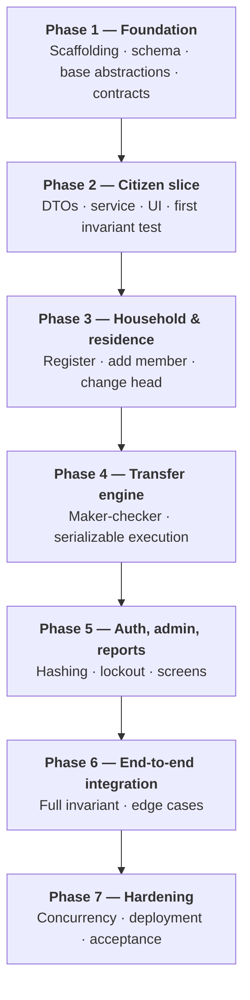
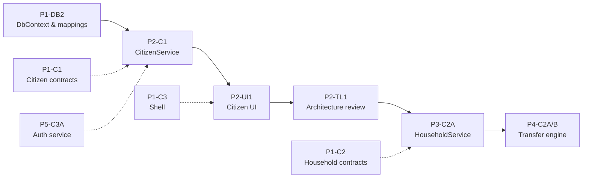

# Appendix D — Team Workflow and Task Briefs

> ARIS 3.0 · [Documentation hub](../README.md) · Companion: [§10](../10-quality-requirements.md) · [Appendix C](C-coding-standards.md) · [§7](../07-deployment-view.md)

---

## D.1 Team and ownership

| Role | Owns | Primary deliverables |
|---|---|---|
| **Team Leader** | Architecture, layer boundaries, PR gate | Solution structure, reviews, invariant verification, release gates |
| **Database Designer** | Schema fidelity, EF Core mappings, audit persistence | 11 entities, `ArisDbContext`, configurations, `AuditService`, seed data, constraint tests |
| **Coder 1** | Citizen slice and directory search | `CIT-01`–`CIT-04`, `SRCH-01`, reference vertical slice |
| **Coder 2** | Household, residence, relocations | `HH-01`–`HH-06`, `RES-03`, `UC-06`, `HIST-01` |
| **Coder 3** | Shell, authentication, admin, reports | `P1-C3`, `AUTH-01`, `ACC-01`, `AUD-01`, `SYS-01`, `RPT-01`–`RPT-03` |

Fill in names on the team channel, not in the repository. The roles are what matter.

---

## D.2 RACI

**R** = responsible, **A** = accountable, **C** = consulted, **I** = informed.

| Work area | Team Leader | DB Designer | Coder 1 | Coder 2 | Coder 3 |
|---|:---:|:---:|:---:|:---:|:---:|
| Architecture and layer boundaries | **A/R** | C | I | I | I |
| Schema v2 and deployment | A | **R** | I | C | I |
| EF Core context and mappings | A | **R** | C | C | C |
| Citizen management | A | C | **R** | I | I |
| Directory search | A | C | **R** | I | C |
| Household and membership | A | C | C | **R** | I |
| Residence tracking | A | C | I | **R** | I |
| Transfer engine (`UC-06`) | A | C | I | **R** | I |
| Record rectification | A | C | I | **R** | I |
| Authentication and accounts | A | I | I | I | **R** |
| UI shell and navigation | A | I | C | C | **R** |
| Reports | A | C | I | I | **R** |
| Crosscutting audit | **A/R** | C | C | C | C |
| Golden Invariant verification | **A** | **R** | I | C | I |
| Optimistic concurrency verification | A | **R** | I | C | I |

---

## D.3 Seven-phase roadmap



| Phase | Exit criteria |
|---|---|
| 1 | Solution builds; schema deployed locally; entities/mappings exist; contracts compile |
| 2 | Citizen create/view/update/deactivate/search works end to end; validator tests pass |
| 3 | Register household, add member, change head; invariant holds after each |
| 4 | Maker and checker flows; all three request types; partial approval; serializable execution |
| 5 | Login, lockout, forced change, account admin, configuration, reports |
| 6 | End-to-end scenarios with real data; negative controls; audit correlation |
| 7 | Concurrency stress, full regression, fresh-machine deployment, course demo |

---

## D.4 Critical path



Coders 2 and 3 are **not blocked** while `P1-DB2` is in progress:

- Coder 2 can write household/transfer DTOs and interfaces (`P1-C2`).
- Coder 3 can build the shell (`P1-C3`) and the authentication service (`P5-C3A`), which
  depends only on `UserAccount` semantics, not on EF Core.

---

## D.5 Phase 1 task briefs

### D.5.1 Database Designer — `P1-DB2` (critical path)

**Goal:** unblock the team with entities, mappings, and audit persistence.

1. Add the SQL Server provider:

   ```powershell
   dotnet add src/Aris.Infrastructure/Aris.Infrastructure.csproj package Microsoft.EntityFrameworkCore.SqlServer --version 10.0.12
   ```

2. Create 11 entities in `src/Aris.Domain/Entities/`. Nine derive from `EntityBase`;
   `SystemConfiguration` and `AuditLog` do not. Use `DateOnly` for `date`.
3. Create `ArisDbContext` with 11 plural `DbSet`s; apply configurations from the assembly.
4. Create one `IEntityTypeConfiguration<T>` per entity. Implement the seven rules in
   [Appendix B §B.6](B-database-reference.md#b6-ef-core-mapping-requirements).
5. Implement `AuditService` with `LogAsync` (current transaction) and
   `LogFailureIndependentAsync` (new connection via `SqlResilience`).
6. Register `ArisDbContext` and `IAuditService` in `AddInfrastructure`.
7. Add a mapping test in `Aris.UnitTests` and run the integration suite with
   `ARIS_TEST_CONNECTION`.

**Definition of Done**

- [x] 11 entities; correct `EntityBase` inheritance.
- [x] 11 `DbSet`s; configurations applied.
- [x] Five `.HasTrigger(...)` declarations.
- [x] `.IsRowVersion()` on the nine mutable tables only.
- [x] Computed `AddressText`.
- [x] Composite FKs on `TransferRequestItem`.
- [x] No cascade deletes.
- [x] `AuditService` implements both audit paths.
- [x] Build and tests clean.

**Status (22/10/2026):** `P1-DB2` is complete: entities, context, configurations,
`AuditService` (both paths), DI registration, and the mapping/audit tests are in place.
`dotnet build Aris.slnx` reports 0 errors and 0 warnings. Without a database,
`dotnet test Aris.slnx` reports 48 passed, 5 skipped; against the local
`aris-sqlserver` container it reports **53 passed, 0 failed, 0 skipped**. Schema
inventory verified at 11 tables / 5 triggers / 3 views, and
`vw_GoldenInvariantViolations` returned 0 rows. Coders 1–3 can now use `ArisDbContext`
and resolve `IAuditService` from DI.

**Traps:** `Citizen.HouseholdId`, `Household.CurrentAddressId`, `IsRowVersion` on
`AuditLog`/`SystemConfiguration`, missing `HasTrigger`, cascade deletes, EF migrations,
`DateTime` for a `date` column.

### D.5.2 Coder 1 — `P1-C1` citizen contracts (start now)

1. Add FluentValidation to `Aris.Application`.
2. Create five DTOs in `src/Aris.Application/Citizens/Dtos/`:
   `CreateCitizenDto`, `UpdateCitizenDto`, `CitizenDto`, `CitizenDetailDto`,
   `CitizenSearchCriteria`.
3. Create `CreateCitizenValidator` and `UpdateCitizenValidator`:
   - National ID exactly 12 digits;
   - full name required, ≤ 100;
   - date of birth in the past;
   - gender in `MALE|FEMALE|OTHER`.
4. Create `ICitizenService`.
5. Add validator unit tests, including negative cases.
6. Register validators in `AddApplication`.

Then, after `P1-DB2`:

- `P2-C1` `CitizenService`: create as `UNASSIGNED`; view profile; update; deactivate;
  search. Audit success/failure correctly.
- `P2-UI1` directory UI: search bar, grid, create dialog, `Result<T>` handling.
- `P3-C1` profile UI: demographics, current household, canonical address, residency
  timeline.

**Traps:** creating a citizen as `ACTIVE`; exposing entities to the UI; `DbContext` in a
form; allowing letters in the National ID; using an in-memory test to prove a DB rule.

### D.5.3 Coder 2 — `P1-C2` household and transfer contracts (start now)

Create DTOs and interfaces under `Households/`, `Residences/`, `Transfers/`:

- `RegisterHouseholdDto`, `AddMemberDto`, `ChangeHeadDto`, `HouseholdDto`
- `CreateTransferRequestDto`, `TransferItemDecisionDto`, `TransferDecisionDto`
- `IHouseholdService`, `IResidenceService`, `ITransferService`

The DTO shape must match `CK_TR_Shape`: each request type carries exactly its required
destination fields.

Then:

- `P3-C2A` `RegisterHousehold` (`HH-01`) — atomic five-step composite.
- `P3-C2B` `AddMember` (`HH-02`) and `ChangeHead` (`HH-04`).
- `P4-C2A/B` transfer engine — validate preconditions, create PENDING request, execute
  decision at `Serializable`, handle three request types, partial approval, successor
  head, emptied household, independent failure audit.

**Traps:** in-place role update (`51011`); overlapping dates (`51002`/`51012`); two active
memberships; split transactions; self-approval; failure audit inside the rollback; an
empty source household left `ACTIVE`.

### D.5.4 Coder 3 — `P1-C3` shell (start now)

1. Build `MainForm` as sidebar + `contentPanel` + status strip (user, role, connection).
2. Add `IUserSession` in `Aris.Application.Common` and a mutable UI implementation.
3. Create empty stub forms for citizen, household, transfer, reports, administration so
   the shell compiles; their owners fill them later.
4. Register every form as transient in `Program.cs`.
5. Hide/block administration for `OFFICER`.
6. Establish the view-model pattern (async, `Result<T>` dialogs).

Then:

- `P5-C3A` authentication: salted PBKDF2/BCrypt, lockout, forced change, audit outcomes,
  never log credentials.
- `P5-C3B` account administration, audit viewer, configuration editor.
- `P5-C3C` reports with CSV or print preview.

**Traps:** EF Core `using` in a form; direct `DbContext`; `.Result`/`.Wait()`; showing
stack traces; hardcoded lockout values; plaintext passwords.

### D.5.5 Team Leader — review milestones

| Task | Acceptance |
|---|---|
| `P1-TL1` | Solution structure, boundaries, base abstractions, audit standard, test harness |
| `P2-TL1` | Reference slice: layer boundaries, `Result<T>` usage, test coverage |
| `P3-TL1` | Golden Invariant = 0 rows after household operations |
| `P4-TL1` | Serializable isolation, rollback behaviour, audit correlation across items |
| `P5-TL1` | Audit and security standards across all services |
| `P6-TL1` | End-to-end integration and negative controls |
| `P7-TL1` | Concurrency stress, fresh-machine deployment, acceptance |

---

## D.6 Daily workflow

```powershell
# 1. Start from the latest develop
git checkout develop
git pull origin develop

# 2. Branch for your task
git checkout -b feature/p1-c1

# 3. Work in small steps
dotnet build Aris.slnx
dotnet test  Aris.slnx

# 4. Commit with a task prefix
git add .
git commit -m "P1-C1: add citizen DTOs and validators"

# 5. Push and open a PR into develop
git push -u origin feature/p1-c1
```

Before opening the PR:

- [ ] Build: 0 errors, 0 warnings.
- [ ] Tests: 0 failed (`--nologo` never used).
- [ ] Integration tests run against the local database for schema-sensitive changes.
- [ ] Golden Invariant: 0 rows.
- [ ] No secrets, `.env`, `bin/`, `obj/`, or `TestResults/`.
- [ ] PR description lists requirement IDs and verification evidence.

Never commit directly to `main` or `develop`. Never force-push a shared branch.

---

## D.7 Local onboarding (condensed)

Full instructions: [`../07-deployment-view.md`](../07-deployment-view.md).

```powershell
# 0. Prerequisites: .NET SDK 10.0.401, Docker Desktop, PowerShell, Git
dotnet --version

# 1. Clone
git clone <repo-url>
cd ARIS

# 2. Local database password
Copy-Item .env.example .env
# edit .env: set a strong MSSQL_SA_PASSWORD

# 3. Start SQL Server 2022
docker compose up -d
docker logs aris-sqlserver     # wait for "ready for client connections"

# 4. Deploy schema + application login
.\scripts\deploy-database.ps1

# 5. Configure the app (real connection string stays outside Git)
cd src/Aris.UI
dotnet user-secrets set "ConnectionStrings:ArisDb" "Server=localhost,1433;Database=ArisDb;User Id=aris_officer;Password=<generated>;TrustServerCertificate=True;Connect Timeout=30;"
cd ../..

# 6. Build, test, run
dotnet build Aris.slnx
$env:ARIS_TEST_CONNECTION = "Server=localhost,1433;Database=ArisDb;User Id=sa;Password=<from .env>;TrustServerCertificate=True"
dotnet test Aris.slnx
dotnet run --project src/Aris.UI
```

First-day checklist:

- [ ] `dotnet --version` prints `10.0.401`.
- [ ] `docker compose ps` shows `aris-sqlserver` running.
- [ ] `.\scripts\deploy-database.ps1` completes and prints the app connection string.
- [ ] `SELECT * FROM dbo.vw_GoldenInvariantViolations;` returns 0 rows.
- [ ] `dotnet build` is clean.
- [ ] You have read §1, §7, §8, and your role brief.

---

## D.8 Escalation

Post in the team channel with:

1. Your task ID (for example `P1-C1`).
2. The exact command you ran.
3. The **full** error text, not a paraphrase.
4. What you already tried.

| Symptom | Likely cause | First check |
|---|---|---|
| `port is already allocated` | Another SQL Server on 1433 | `docker ps`; stop the other instance |
| `Login failed for user 'sa'` | Wrong password / old volume | `.env`; reset with `docker compose down -v` |
| `Cannot open database "ArisDb"` | Schema not deployed | `.\scripts\deploy-database.ps1` |
| Certificate not trusted | Missing `TrustServerCertificate=True` | Connection string |
| Container exits immediately | Weak password or low Docker memory | `docker logs aris-sqlserver` |
| Tests skipped | `ARIS_TEST_CONNECTION` unset | Set it and re-run |
| "Zero tests ran" | `--nologo` passed | Re-run without it |
| `51001`/`51011`/`51021` | In-place history update | Use close-and-open |
| `51002`/`51012`/`51022` | Overlap | `E > StartDate`; `EndDate = E - 1` |
| `DbUpdateConcurrencyException` | Stale `RowVersion` | Reload and retry |
| Golden Invariant returns rows | Partial/inconsistent write | Read the violation code; fix the service |

The golden rule: **do not "fix" a database rejection by disabling the trigger or widening
a constraint.** Change the code or the DDL deliberately, and update the documentation in
the same PR.

---

## D.9 Contribution checklist for a new team member

- [ ] Read §1, §2, §7, §8, and your role brief in this appendix.
- [ ] Run the local onboarding path successfully.
- [ ] Read the canonical service pattern and the ten hallucination traps in
      [Appendix C](C-coding-standards.md).
- [ ] Pick your first task from §D.5.
- [ ] Create a `feature/<task-id>` branch.
- [ ] Open a draft PR early; do not wait for perfection.
- [ ] Ask for review with evidence: build, tests, invariant result.
