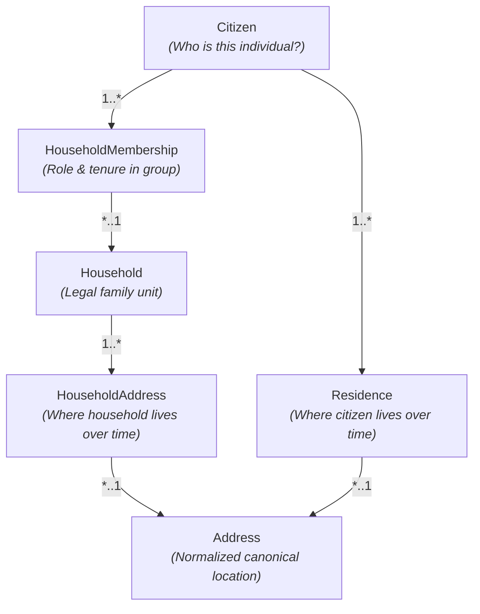
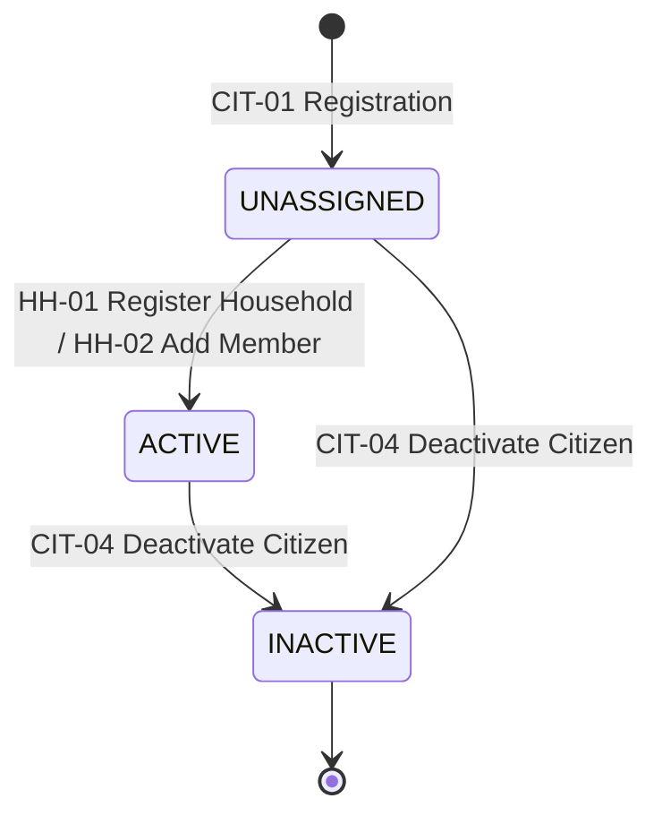
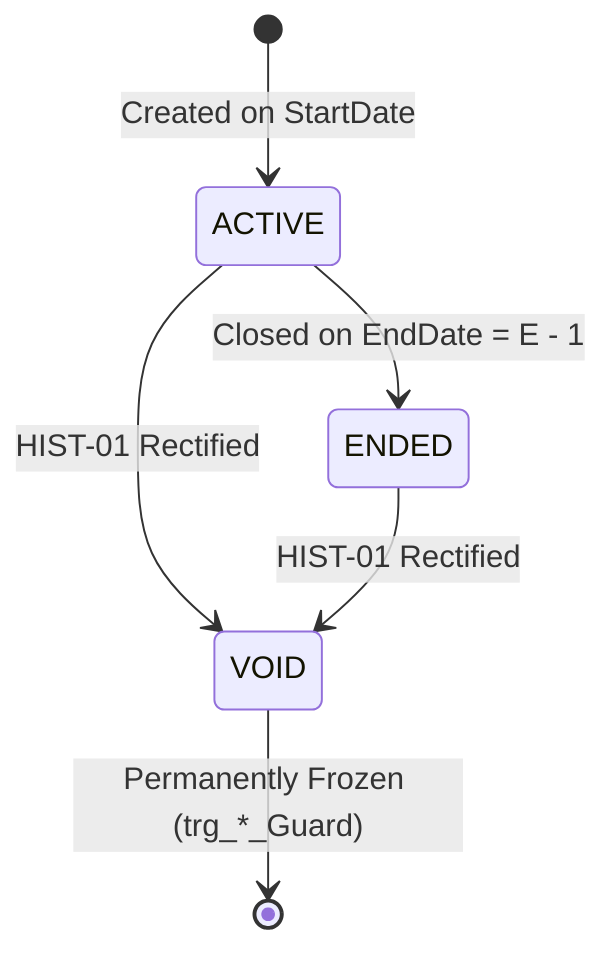
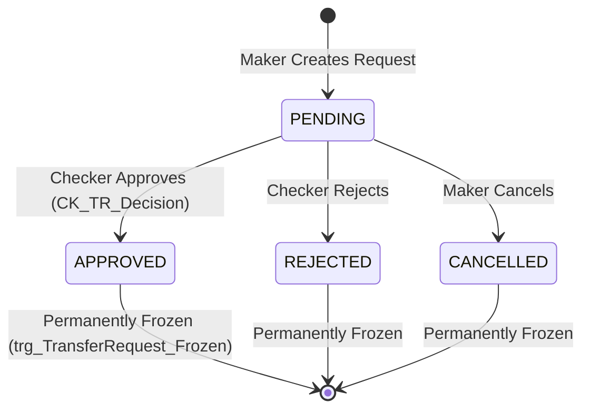

# ARIS Domain Model & Entity Reference

**Document Code:** `DOM-ARIS-v2.0`  
**Single Source of Truth:** Schema v2 ([`../aris_schema_v2.sql`](../aris_schema_v2.sql)) · [`golden-invariant.md`](golden-invariant.md)  
**Visual Diagrams:** [`../erd_v2.svg`](../erd_v2.svg) · [`../erd_v2.png`](../erd_v2.png)

---

## 1. Core Mental Model & Decoupling Rationale

The ARIS domain model strictly decouples **6 core concepts** to eliminate static foreign key anomalies and historical data loss:

### Why Static Keys are Prohibited

1. **No `Citizen.HouseholdId`:** An individual belongs to different households across distinct time intervals (e.g., childhood family household, adult household, marriage). Static foreign keys permanently overwrite tenure history.
2. **No `Citizen.CurrentAddressId`:** Residency is temporal ($StartDate \rightarrow EndDate$).
3. **No `Household.CurrentAddressId`:** When a household moves, overwriting the address column destroys the chronological record of where the household resided previously. Household addresses are tracked exclusively via append-only `HouseholdAddress` records.

---

## 2. Domain Entity Specifications

### 2.1. Citizen
Represents an individual managed within the administrative boundary.

| Property | Type | Nullable | Constraints & Defaults | Description |
|---|---|:---:|---|---|
| `CitizenId` | `int` | No | PK, IDENTITY(1,1) | Unique surrogate identifier. |
| `NationalId` | `char(12)` | No | UNIQUE, CHECK: 12 numeric digits | Canonical National ID number. |
| `FullName` | `nvarchar(100)` | No | Indexed | Legal full name. |
| `DateOfBirth` | `date` | No | — | Date of birth. |
| `Gender` | `varchar(10)` | No | CHECK: `MALE`, `FEMALE`, `OTHER` | Gender identifier. |
| `Status` | `varchar(12)` | No | CHECK: `UNASSIGNED`, `ACTIVE`, `INACTIVE` | Lifecycle status. |
| `CreatedAt` | `datetime2(3)` | No | DEFAULT `SYSUTCDATETIME()` | Creation timestamp. |
| `UpdatedAt` | `datetime2(3)` | No | DEFAULT `SYSUTCDATETIME()` | Last update timestamp. |
| `DeactivatedAt`| `datetime2(3)`| Yes | NULL | Timestamp of deactivation. |
| `RowVersion` | `rowversion` | No | Concurrency Token | Optimistic concurrency version. |

### 2.2. Household
Represents a legal administrative family unit.

| Property | Type | Nullable | Constraints & Defaults | Description |
|---|---|:---:|---|---|
| `HouseholdId` | `int` | No | PK, IDENTITY(1,1) | Unique surrogate identifier. |
| `Status` | `varchar(10)` | No | CHECK: `ACTIVE`, `INACTIVE` | Lifecycle status. |
| `CreatedAt` | `datetime2(3)` | No | DEFAULT `SYSUTCDATETIME()` | Creation timestamp. |
| `InactivatedAt`| `datetime2(3)`| Yes | NULL | Timestamp of inactivation. |
| `RowVersion` | `rowversion` | No | Concurrency Token | Optimistic concurrency version. |

### 2.3. HouseholdAddress
Append-only historical timeline of physical addresses occupied by a household.

| Property | Type | Nullable | Constraints & Defaults | Description |
|---|---|:---:|---|---|
| `HouseholdAddressId` | `int` | No | PK, IDENTITY(1,1) | Unique surrogate identifier. |
| `HouseholdId` | `int` | No | FK $\rightarrow$ `Household` | Associated household. |
| `AddressId` | `int` | No | FK $\rightarrow$ `Address` | Associated physical address. |
| `StartDate` | `date` | No | — | Start of address occupancy. |
| `EndDate` | `date` | Yes | NULL | End of occupancy. |
| `Status` | `varchar(10)` | No | CHECK: `ACTIVE`, `ENDED`, `VOID` | Tenure status. |
| `CreatedBy` | `int` | No | FK $\rightarrow$ `UserAccount` | User who opened record. |
| `CreatedAt` | `datetime2(3)` | No | DEFAULT `SYSUTCDATETIME()` | Creation timestamp. |
| `EndedBy` | `int` | Yes | FK $\rightarrow$ `UserAccount` | User who ended record. |
| `EndedAt` | `datetime2(3)` | Yes | NULL | Timestamp of ending. |
| `OpenedByRequestId` | `int` | Yes | FK $\rightarrow$ `TransferRequest` | Source transfer request. |
| `CorrectsHouseholdAddressId` | `int` | Yes | FK $\rightarrow$ `HouseholdAddress` | Prior voided record rectified. |
| `RowVersion` | `rowversion` | No | Concurrency Token | Optimistic concurrency token. |

- *Unique Constraint:* `UX_HA_OneActivePerHousehold` (Filtered: at most 1 `ACTIVE` address per household).

### 2.4. HouseholdMembership
Append-only tenure relationship between a Citizen and a Household.

| Property | Type | Nullable | Constraints & Defaults | Description |
|---|---|:---:|---|---|
| `MembershipId` | `int` | No | PK, IDENTITY(1,1) | Unique surrogate identifier. |
| `CitizenId` | `int` | No | FK $\rightarrow$ `Citizen` | Associated citizen. |
| `HouseholdId` | `int` | No | FK $\rightarrow$ `Household` | Associated household. |
| `Role` | `varchar(10)` | No | CHECK: `HEAD`, `MEMBER` | Role in household. |
| `StartDate` | `date` | No | — | Start date of membership. |
| `EndDate` | `date` | Yes | NULL | End date of membership. |
| `Status` | `varchar(10)` | No | CHECK: `ACTIVE`, `ENDED`, `VOID` | Membership status. |
| `CreatedBy` | `int` | No | FK $\rightarrow$ `UserAccount` | User who opened record. |
| `CreatedAt` | `datetime2(3)` | No | DEFAULT `SYSUTCDATETIME()` | Creation timestamp. |
| `EndedBy` | `int` | Yes | FK $\rightarrow$ `UserAccount` | User who ended record. |
| `EndedAt` | `datetime2(3)` | Yes | NULL | Timestamp of ending. |
| `OpenedByRequestId` | `int` | Yes | FK $\rightarrow$ `TransferRequest` | Source transfer request. |
| `CorrectsMembershipId` | `int` | Yes | FK $\rightarrow$ `HouseholdMembership` | Prior voided record rectified. |
| `RowVersion` | `rowversion` | No | Concurrency Token | Optimistic concurrency token. |

- *Constraints:* `UX_HM_OneActivePerCitizen` (at most 1 active membership system-wide), `UX_HM_OneActiveHeadPerHousehold` (at most 1 active head per household).

### 2.5. Address
Standardized geographic location with administrative boundary lineage tracking.

| Property | Type | Nullable | Constraints & Defaults | Description |
|---|---|:---:|---|---|
| `AddressId` | `int` | No | PK, IDENTITY(1,1) | Unique surrogate identifier. |
| `AddressCode` | `varchar(30)` | No | UNIQUE | Standardized administrative code. |
| `AddressLine` | `nvarchar(200)` | No | — | Street address details. |
| `Ward` | `nvarchar(100)` | No | — | Administrative Ward. |
| `District` | `nvarchar(100)` | Yes | NULL (legacy records) | Administrative District. |
| `Province` | `nvarchar(100)` | No | — | Administrative Province/City. |
| `AddressText` | `nvarchar(500)` | No | Computed Column | `CONCAT_WS(N', ', AddressLine, Ward, District, Province)` |
| `Status` | `varchar(10)` | No | CHECK: `ACTIVE`, `INACTIVE` | Validity status. |
| `ValidFrom` | `date` | No | — | Effective start date. |
| `ValidTo` | `date` | Yes | NULL | Effective end date. |
| `ReplacedByAddressId` | `int` | Yes | FK $\rightarrow$ `Address` (Self-ref) | Successor address for $N \rightarrow 1$ mergers. |
| `CreatedAt` | `datetime2(3)` | No | DEFAULT `SYSUTCDATETIME()` | Creation timestamp. |
| `DeactivatedAt`| `datetime2(3)`| Yes | NULL | Timestamp of deactivation. |
| `RowVersion` | `rowversion` | No | Concurrency Token | Optimistic concurrency token. |

### 2.6. Residence
Append-only occupancy of a Citizen at an Address over time.

| Property | Type | Nullable | Constraints & Defaults | Description |
|---|---|:---:|---|---|
| `ResidenceId` | `int` | No | PK, IDENTITY(1,1) | Unique surrogate identifier. |
| `CitizenId` | `int` | No | FK $\rightarrow$ `Citizen` | Associated citizen. |
| `AddressId` | `int` | No | FK $\rightarrow$ `Address` | Associated physical address. |
| `StartDate` | `date` | No | — | Start of residency. |
| `EndDate` | `date` | Yes | NULL | End of residency. |
| `Status` | `varchar(10)` | No | CHECK: `ACTIVE`, `ENDED`, `VOID` | Residency status. |
| `CreatedBy` | `int` | No | FK $\rightarrow$ `UserAccount` | User who opened record. |
| `CreatedAt` | `datetime2(3)` | No | DEFAULT `SYSUTCDATETIME()` | Creation timestamp. |
| `EndedBy` | `int` | Yes | FK $\rightarrow$ `UserAccount` | User who ended record. |
| `EndedAt` | `datetime2(3)` | Yes | NULL | Timestamp of ending. |
| `OpenedByRequestId` | `int` | Yes | FK $\rightarrow$ `TransferRequest` | Source transfer request. |
| `CorrectsResidenceId` | `int` | Yes | FK $\rightarrow$ `Residence` | Prior voided record rectified. |
| `RowVersion` | `rowversion` | No | Concurrency Token | Optimistic concurrency token. |

- *Unique Constraint:* `UX_Res_OneActivePerCitizen` (at most 1 active residence per citizen).

### 2.7. TransferRequest & TransferRequestItem
Header and line-item entities governing relocations under dual-control maker-checker rules.

#### TransferRequest (Header)
- `RequestId` (`int`, PK, IDENTITY)
- `RequestType` (`varchar(20)`: `JOIN_EXISTING`, `NEW_HOUSEHOLD`, `HOUSEHOLD_MOVE`)
- `SourceHouseholdId` (`int`, FK $\rightarrow$ `Household`)
- `DestinationHouseholdId` (`int`, FK $\rightarrow$ `Household`, nullable)
- `DestinationAddressId` (`int`, FK $\rightarrow$ `Address`, nullable)
- `EffectiveDate` (`date`)
- `NewHeadCitizenId` (`int`, FK $\rightarrow$ `Citizen`, nullable)
- `SuccessorHeadCitizenId` (`int`, FK $\rightarrow$ `Citizen`, nullable)
- `ResultHouseholdId` (`int`, FK $\rightarrow$ `Household`, nullable)
- `Status` (`varchar(10)`: `PENDING`, `APPROVED`, `REJECTED`, `CANCELLED`)
- `RequestedBy` (`int`, FK $\rightarrow$ `UserAccount`)
- `RequestedAt` (`datetime2(3)`)
- `DecidedBy` (`int`, FK $\rightarrow$ `UserAccount`, nullable)
- `DecidedAt` (`datetime2(3)`, nullable)
- `DecisionNote` (`nvarchar(500)`, nullable)
- `RowVersion` (`rowversion`)
- *Check Constraint:* `CK_TR_Decision` (`DecidedBy <> RequestedBy` when decided).

#### TransferRequestItem (Detail)
- `ItemId` (`int`, PK, IDENTITY)
- `RequestId` (`int`, FK $\rightarrow$ `TransferRequest`)
- `CitizenId` (`int`, FK $\rightarrow$ `Citizen`)
- `SourceMembershipId` (`int`, FK $\rightarrow$ `HouseholdMembership`)
- `SourceResidenceId` (`int`, FK $\rightarrow$ `Residence`)
- `Status` (`varchar(10)`: `PENDING`, `APPROVED`, `REJECTED`, `CANCELLED`)
- `RejectReason` (`nvarchar(300)`, nullable)
- `RowVersion` (`rowversion`)
- *Unique Constraint:* `UX_TRI_OneOpenPerCitizen` (citizen can belong to at most 1 `PENDING` item).

### 2.8. UserAccount, SystemConfiguration & AuditLog

- **`UserAccount`:** `UserId`, `Username`, `PasswordHash`, `FullName`, `Role` (`OFFICER`/`ADMIN`), `Status` (`ACTIVE`/`LOCKED`), `FailedLoginCount`, `LockedUntil`, `MustChangePassword`, `PasswordChangedAt`, `CreatedAt`, `RowVersion`.
- **`SystemConfiguration`:** `ConfigKey` (PK), `ConfigValue`, `Description`, `UpdatedAt`, `UpdatedBy` (FK).
- **`AuditLog`:** `AuditLogId` (`bigint`, PK), `ActorUserId` (FK), `AttemptedUsername`, `Action`, `EntityType`, `EntityId`, `OccurredAt`, `Result` (`SUCCESS`/`FAILURE`), `Details` (`nvarchar(max)`, valid JSON validated via `ISJSON`), `CorrelationId` (`uniqueidentifier`).

---

## 3. Entity Lifecycle State Machines

### 3.1. Citizen Lifecycle

### 3.2. Append-Only Tenure Entities (`Membership`, `Residence`, `HouseholdAddress`)

### 3.3. Transfer Request Lifecycle

---

## 4. Entity State Transition Matrix

State transitions not explicitly enumerated in this matrix are **prohibited**:

| Entity | Allowed States | Permitted Transitions | Enforcement Mechanism |
|---|---|---|---|
| **`Citizen`** | `UNASSIGNED`, `ACTIVE`, `INACTIVE` | `UNASSIGNED → ACTIVE` `ACTIVE → INACTIVE` `UNASSIGNED → INACTIVE` | `CK_Citizen_Lifecycle` |
| **`Household`** | `ACTIVE`, `INACTIVE` | `ACTIVE → INACTIVE` (when last member departs) | View `H4` invariant |
| **`Membership / Residence / HouseholdAddress`** | `ACTIVE`, `ENDED`, `VOID` | `ACTIVE → ENDED` `ACTIVE → VOID` `ENDED → VOID` *(VOID is permanently frozen)* | Triggers: `trg_*_Guard` (Errors 51001, 51011, 51021) |
| **`TransferRequest`** | `PENDING`, `APPROVED`, `REJECTED`, `CANCELLED` | `PENDING → APPROVED / REJECTED / CANCELLED` *(Decided requests are frozen)* | Trigger: `trg_TransferRequest_Frozen` (Error 51040) |
| **`TransferRequestItem`** | `PENDING`, `APPROVED`, `REJECTED`, `CANCELLED` | Mirrors parent resolution; can be rejected individually | `CK_TRI_Status` |
| **`Address`** | `ACTIVE`, `INACTIVE` | `ACTIVE → INACTIVE` (optionally sets `ReplacedByAddressId`) | `CK_Address_Lifecycle` |
| **`UserAccount`** | `ACTIVE`, `LOCKED` | Bidirectional | `CK_UserAccount_Status` |
