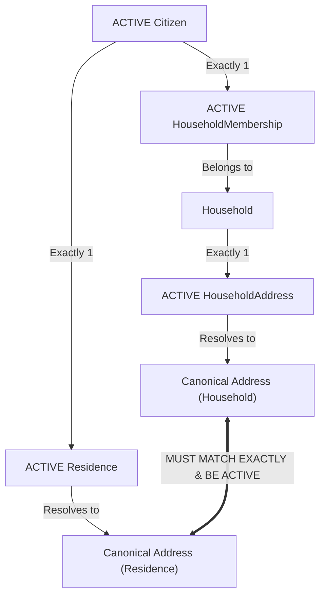

# The Golden Invariant Specification

**Document Code:** `INV-ARIS-v2.0`  
**Database View:** `dbo.vw_GoldenInvariantViolations` ([`../aris_schema_v2.sql`](../aris_schema_v2.sql#L577))  
**Integration Tests:** [`tests/Aris.Tests/GoldenInvariantTests.cs`](file:///C:/Users/Bryan/Documents/ARIS/tests/Aris.Tests/GoldenInvariantTests.cs)

---

## 1. Definition & Mathematical Formulation

The **Residency-Household Consistency Invariant** (the "Golden Invariant") represents the core data integrity contract of ARIS:

$$\forall c \in \text{Citizen} \mid \text{Status}(c) = \text{ACTIVE} \implies$$
$$\exists! m \in \text{HouseholdMembership} \mid \text{Citizen}(m) = c \land \text{Status}(m) = \text{ACTIVE}$$
$$\land \; \exists! r \in \text{Residence} \mid \text{Citizen}(r) = c \land \text{Status}(r) = \text{ACTIVE}$$
$$\land \; \exists! ha \in \text{HouseholdAddress} \mid \text{Household}(ha) = \text{Household}(m) \land \text{Status}(ha) = \text{ACTIVE}$$
$$\land \; \text{CanonicalAddress}(\text{Address}(r)) = \text{CanonicalAddress}(\text{Address}(ha))$$
$$\land \; \text{Status}(\text{CanonicalAddress}(\text{Address}(r))) = \text{ACTIVE}$$

### Plain Language Invariant Definition

> **Every `ACTIVE` citizen must belong to exactly one active household and have exactly one active residence whose canonical address matches their household's active canonical address.**



---

## 2. Canonical Address Resolution (`vw_AddressCanonical`)

When administrative borders shift, districts consolidate, or street naming reforms occur, physical locations receive new administrative codes. ARIS supports $N \rightarrow 1$ address mergers via `ReplacedByAddressId`.

The view `vw_AddressCanonical` uses a recursive Common Table Expression (CTE) to traverse `ReplacedByAddressId` lineages up to 20 levels deep to resolve the current canonical address:

```sql
WITH chain AS (
    SELECT a.AddressId AS OriginId, a.AddressId AS CurrentId, a.ReplacedByAddressId AS NextId, 0 AS Depth
    FROM dbo.Address a
    UNION ALL
    SELECT c.OriginId, n.AddressId, n.ReplacedByAddressId, c.Depth + 1
    FROM chain c
    JOIN dbo.Address n ON n.AddressId = c.NextId
    WHERE c.Depth < 20
)
SELECT c.OriginId AS AddressId, c.CurrentId AS CanonicalAddressId, a.Status AS CanonicalStatus
FROM chain c
JOIN dbo.Address a ON a.AddressId = c.CurrentId
WHERE c.NextId IS NULL;
```

A historical residence record referencing an older address ID remains legally valid as long as its terminal canonical address resolves to an `ACTIVE` address record.

---

## 3. The 9 Automated Invariant Checks

The database view `dbo.vw_GoldenInvariantViolations` continuously evaluates 9 failure conditions. After every committed business transaction, this view must return **0 rows**:

```sql
SELECT * FROM dbo.vw_GoldenInvariantViolations;
```

### 3.1. Citizen Invariants (`C1`–`C5`)

| Check Code | Violation Name | Detection Condition | Remediation Required |
|---|---|---|---|
| **`C1`** | `CITIZEN_NO_ACTIVE_MEMBERSHIP` | Citizen is `ACTIVE`, but has no `ACTIVE` record in `HouseholdMembership`. | Assign citizen to a household (`HH-01` or `HH-02`), or set citizen `UNASSIGNED`. |
| **`C2`** | `CITIZEN_NO_ACTIVE_RESIDENCE` | Citizen is `ACTIVE`, but has no `ACTIVE` record in `Residence`. | Create an active `Residence` matching their active household address. |
| **`C3`** | `CITIZEN_ADDRESS_MISMATCH` | Citizen's active `Residence` canonical address differs from their household's active canonical address. | Execute a relocation transfer (`UC-06`) or rectify the residency record (`HIST-01`). |
| **`C4`** | `CITIZEN_NOT_ACTIVE_BUT_ASSIGNED` | Citizen has `Status = 'UNASSIGNED'` or `'INACTIVE'`, yet holds an active `HouseholdMembership` or `Residence`. | Close lingering memberships/residences when deactivating citizen (`CIT-04`). |
| **`C5`** | `RESIDENCE_ADDRESS_NOT_ACTIVE` | Citizen's active `Residence` points to an address whose canonical address is `INACTIVE` (or whose lineage chain is severed). | Update household and member residences to the new active address. |

### 3.2. Household Invariants (`H1`–`H4`)

| Check Code | Violation Name | Detection Condition | Remediation Required |
|---|---|---|---|
| **`H1`** | `HOUSEHOLD_ACTIVE_NO_HEAD` | An `ACTIVE` household lacks exactly one member with `Role = 'HEAD'` and `Status = 'ACTIVE'`. | Designate an active head (`HH-04`). |
| **`H2`** | `HOUSEHOLD_ACTIVE_NO_MEMBERS` | An `ACTIVE` household contains zero active member records in `HouseholdMembership`. | Deactivate the household if empty, or add members (`HH-02`). |
| **`H3`** | `HOUSEHOLD_ACTIVE_NO_VALID_ADDRESS` | An `ACTIVE` household lacks an active `HouseholdAddress`, or its canonical address is `INACTIVE`. | Assign a valid `HouseholdAddress` (`HH-01` or `HOUSEHOLD_MOVE`). |
| **`H4`** | `HOUSEHOLD_INACTIVE_HAS_MEMBERS` | An `INACTIVE` household still contains active member rows in `HouseholdMembership`. | Transfer remaining members (`UC-06`) or deactivate lingering memberships. |

---

## 4. Automated Integration Test Verification

The integration test suite [`tests/Aris.Tests/GoldenInvariantTests.cs`](file:///C:/Users/Bryan/Documents/ARIS/tests/Aris.Tests/GoldenInvariantTests.cs) validates the invariant view through positive and negative test controls:

### Positive Test: Zero Invariant Violations
Asserts that the committed database state maintains complete relational consistency:

```csharp
[Fact]
public async Task GoldenInvariant_HasNoViolations()
{
    await using var conn = await TestDatabase.OpenConnectionAsync();
    await using var cmd = new SqlCommand("SELECT COUNT(*) FROM dbo.vw_GoldenInvariantViolations;", conn);
    var count = (int)(await cmd.ExecuteScalarAsync())!;
    Assert.Equal(0, count);
}
```

### Negative Control: Deliberate Invariant Violation Detection
Proves that the invariant view actively flags violations and cannot falsely pass:

```csharp
[Fact]
public async Task GoldenInvariant_DetectsDeliberateViolation()
{
    await using var conn = await TestDatabase.OpenConnectionAsync();
    await using var tx = conn.BeginTransaction();
    try
    {
        // Deliberately insert an ACTIVE citizen without household membership
        await using var insertCmd = new SqlCommand(@"
            INSERT INTO dbo.Citizen (NationalId, FullName, DateOfBirth, Gender, Status)
            VALUES ('999999999999', 'Test Invariant Citizen', '2000-01-01', 'MALE', 'ACTIVE');", conn, tx);
        await insertCmd.ExecuteNonQueryAsync();

        // Verify that the view flags violation C1 (CITIZEN_NO_ACTIVE_MEMBERSHIP)
        await using var checkCmd = new SqlCommand(@"
            SELECT ViolationCode FROM dbo.vw_GoldenInvariantViolations 
            WHERE ViolationCode = 'CITIZEN_NO_ACTIVE_MEMBERSHIP';", conn, tx);
        var violation = (string?)await checkCmd.ExecuteScalarAsync();
        Assert.Equal("CITIZEN_NO_ACTIVE_MEMBERSHIP", violation);
    }
    finally
    {
        await tx.RollbackAsync(); // Revert deliberate test corruption
    }
}
```
