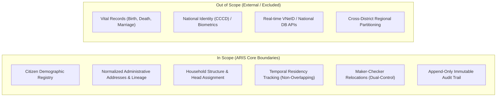
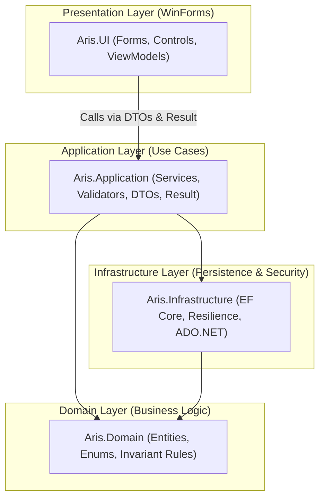
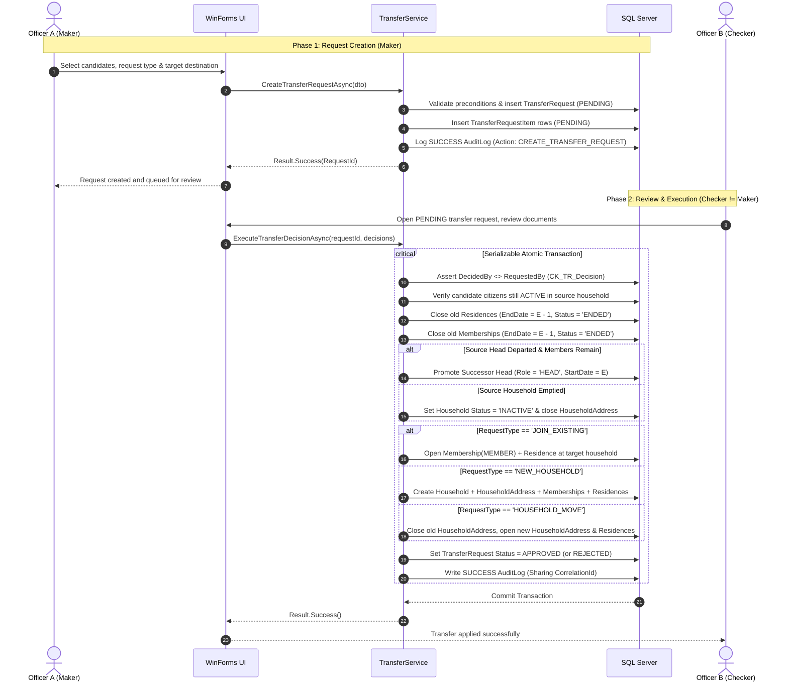

# Software Requirements Specification (SRS)

**Document Code:** `SRS-ARIS-v2.0`  
**Standard:** Aligned with IEEE 830 / ISO/IEC/IEEE 29148  
**Target Platform:** .NET 10 (C#) Windows Forms Desktop · Visual Studio 2026 · Microsoft SQL Server 2019+ · Entity Framework Core  
**Companion Documents:** [`domain-model.md`](domain-model.md) · [`golden-invariant.md`](golden-invariant.md) · [`../database/design-rationale.md`](../database/design-rationale.md)

---

## 1. Project Overview & Scope

### 1.1. System Vision
The **Administrative Residence Information System (ARIS)** is a Windows desktop application designed for local residence management officers. It streamlines citizen demographic lookup, household record-keeping, administrative address lineage, and dual-control residency relocations, underpinned by an append-only historical audit trail.

### 1.2. Scope & Boundaries

- **In Scope:**
  - Citizen demographic registry for residence administration (`UNASSIGNED`, `ACTIVE`, `INACTIVE`).
  - Standardized administrative addresses with historic boundary lineage (`Address Lineage`).
  - Household lifecycle management: head-of-household designation, member additions, and head reassignments.
  - Temporal residency tracking (start dates, end dates, non-overlapping intervals).
  - Two-phase maker-checker relocation workflow (`TransferRequest` + `TransferRequestItem`).
  - Append-only immutable audit trail and demographic/residency reporting.
- **Out of Scope:**
  - Civil status and vital statistics (birth certificates, death registrations, marriages).
  - Issuance or biometric capture of National Identity Cards (CCCD) or passports.
  - Direct real-time API integrations with the National Population Database or VNeID.
  - Geographic access partitioning (all officers operate within the administrative boundary).

---

## 2. User Roles & Stakeholders

| Role Code | Role Name | System Permissions & Responsibilities |
|---|---|---|
| **`OFFICER`** | **Residence Management Officer** | - Register and update citizen demographic records. - Create households, designate household heads, and assign members. - Initiate transfer requests as **Maker**. - Review, approve, or reject transfer requests as **Checker** (dual-control). - Query citizen, household, and address chronological histories. - Execute historical record rectifications (`VOID`). - Generate demographic distribution and residency movement reports. |
| **`ADMIN`** | **System Administrator** | - Manage user accounts (create officers, lock/unlock accounts, reset credentials). - Configure system parameters (`PASSWORD_MIN_LENGTH`, `MAX_FAILED_LOGINS`, `LOCKOUT_MINUTES`, `SESSION_TIMEOUT_MINUTES`). - Inspect system-wide immutable audit logs (`dbo.AuditLog`). |

---

## 3. System Architecture & Architectural Constraints

### 3.1. Layered Architecture

ARIS strictly enforces a 4-layer dependency model:

> [!IMPORTANT]
> **Architectural Boundary Rule:** UI forms and view models must **never** reference `ArisDbContext` or execute direct SQL. All mutations and business invariants reside in the Application layer, returning [`Result<T>`](file:///C:/Users/Bryan/Documents/ARIS/src/Aris.Application/Common/Result.cs).

### 3.2. Technical Constraints

- **`CON-PROJ-01` (Platform):** Built with .NET 10 (C#) WinForms desktop UI, EF Core, and SQL Server 2019+.
- **`CON-SEC-01` (Credential Security):** Plaintext passwords are strictly prohibited; passwords must be hashed with salt (PBKDF2/BCrypt).
- **`CON-SEC-02` (Secret Management):** Connection strings and secrets must never be committed to source control; use user-secrets or environment variables.
- **`CON-AUTH-01` (Authentication):** System authentication is required for all operations.
- **`CON-AUTH-02` (Authorization):** Role-based authorization (`OFFICER` vs `ADMIN`) enforced at the service level.
- **`CON-TRANS-01` (Transaction Isolation):** Multi-table mutations must execute within an atomic transaction (`IsolationLevel.Serializable` for relocations).
- **`CON-CONC-01` (Concurrency):** All mutable entities map `RowVersion` (`rowversion`) to support optimistic concurrency conflict detection (`DbUpdateConcurrencyException`).

---

## 4. Functional Requirements Catalog

### 4.1. Authentication & System Administration

- **`AUTH-01` (User Login):** Validate username and password; enforce account lockout after `MAX_FAILED_LOGINS` failures for `LOCKOUT_MINUTES`; enforce mandatory password change when `MustChangePassword = 1`; initialize user session context.
- **`ACC-01` (Manage Accounts):** Administrators can register officers, lock or unlock accounts, toggle active status, and reset passwords with mandatory change on next login.
- **`PERM-01` (Role Authorization):** Enforce screen and service-level access control based on user role (`OFFICER` vs `ADMIN`).
- **`AUD-01` (View Audit Logs):** Administrative interface to filter and view immutable audit entries by date range, actor, entity type, action, and outcome.
- **`SYS-01` (System Configuration):** Administrative interface to manage key-value system settings in `dbo.SystemConfiguration`.

### 4.2. Citizen Management

- **`CIT-01` (Create Citizen):** Register an individual with mandatory attributes (`NationalId`, `FullName`, `DateOfBirth`, `Gender`). Citizen is initialized with `Status = 'UNASSIGNED'`.
- **`CIT-02` (View Citizen Profile):** View citizen demographics, current household, canonical address, and complete chronological residency timeline.
- **`CIT-03` (Update Citizen Demographics):** Update non-identifying demographic attributes. Writes a full before/after audit snapshot.
- **`CIT-04` (Deactivate Citizen):** Transition citizen to `INACTIVE`.
  - If citizen is household `HEAD` with remaining members, a successor head must be designated.
  - Closes active `HouseholdMembership` and `Residence` records (`EndDate = E - 1, Status = 'ENDED'`).
  - If citizen is the sole member, the household becomes `INACTIVE` and its active `HouseholdAddress` is closed.

### 4.3. Address Management

- **`ADR-01` (Create Address):** Register an administrative address (`AddressLine`, `Ward`, `District`, `Province`). System computes canonical `AddressText`.
- **`ADR-02` (Search & View Address):** Query addresses and inspect currently residing households and citizens.
- **`ADR-03` (Update Address & Lineage):** When administrative boundaries change, old address becomes `INACTIVE` with `ReplacedByAddressId` pointing to the new address. Historical residency records remain untouched.

### 4.4. Household & Residence Management

- **`HH-01` (Register Household):** Atomic composite operation:
  1. Insert `Household(ACTIVE)` and `HouseholdAddress(ACTIVE, StartDate = E)`.
  2. Select an `UNASSIGNED` citizen to serve as initial `HEAD`.
  3. Insert `HouseholdMembership(Role = 'HEAD', Status = 'ACTIVE', StartDate = E)`.
  4. Insert `Residence(Status = 'ACTIVE', StartDate = E)` at the household address.
  5. Update `Citizen.Status = 'ACTIVE'`.
- **`HH-02` (Add Household Member):** Assign an `UNASSIGNED` citizen to an `ACTIVE` household:
  1. Insert `HouseholdMembership(Role = 'MEMBER', Status = 'ACTIVE', StartDate = E)`.
  2. Insert `Residence(Status = 'ACTIVE', StartDate = E)` at the household's active address.
  3. Update `Citizen.Status = 'ACTIVE'`.
- **`HH-03` (Remove Household Member):** Member departures only occur via Transfer (`HH-05`) or Deactivation (`CIT-04`) to prevent orphaned citizens.
- **`HH-04` (Change Household Head):** Append-only head reassignment:
  1. Close former head (`Role = 'HEAD', EndDate = E - 1, Status = 'ENDED'`).
  2. Close successor member (`Role = 'MEMBER', EndDate = E - 1, Status = 'ENDED'`).
  3. Open new member for former head (`Role = 'MEMBER', StartDate = E, Status = 'ACTIVE'`).
  4. Open new head for successor (`Role = 'HEAD', StartDate = E, Status = 'ACTIVE'`).
- **`HH-06` (View Household History):** Inspect timelines of address changes and member tenures.
- **`RES-01` / `RES-02` (Register / End Residence):** Internal atomic steps within composite transactions (`HH-01`, `HH-02`, `HH-05`, `CIT-04`). Standalone execution is prohibited.
- **`RES-03` (View Current Residence):** Retrieve validated current residence address.
- **`HIST-01` (Void and Rectify Record):** Mark erroneous record `Status = 'VOID'` and insert corrected row with `Corrects...Id` referencing the voided record.

### 4.5. Search & Reporting

- **`SRCH-01` (Search Citizens):** Search by National ID, full name (case/accent insensitive), or lifecycle status.
- **`SRCH-02` (Search Households):** Search by Household ID, head name, head National ID, or address text.
- **`SRCH-03` (Search Addresses):** Search by street name, ward, district, or province.
- **`RPT-01` (Demographic Distribution Report):** Aggregate resident counts by administrative hierarchy using `vw_AddressCanonical`.
- **`RPT-02` (Household Summary Report):** Total active/inactive households, average household size, and single-member household counts.
- **`RPT-03` (Residency Movement Report):** Track residency movements over a specified date range (registrations, transfers, deactivations).

---

## 5. Core Use Case: UC-06 — Transfer Household & Residence (`HH-05`)

| Attribute | Specification |
|---|---|
| **Primary Actor** | Residence Management Officer (`OFFICER`) |
| **Transaction Scope** | Atomic Transaction with `IsolationLevel.Serializable` |
| **Participating Tables** | `TransferRequest`, `TransferRequestItem`, `Citizen`, `Household`, `HouseholdAddress`, `HouseholdMembership`, `Residence`, `AuditLog` |

### 5.1. Preconditions
1. Maker (Officer A) is authenticated.
2. Candidate citizens are `ACTIVE` members of the source household and hold active residences.
3. Candidate citizens have no other open `PENDING` request items (`UX_TRI_OneOpenPerCitizen`).
4. Effective date $E$ is strictly greater than the `StartDate` of any record being closed ($E > \text{StartDate}$).
5. Preconditions by request type:
   - `JOIN_EXISTING`: Target household is `ACTIVE` with a valid active address.
   - `NEW_HOUSEHOLD`: Target address is `ACTIVE`; a designated new head is selected from the moving members.
   - `HOUSEHOLD_MOVE`: Request includes **all** active members of the household.
6. If the source head departs while other members remain, a valid `SuccessorHeadCitizenId` is specified.

### 5.2. Two-Phase Maker-Checker Sequence

### 5.3. Alternative Flows & Exception Handling
- **A1 (Entire Household Moves - `HOUSEHOLD_MOVE`):** Preserves `HouseholdId` and memberships. Replaces `HouseholdAddress` and creates new `Residence` records.
- **A3 (Departing Head with Remaining Members):** Promotes `SuccessorHeadCitizenId` append-only on date $E$.
- **A4 (Partial Item Approval):** Rejected members remain in the source household; approved members proceed with relocation.
- **E1 (Maker Tries to Self-Approve):** Check constraint `CK_TR_Decision` (`DecidedBy <> RequestedBy`) aborts the update.
- **E2 (Concurrency Conflict):** Mapped `RowVersion` raises `DbUpdateConcurrencyException`. The transaction aborts and prompts user to refresh stale records.
- **E3 (Database Failure):** Immediate `ROLLBACK`, followed by independent `FAILURE` audit logging on a fresh connection.
