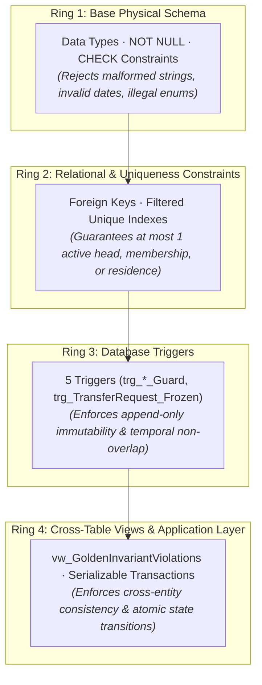

# Database Design Rationale & Architectural Decision Log

**Document Code:** `DB-DESIGN-v2.0`  
**Target Engine:** Microsoft SQL Server 2019+ (Azure SQL / Local Docker)  
**Schema Script:** [`../aris_schema_v2.sql`](../aris_schema_v2.sql)  
**Visual Diagrams:** [`../erd_v2.svg`](../erd_v2.svg) · [`../erd_v2.png`](../erd_v2.png)

---

## 1. Concentric Defense Rings Architecture

ARIS organizes data integrity into **4 concentric defense rings**, evaluating from the least expensive check to the most comprehensive:

---

## 2. Architectural Decision Log (D1–D14)

### `D1`: Dual-Control Maker-Checker Restricted to Relocations
- **Context:** Relocations carry high risks of cross-household corruption, unauthorized citizen displacement, or fraud. Routine demographic updates are high-frequency and low-risk.
- **Decision:** Maker-checker verification is enforced strictly on `TransferRequest` via check constraint `CK_TR_Decision` (`DecidedBy <> RequestedBy`). All other operations (demographics, head changes) are single-officer actions protected by immutable audit logging.
- **Consequences:** Ensures administrative integrity for critical relocations without imposing excessive operational overhead on daily demographic maintenance.

### `D2`: Tri-State Citizen Lifecycle Status
- **Context:** If a citizen requires an active household upon creation, how can an officer register a citizen before household assignment?
- **Decision:** Introduce `UNASSIGNED` as the initial citizen state. Citizens transition `UNASSIGNED → ACTIVE` upon household registration (`HH-01`) or member addition (`HH-02`).
- **Consequences:** Eliminates the circular dependency dilemma while maintaining the Golden Invariant (which applies exclusively to `ACTIVE` citizens).

### `D3`: Append-Only Temporal History
- **Context:** In-place updates on tenure and residency records destroy historical legal truth and make audit investigations impossible.
- **Decision:** `HouseholdMembership`, `Residence`, and `HouseholdAddress` are strictly append-only. No in-place `UPDATE` on identity columns, roles, or start dates. Historical errors are rectified by marking rows `VOID` and creating correcting records with `Corrects...Id`.
- **Consequences:** Guarantees tamper-evident historical auditability. Requires close-and-open mechanics for all role or address modifications.

### `D4`: Removal of Static `Household.CurrentAddressId`
- **Context:** Storing `CurrentAddressId` directly on `Household` creates dual sources of truth with `HouseholdAddress` and destroys move histories.
- **Decision:** Drop `CurrentAddressId` from `Household`. Current addresses are resolved dynamically via the filtered view `vw_HouseholdCurrent`.
- **Consequences:** Eliminates synchronization anomalies; household address history is centralized in `HouseholdAddress`.

### `D5`: Unified Tri-Modal Relocation Schema
- **Context:** Relocations take multiple forms: individual member transfers, splitting to form a new household, and whole-family address changes.
- **Decision:** Consolidate all moves into `TransferRequest` with three explicit shapes: `JOIN_EXISTING`, `NEW_HOUSEHOLD`, and `HOUSEHOLD_MOVE`. Individual movers are captured in `TransferRequestItem`, permitting partial item approvals.
- **Consequences:** Unified approval workflow and UI; supports granular approval or rejection per household member.

### `D6`: Traceable Verification Lineage
- **Context:** Determining why a residency record exists previously required complex audit log analysis.
- **Decision:** State changes created by relocations store `OpenedByRequestId`. Historical rows track `CreatedBy` and `EndedBy`. Redundant `VerifiedBy` fields are removed.
- **Consequences:** Direct foreign-key lineage from any current or historical residency record back to its originating transfer approval.

### `D7`: Independent Post-Rollback Failure Auditing
- **Context:** When a multi-table database transaction fails and rolls back, any audit entry written inside the transaction is discarded.
- **Decision:** On transaction failure, execute `RollbackAsync()`, then write the failure audit log using `LogFailureIndependentAsync()` on an independent database connection.
- **Consequences:** Guarantees that failure events survive rollbacks without violating transaction isolation boundaries.

### `D8`: Normalized Administrative Address Hierarchy
- **Context:** Freeform text addresses prevent aggregation and regional demographic reporting.
- **Decision:** Decompose addresses into `AddressLine`, `Ward`, `District` (nullable for legacy), and `Province`. Expose `AddressText` as a computed column using `CONCAT_WS`.
- **Consequences:** Enables structured regional grouping for demographic reports (`RPT-01`) while providing human-readable formatted addresses.

### `D9`: Address Lineage via Self-Referencing $N \rightarrow 1$ Mergers
- **Context:** Administrative boundary reorganizations change ward names without physically moving residents.
- **Decision:** When boundaries change, mark old address `INACTIVE` with `ReplacedByAddressId` pointing to the new address. Never mutate historical residency records.
- **Consequences:** Preserves historical legal records; recursive view `vw_AddressCanonical` resolves the current active address seamlessly.

### `D10`: Enhanced User Account Security
- **Context:** Desktop administrative applications require lockout defenses against brute-force attacks.
- **Decision:** `UserAccount` includes `FailedLoginCount`, `LockedUntil`, `MustChangePassword`, and `PasswordChangedAt`. System distinguishes `OFFICER` vs `ADMIN`.
- **Consequences:** Meets security standards (`CON-SEC-01`, `CON-AUTH-01`) without external identity server dependencies.

### `D11`: Dynamic System Configuration Table
- **Context:** Operational parameters (lockout duration, password length, session timeout) should not require code recompilation.
- **Decision:** Seed system parameters in key-value table `SystemConfiguration`.
- **Consequences:** Administrative configurability with built-in auditability.

### `D12`: Least-Privilege Database Application Role (`aris_app`)
- **Context:** Direct connection from desktop clients must not have permissions to truncate tables or destroy audit logs.
- **Decision:** Application connects via role `aris_app` with `GRANT SELECT, INSERT, UPDATE ON SCHEMA::dbo`, `DENY DELETE ON SCHEMA::dbo`, and `DENY UPDATE ON dbo.AuditLog`.
- **Consequences:** Even malicious or compromised client code cannot delete records or alter historical audits (`DENY` overrides `GRANT`).

### `D13`: Automated Invariant Database Views
- **Context:** Complex cross-table business rules must be verifiable continuously during development and testing.
- **Decision:** Create canonical views: `vw_AddressCanonical`, `vw_HouseholdCurrent`, and `vw_GoldenInvariantViolations` (9 checks: `C1`–`C5`, `H1`–`H4`).
- **Consequences:** Enables automated integration testing (`Assert.Equal(0, count)`) against the live database.

### `D14`: Optimistic Concurrency Control across All Mutable Tables
- **Context:** Multiple officers working simultaneously could overwrite state without detection.
- **Decision:** Add `RowVersion` (`rowversion`) to all 9 mutable tables and configure `.IsRowVersion()` in EF Core.
- **Consequences:** Prevents lost updates by throwing `DbUpdateConcurrencyException` upon concurrency collisions.

---

## 3. Layer Responsibility Matrix

| Business Rule | DB Enforced? | Enforcement Mechanism | Failure Response |
|---|:---:|---|---|
| At most 1 `ACTIVE` residence per citizen | ✔ | Filtered unique index `UX_Res_OneActivePerCitizen` | SQL Exception (Duplicate key) |
| At most 1 `ACTIVE` membership per citizen | ✔ | Filtered unique index `UX_HM_OneActivePerCitizen` | SQL Exception (Duplicate key) |
| At most 1 `ACTIVE` head per household | ✔ | Filtered unique index `UX_HM_OneActiveHeadPerHousehold` | SQL Exception (Duplicate key) |
| At most 1 `ACTIVE` address per household | ✔ | Filtered unique index `UX_HA_OneActivePerHousehold` | SQL Exception (Duplicate key) |
| Citizen in at most 1 `PENDING` transfer item | ✔ | Filtered unique index `UX_TRI_OneOpenPerCitizen` | SQL Exception (Duplicate key) |
| Status synchronized with `EndDate` / `EndedAt` | ✔ | `CK_*_Lifecycle` constraints | SQL Exception (CHECK constraint) |
| Valid transfer payload & Maker $\ne$ Checker | ✔ | `CK_TR_Shape`, `CK_TR_Decision` constraints | SQL Exception (CHECK constraint) |
| Append-only history & frozen decided requests | ✔ | Triggers: `trg_*_Guard`, `trg_TransferRequest_Frozen` | Custom Trigger Errors (51001–51040) |
| Non-overlapping temporal intervals | ◐ | Trigger reads committed state; requires `IsolationLevel.Serializable` | Custom Trigger Errors (51002, 51012, 51022) |
| Immutable audit trail | ✔ | Trigger `trg_AuditLog_AppendOnly` + Role `DENY UPDATE` | Database Permission / Trigger Error 51030 |
| Active household must have $\ge 1$ head & member | ✘ | Application Layer Service + View `vw_GoldenInvariantViolations` (`H1`, `H2`) | Service returns `Result.Failure(...)` |
| Active citizen must have active membership & residence | ✘ | Application Layer Service + View `vw_GoldenInvariantViolations` (`C1`, `C2`, `C4`) | Service returns `Result.Failure(...)` |
| Active residence matches active household address | ✘ | Application Layer Service + View `vw_GoldenInvariantViolations` (`C3`, `H3`) | Service returns `Result.Failure(...)` |

> [!NOTE]
> Database constraints evaluate committed rows. During an in-flight multi-step transaction, transient intermediate states (e.g. promoting a successor head before closing the previous head) are fully permissible prior to `COMMIT`.
