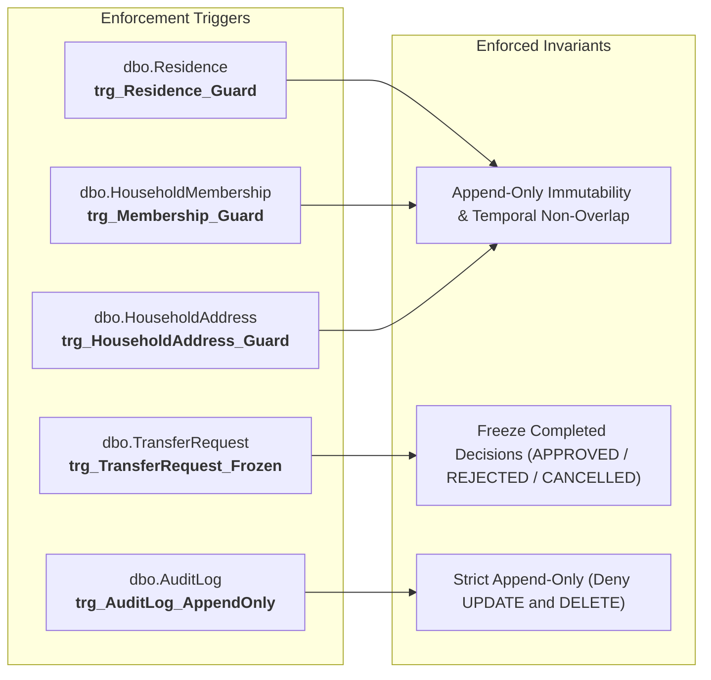

# Database Triggers, Error Codes & Security Architecture

**Document Code:** `DB-SECURITY-v2.0`  
**Target Engine:** Microsoft SQL Server 2019+ · Azure SQL Database  
**Schema Script:** [`../aris_schema_v2.sql`](../aris_schema_v2.sql)

---

## 1. Database Triggers (Defense Layer 3)

SQL Server triggers provide defense-in-depth enforcement against application bugs and improper data modifications. The ARIS schema deploys **5 specialized triggers**:



---

## 2. Trigger Mechanics & Execution Flow

```mermaid
flowchart TD
    Start["DML Operation (INSERT / UPDATE)"] --> CheckTable{"Target Table?"}
    
    CheckTable -->|AuditLog| AuditCheck{"Operation == INSERT?"}
    AuditCheck -->|No (UPDATE/DELETE)| Raise51030["ROLLBACK & THROW 51030<br>(AuditLog is strictly append-only)"]
    AuditCheck -->|Yes| AllowOp["ALLOW OPERATION"]

    CheckTable -->|TransferRequest| CheckFrozen{"Prior Status In<br>(APPROVED, REJECTED, CANCELLED)?"}
    CheckFrozen -->|Yes| Raise51040["ROLLBACK & THROW 51040<br>(Decided request is permanently frozen)"]
    CheckFrozen -->|No| AllowOp

    CheckTable -->|Tenure Tables| CheckIdentity{"Identity/StartDate Changed?"}
    CheckIdentity -->|Yes| Raise510x1["ROLLBACK & THROW 510x1<br>(Append-only identity violation)"]
    CheckIdentity -->|No| CheckOverlap{"Temporal Interval Overlaps<br>Existing Non-VOID Row?"}
    CheckOverlap -->|Yes| Raise510x2["ROLLBACK & THROW 510x2<br>(Temporal overlap violation)"]
    CheckOverlap -->|No| AllowOp
```

### 2.1. Append-Only Guard Rules (`trg_*_Guard`)
Applies to `Residence`, `HouseholdMembership`, and `HouseholdAddress`:
1. **Identity Immutability:** Any `UPDATE` statement that alters `CitizenId`, `HouseholdId`, `AddressId`, `Role`, or `StartDate` triggers an immediate `ROLLBACK` and raises error `51001`, `51011`, or `51021`.
2. **Frozen VOID Records:** Records with `Status = 'VOID'` cannot be updated under any circumstances.
3. **Ended Record Transitions:** Records with `Status = 'ENDED'` can only transition to `'VOID'` (rectification).

### 2.2. Temporal Non-Overlap Rules
When inserting or updating a non-`VOID` record, the trigger inspects existing non-`VOID` records for that citizen or household. If:
$$[StartDate_A, EndDate_A] \cap [StartDate_B, EndDate_B] \ne \emptyset$$
the trigger aborts the transaction with error `51002`, `51012`, or `51022`. Open-ended intervals (`EndDate IS NULL`) are evaluated through infinity.

---

## 3. Standardized Trigger Error Code Reference

Reference these standardized error codes in exception handlers, unit tests, and integration assertions:

| Error Code | Severity | Source Trigger | Condition / Violation Meaning | Remediation Action |
|---|:---:|---|---|---|
| **`51001`** | 16 | `trg_Residence_Guard` | Identity columns altered or invalid state transition on `Residence`. | Close existing record (`EndDate = E - 1`) and insert new row (`StartDate = E`). |
| **`51002`** | 16 | `trg_Residence_Guard` | Temporal residency overlap detected for the citizen. | Ensure effective date $E > StartDate$ and adjust dates to prevent overlap. |
| **`51011`** | 16 | `trg_Membership_Guard` | Identity or role altered in-place on `HouseholdMembership`. | Use close-and-open pattern for role changes; do not update in-place. |
| **`51012`** | 16 | `trg_Membership_Guard` | Temporal membership overlap detected for the citizen. | Ensure existing membership is ended before opening a new one. |
| **`51021`** | 16 | `trg_HouseholdAddress_Guard` | Identity or start date mutated on `HouseholdAddress`. | End old address record and insert new address record. |
| **`51022`** | 16 | `trg_HouseholdAddress_Guard` | Temporal address overlap detected for the household. | Verify that prior address is closed prior to new address effective date. |
| **`51030`** | 16 | `trg_AuditLog_AppendOnly` | Attempted `UPDATE` or `DELETE` on `dbo.AuditLog`. | Audit logs are write-only. Write new audit records; do not modify existing ones. |
| **`51040`** | 16 | `trg_TransferRequest_Frozen` | Attempted update on a decided `TransferRequest`. | Create a new transfer request; resolved requests cannot be reopened. |

---

## 4. Least-Privilege Security Role (`aris_app`)

The application connects to SQL Server using a dedicated account assigned to the least-privilege role **`aris_app`**:

```sql
IF DATABASE_PRINCIPAL_ID('aris_app') IS NULL
    CREATE ROLE aris_app;

-- Grant standard operational permissions
GRANT SELECT, INSERT, UPDATE ON SCHEMA::dbo TO aris_app;

-- Deny destructive operations
DENY DELETE ON SCHEMA::dbo TO aris_app;       -- History cannot be physically deleted
DENY UPDATE ON dbo.AuditLog TO aris_app;      -- Audit logs are strictly INSERT and SELECT
```

> [!IMPORTANT]
> In Microsoft SQL Server, **`DENY` takes absolute precedence over `GRANT`**. Even if an application service or developer query inadvertently attempts a SQL `DELETE` or `UPDATE AuditLog`, the database engine unconditionally rejects the command.

---

## 5. Entity Framework Core Configuration Requirements

When mapping the domain model with EF Core in `src/Aris.Infrastructure/Persistence/Configurations/`:

### 5.1. Trigger Declaration (EF Core 7+)
Tables protected by database triggers must declare `.ToTable(t => t.HasTrigger("..."))` to prevent EF Core from attempting unsupported `OUTPUT` clauses during batch `SaveChanges`:

```csharp
builder.ToTable("Residence", t => t.HasTrigger("trg_Residence_Guard"));
builder.ToTable("HouseholdMembership", t => t.HasTrigger("trg_Membership_Guard"));
builder.ToTable("HouseholdAddress", t => t.HasTrigger("trg_HouseholdAddress_Guard"));
builder.ToTable("TransferRequest", t => t.HasTrigger("trg_TransferRequest_Frozen"));
builder.ToTable("AuditLog", t => t.HasTrigger("trg_AuditLog_AppendOnly"));
```

### 5.2. Optimistic Concurrency (`RowVersion`)
All **9 mutable tables** must map `RowVersion`:

```csharp
builder.Property(e => e.RowVersion).IsRowVersion();
```
*(Note: `AuditLog` and `SystemConfiguration` do not contain `RowVersion`).*

### 5.3. Computed Column Mapping
`Address.AddressText` must be mapped as a database-generated computed column:

```csharp
builder.Property(a => a.AddressText)
       .HasComputedColumnSql("CONCAT_WS(N', ', AddressLine, Ward, District, Province)");
```

### 5.4. Composite Foreign Key Mappings
`TransferRequestItem` maps composite foreign keys pointing to `(MembershipId, CitizenId)` and `(ResidenceId, CitizenId)`:

```csharp
builder.HasOne<HouseholdMembership>()
       .WithMany()
       .HasForeignKey(i => new { i.SourceMembershipId, i.CitizenId });

builder.HasOne<Residence>()
       .WithMany()
       .HasForeignKey(i => new { i.SourceResidenceId, i.CitizenId });
```

### 5.5. Delete Behavior Policy
Because `aris_app` enforces `DENY DELETE`, never configure cascade deletes in EF Core mappings. Configure relationships using `DeleteBehavior.Restrict` or `DeleteBehavior.NoAction`.
