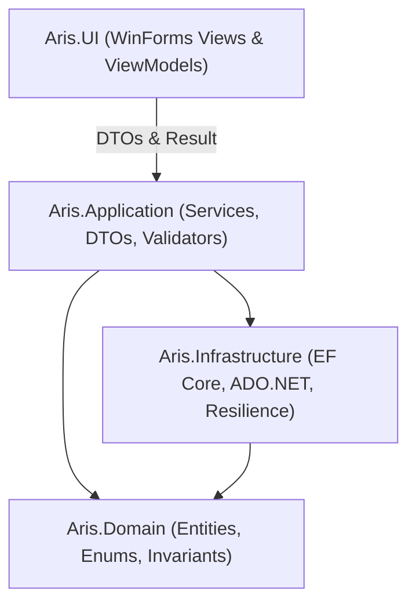
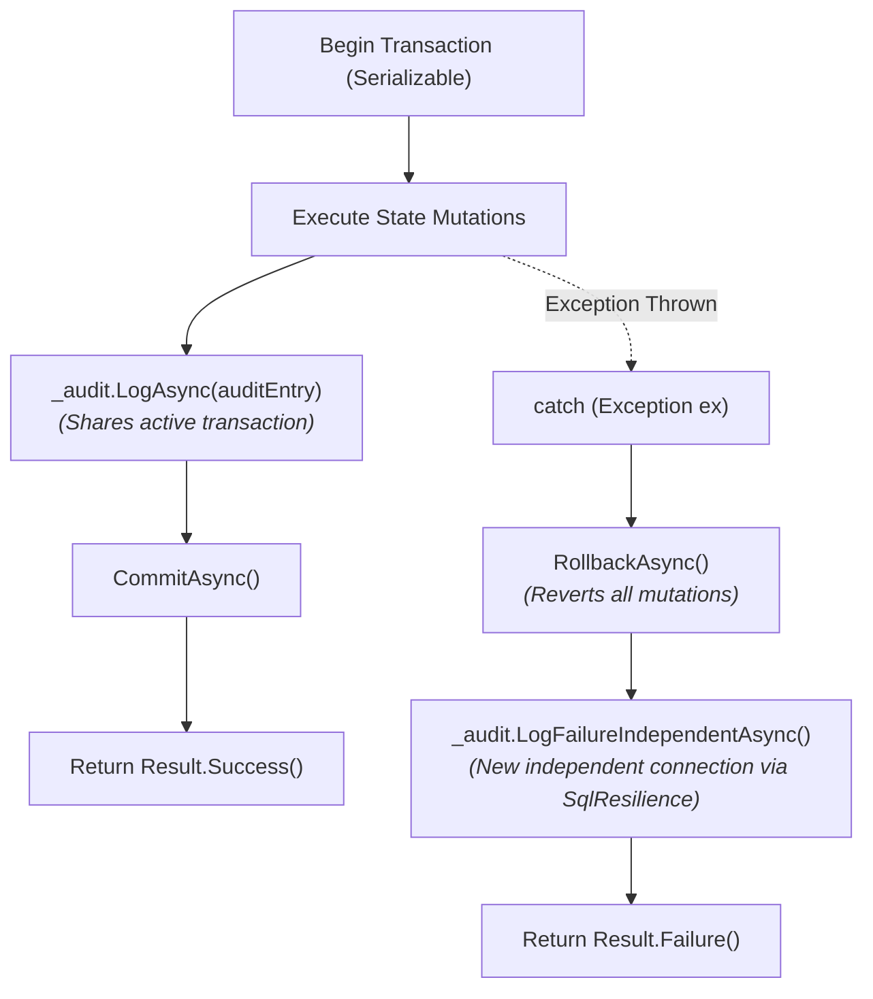

# Team Coding Conventions & Development Standards

**Document Code:** `STD-CODE-v2.0`  
**Applies to:** All Services, ViewModels, and Infrastructure Code  
**Single Source of Truth:** [`ai-coding-guidelines.md`](ai-coding-guidelines.md) · [`pr-review-checklist.md`](pr-review-checklist.md)

---

## 1. Architectural Layering & Error Handling Policy

### 1.1. Strict Layering Dependency Rule



- **Zero SQL or `DbContext` in UI:** WinForms controls only invoke Application service interfaces via DTOs and [`Result<T>`](file:///C:/Users/Bryan/Documents/ARIS/src/Aris.Application/Common/Result.cs).
- **No Domain Entities Exposed to UI:** Application services map internal domain entities to lightweight DTO records before returning data to the presentation layer.

### 1.2. Error Handling Policy

| Error Classification | Scenario | Required Handling |
|---|---|---|
| **Expected Business Failures** | Validation errors, entity not found, rule conflicts, authorization rejections | **Return [`Result<T>.Failure(...)`](file:///C:/Users/Bryan/Documents/ARIS/src/Aris.Application/Common/Result.cs)**. Do not throw exceptions for routine business outcomes. |
| **Malformed Inputs / Guard Violations** | Null arguments, programming bugs, corrupt internal states | Throw [`ValidationException`](file:///C:/Users/Bryan/Documents/ARIS/src/Aris.Application/Common/ValidationException.cs) or `ArgumentNullException`. |
| **Unexpected Infrastructure Failures** | Database network disconnection, timeout, OS fault | Propagate to the transaction boundary; execute `RollbackAsync()`. |

---

## 2. Cross-Cutting Audit Logging Protocol

Every state-altering business mutation must write an audit record to `dbo.AuditLog` (`BR-AUD-01`).

### The Two Logging Patterns



| Method | Invocation Context | Connection Used | Target Outcome |
|---|---|---|---|
| **`_audit.LogAsync(...)`** | Inside business transaction, **before** `CommitAsync` | Current caller's transaction | Records `SUCCESS` audit trail |
| **`_audit.LogFailureIndependentAsync(...)`** | Inside `catch`, **after** `RollbackAsync` | **New, independent connection** via [`SqlResilience`](file:///C:/Users/Bryan/Documents/ARIS/src/Aris.Infrastructure/Resilience/SqlResilience.cs) | Preserves `FAILURE` record post-rollback |

> [!WARNING]
> If you log a failure audit record using the same transaction and then execute `RollbackAsync()`, the failure record **is discarded along with the transaction**. A separate independent connection is required to survive the rollback.

### Mandatory Audit Record Constraints
1. **`Action`:** Stable uppercase string $\le 50$ chars (e.g. `REGISTER_HOUSEHOLD`, `EXECUTE_TRANSFER`, `LOGIN_SUCCESS`).
2. **`EntityType`:** Singular table name $\le 50$ chars (e.g. `Household`, `Citizen`).
3. **`DetailsJson`:** Valid serialized JSON payload. Constraint `CK_Audit_Details` executes `ISJSON(Details) = 1` and rejects invalid strings. Always use `JsonSerializer.Serialize()`.
4. **`CorrelationId`:** Generate a `Guid` at use-case entry to correlate all resulting audit entries across entities.

---

## 3. Canonical Service Pattern (Reference Implementation)

All Application services must follow this canonical implementation structure:

```csharp
public class HouseholdService : IHouseholdService
{
    private readonly ArisDbContext _context;
    private readonly IAuditService _audit;
    private readonly IValidator<RegisterHouseholdDto> _validator;

    public HouseholdService(
        ArisDbContext context,
        IAuditService audit,
        IValidator<RegisterHouseholdDto> validator)
    {
        _context = context;
        _audit = audit;
        _validator = validator;
    }

    public async Task<Result<int>> RegisterHouseholdAsync(
        RegisterHouseholdDto dto,
        int currentUserId,
        CancellationToken ct = default)
    {
        // 1. Validation BEFORE opening database transaction
        var valResult = await _validator.ValidateAsync(dto, ct);
        if (!valResult.IsValid)
            return Result<int>.Failure(valResult.Errors.Select(e => e.ErrorMessage));

        var correlationId = Guid.NewGuid();

        // 2. Open atomic transaction (Serializable for relocations)
        await using var transaction = await _context.Database.BeginTransactionAsync(IsolationLevel.Serializable, ct);
        try
        {
            var effectiveDate = dto.EffectiveDate;

            // Step A: Create Household
            var household = new Household
            {
                Status = "ACTIVE",
                CreatedAt = DateTime.UtcNow
            };
            _context.Households.Add(household);
            await _context.SaveChangesAsync(ct);

            // Step B: Record Household Address
            var householdAddress = new HouseholdAddress
            {
                HouseholdId = household.HouseholdId,
                AddressId = dto.AddressId,
                StartDate = effectiveDate,
                Status = "ACTIVE",
                CreatedBy = currentUserId,
                CreatedAt = DateTime.UtcNow
            };
            _context.HouseholdAddresses.Add(householdAddress);

            // Step C: Link Head Member
            var membership = new HouseholdMembership
            {
                CitizenId = dto.HeadCitizenId,
                HouseholdId = household.HouseholdId,
                Role = "HEAD",
                StartDate = effectiveDate,
                Status = "ACTIVE",
                CreatedBy = currentUserId,
                CreatedAt = DateTime.UtcNow
            };
            _context.HouseholdMemberships.Add(membership);

            // Step D: Create Residence
            var residence = new Residence
            {
                CitizenId = dto.HeadCitizenId,
                AddressId = dto.AddressId,
                StartDate = effectiveDate,
                Status = "ACTIVE",
                CreatedBy = currentUserId,
                CreatedAt = DateTime.UtcNow
            };
            _context.Residences.Add(residence);

            // Step E: Transition Citizen Status to ACTIVE
            var citizen = await _context.Citizens.FindAsync(new object[] { dto.HeadCitizenId }, ct);
            if (citizen == null)
                return Result<int>.Failure("Citizen not found.");

            citizen.Status = "ACTIVE";
            citizen.UpdatedAt = DateTime.UtcNow;

            await _context.SaveChangesAsync(ct);

            // Step F: Audit Success inside transaction
            var auditEntry = new AuditEntry
            {
                ActorUserId = currentUserId,
                Action = "REGISTER_HOUSEHOLD",
                EntityType = "Household",
                EntityId = household.HouseholdId,
                DetailsJson = JsonSerializer.Serialize(new { after = new { household.HouseholdId, dto.AddressId } }),
                CorrelationId = correlationId
            };
            await _audit.LogAsync(auditEntry, ct);
            await _context.SaveChangesAsync(ct);

            await transaction.CommitAsync(ct);
            return Result<int>.Success(household.HouseholdId);
        }
        catch (Exception ex)
        {
            await transaction.RollbackAsync(ct);

            // 3. Log Failure on an independent connection (survives rollback)
            var connectionString = _context.Database.GetConnectionString()
                ?? throw new InvalidOperationException("Missing connection string for audit.");

            await _audit.LogFailureIndependentAsync(connectionString, new AuditFailureEntry
            {
                ActorUserId = currentUserId,
                Action = "REGISTER_HOUSEHOLD",
                EntityType = "Household",
                DetailsJson = JsonSerializer.Serialize(new { reason = ex.Message, exception = ex.GetType().Name }),
                CorrelationId = correlationId
            }, ct);

            return Result<int>.Failure($"Registration failed: {ex.Message}");
        }
    }
}
```

---

## 4. UI Presentation Pattern (WinForms & ViewModels)

- UI event handlers delegate work to async ViewModel or Presenter methods.
- UI never blocks the main thread; use `async/await` and display busy indicators.
- Display user-friendly error dialogs from `result.Errors` rather than unhandled exception stack traces:

```csharp
public class RegisterHouseholdViewModel
{
    private readonly IHouseholdService _householdService;
    private readonly IUserSession _session;

    public RegisterHouseholdViewModel(IHouseholdService householdService, IUserSession session)
    {
        _householdService = householdService;
        _session = session;
    }

    public async Task<bool> SaveAsync(RegisterHouseholdDto dto)
    {
        var result = await _householdService.RegisterHouseholdAsync(dto, _session.CurrentUserId);
        if (!result.IsSuccess)
        {
            MessageBox.Show(
                string.Join(Environment.NewLine, result.Errors),
                "Validation Error",
                MessageBoxButtons.OK,
                MessageBoxIcon.Warning);
            return false;
        }

        MessageBox.Show(
            "Household registered successfully.",
            "Success",
            MessageBoxButtons.OK,
            MessageBoxIcon.Information);
        return true;
    }
}
```

---

## 5. DTO Conventions & Validation

- DTOs reside in `src/Aris.Application/<Module>/Dtos/`.
- Use immutable C# `record` types with `init` property accessors.
- Use the C# `required` modifier for mandatory properties.
- Implement an `AbstractValidator<T>` using FluentValidation for each input DTO.

---

## 6. Testing Strategy: Unit vs. Integration

The test suite is partitioned into two distinct projects:

```text
tests/
├── Aris.UnitTests/      # Fast, in-memory, zero database dependencies
└── Aris.Tests/          # Real SQL Server integration tests (Azure / Docker)
```

| Verification Target | Target Test Project | Execution Mechanism |
|---|---|---|
| Business rules, input validation, DTO mapping | `Aris.UnitTests` | In-memory unit tests using xUnit and Moq |
| Triggers, CHECK constraints, filtered indexes | `Aris.Tests` | Real SQL Server connection via `$env:ARIS_TEST_CONNECTION` |
| Golden Invariant verification (`vw_GoldenInvariantViolations`) | `Aris.Tests` | Queries live view; asserts 0 rows |
| Optimistic concurrency (`RowVersion`) | `Aris.Tests` | Simulates concurrent updates; asserts `DbUpdateConcurrencyException` |

> [!CAUTION]
> **In-memory databases do not enforce SQL Server triggers, CHECK constraints, filtered unique indexes, or rowversion tokens.** Never write C# code to emulate a database constraint merely to satisfy an in-memory test.
