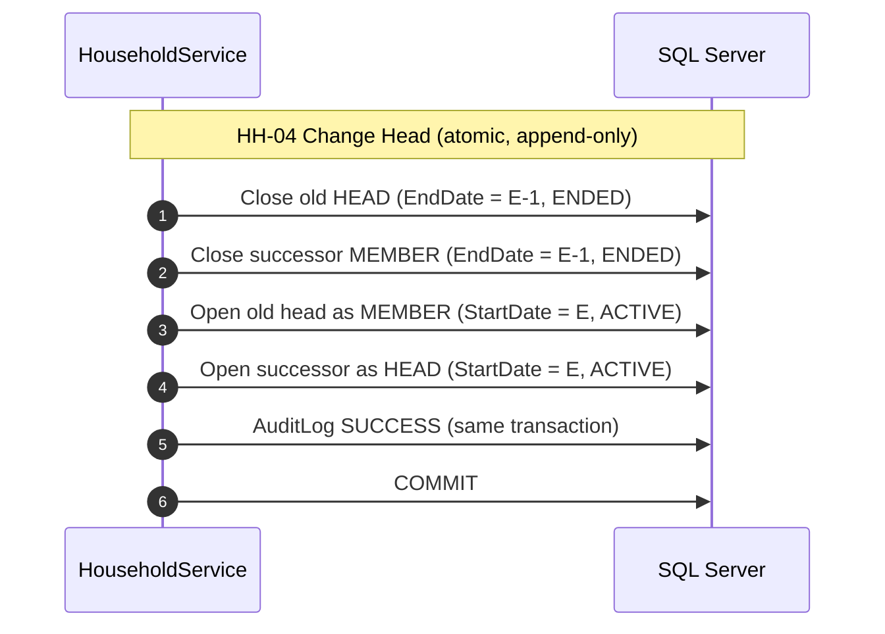

# Role Brief - Coder 2 (Household, Residence & Transfers)

**Document Code:** `WKF-TEAM-C2-v2.0`
**Owner:** `<name>`
**Module B:** Household & Membership (`HH-01`-`HH-06`), Residence (`RES-01`-`RES-03`), Maker-Checker Transfers (`UC-06`)
**Companion docs:** [`../workflow/phase1-tasks.md`](../workflow/phase1-tasks.md) §4 · [`../architecture/srs.md`](../architecture/srs.md) §4.4 & §5 · [`../architecture/golden-invariant.md`](../architecture/golden-invariant.md)

> [!IMPORTANT]
> You own the **hardest and most important** part of ARIS: the append-only history engine and the
> maker-checker transfer. Almost every database trigger exists to catch a mistake in *your* code.
> Read [`../architecture/domain-model.md`](../architecture/domain-model.md) §3 before you write anything.

---

## 1. What You Own

| Area | Tasks |
|---|---|
| Household lifecycle | Register household, add member, change head, view history |
| Residence | Register/end **only inside** composite operations; query current residence |
| Relocations | Two-phase maker-checker: `CreateRequest` (maker) + `ExecuteDecision` (checker) |
| Rectification | `HIST-01` void-and-correct |

## 2. What You Can Start Today vs What Is Blocked

| Task | Status |
|---|---|
| `P1-C2` Domain contracts & interfaces (DTOs + interfaces) | **Start now** |
| `P3-C2A` `HouseholdService.RegisterHousehold` (`HH-01`) | Blocked on `P1-DB2` (`ArisDbContext`) |
| `P3-C2B` Member addition & head change (`HH-02`, `HH-04`) | Blocked on `P3-C2A` |
| `P4-C2A` / `P4-C2B` Transfer engine (`UC-06`) | Blocked on `P3-C2A` - the critical path |

Finish `P1-C2` now; it has **no** dependency on the database.

---

## 3. The Two Rules That Define Your Module

**Rule 1 - History is append-only.** `HouseholdMembership`, `Residence`, and `HouseholdAddress`
are never edited in place. Every change is *close the old row + open a new row*:

```
Close old row:  EndDate = E - 1,  Status = 'ENDED',  EndedBy = userId, EndedAt = now
Open new row :  StartDate = E,    Status = 'ACTIVE'
Precondition :  E > StartDate of every row being closed
```

**Rule 2 - The Golden Invariant must hold after every commit.** An `ACTIVE` citizen has exactly one
active membership and one active residence at the household's active address. `HH-04` (head change)
is the classic way to break it: you must close **both** rows and open **two** new ones, all in one
transaction.



> [!CAUTION]
> `membership.Role = "HEAD"` is an **instant rejection** (trigger `trg_Membership_Guard`, error **51011**).
> Role changes are close + open, never an update.

---

## 4. Step by Step - `P1-C2` (start now)

```powershell
git checkout develop
git pull origin develop
git checkout -b feature/p1-c2
```

Create the DTOs and interfaces under `src/Aris.Application/` (module folders `Households/`,
`Residences/`, `Transfers/`). They are contracts only - no implementation yet.

<details>
<summary><b>Template: household DTOs</b></summary>

```csharp
namespace Aris.Application.Households.Dtos;

public sealed record RegisterHouseholdDto
{
    public required int HeadCitizenId { get; init; }
    public required int AddressId { get; init; }
    public required DateOnly EffectiveDate { get; init; }
}

public sealed record AddMemberDto
{
    public required int HouseholdId { get; init; }
    public required int CitizenId { get; init; }
    public required DateOnly EffectiveDate { get; init; }
}

public sealed record ChangeHeadDto
{
    public required int HouseholdId { get; init; }
    public required int NewHeadCitizenId { get; init; }
    public required DateOnly EffectiveDate { get; init; }
}

public sealed record HouseholdDto
{
    public required int HouseholdId { get; init; }
    public required string Status { get; init; }
    public int? CurrentAddressId { get; init; }
    public int? HeadCitizenId { get; init; }
    public required int ActiveMemberCount { get; init; }
}
```
</details>

<details>
<summary><b>Template: transfer DTOs (make a decision per member)</b></summary>

```csharp
namespace Aris.Application.Transfers.Dtos;

public sealed record CreateTransferRequestDto
{
    /// <summary>JOIN_EXISTING | NEW_HOUSEHOLD | HOUSEHOLD_MOVE.</summary>
    public required string RequestType { get; init; }
    public required int SourceHouseholdId { get; init; }
    public int? DestinationHouseholdId { get; init; }   // required for JOIN_EXISTING
    public int? DestinationAddressId { get; init; }     // required for NEW_HOUSEHOLD / HOUSEHOLD_MOVE
    public required DateOnly EffectiveDate { get; init; }
    public int? NewHeadCitizenId { get; init; }         // required for NEW_HOUSEHOLD
    public int? SuccessorHeadCitizenId { get; init; }   // if the source head leaves but others stay
    public required IReadOnlyList<int> CitizenIds { get; init; }
}

public sealed record TransferItemDecisionDto
{
    public required int ItemId { get; init; }
    public required bool Approve { get; init; }
    public string? RejectReason { get; init; }          // required when not approved
}

public sealed record TransferDecisionDto
{
    public required int RequestId { get; init; }
    public string? DecisionNote { get; init; }
    public required IReadOnlyList<TransferItemDecisionDto> Items { get; init; }
}
```
</details>

<details>
<summary><b>Template: the three interfaces</b></summary>

```csharp
using Aris.Application.Common;
using Aris.Application.Households.Dtos;

namespace Aris.Application.Households;

public interface IHouseholdService
{
    Task<Result<int>> RegisterHouseholdAsync(RegisterHouseholdDto dto, int currentUserId, CancellationToken ct = default);
    Task<Result> AddMemberAsync(AddMemberDto dto, int currentUserId, CancellationToken ct = default);
    Task<Result> ChangeHeadAsync(ChangeHeadDto dto, int currentUserId, CancellationToken ct = default);
    Task<Result<HouseholdDto>> GetHouseholdAsync(int householdId, CancellationToken ct = default);
}
```

```csharp
using Aris.Application.Common;

namespace Aris.Application.Residences;

public interface IResidenceService
{
    /// <summary>RES-03: the validated current residence of a citizen.</summary>
    Task<Result<string>> GetCurrentAddressTextAsync(int citizenId, CancellationToken ct = default);
}
```

```csharp
using Aris.Application.Common;
using Aris.Application.Transfers.Dtos;

namespace Aris.Application.Transfers;

public interface ITransferService
{
    Task<Result<int>> CreateRequestAsync(CreateTransferRequestDto dto, int requestedBy, CancellationToken ct = default);
    Task<Result> ExecuteDecisionAsync(TransferDecisionDto decision, int decidedBy, CancellationToken ct = default);
}
```
</details>

> [!NOTE]
> `RES-01`/`RES-02` (register/end residence) are **internal steps** of `HH-01`, `HH-02`, `HH-05`, and
> `CIT-04` - they are never standalone operations, so `IResidenceService` only exposes the query.

---

## 5. Phase 3 & 4 Preview (after `P1-DB2`)

### `HH-01` Register Household - the atomic composite

All five steps in **one** transaction: insert `Household(ACTIVE)` + `HouseholdAddress(ACTIVE)`,
insert `HouseholdMembership(HEAD)`, insert `Residence`, then flip the citizen `UNASSIGNED → ACTIVE`.
A partial write here is exactly what the Golden Invariant forbids.

### `UC-06` Execute Transfer - the checker phase

`ExecuteDecisionAsync` runs inside `IsolationLevel.Serializable` and must:

1. Assert `decidedBy != requestedBy` (maker-checker; DB constraint `CK_TR_Decision` is the backstop).
2. Re-verify each citizen is still `ACTIVE` in the source household (state may have moved on).
3. Close the old `Residence` and `HouseholdMembership` rows (`EndDate = E - 1`).
4. Handle the source head leaving, or the source household emptying (set `INACTIVE`, close its address).
5. Branch by `RequestType`: `JOIN_EXISTING` / `NEW_HOUSEHOLD` / `HOUSEHOLD_MOVE`.
6. Set the request `APPROVED`/`REJECTED` and write the `SUCCESS` audit sharing one `CorrelationId`.

The full diagram is in [`../architecture/srs.md`](../architecture/srs.md) §5.2 - keep it open while coding.

```csharp
await using var tx = await _context.Database.BeginTransactionAsync(
    System.Data.IsolationLevel.Serializable, ct);
try
{
    // ... all mutations, audit, then ...
    await tx.CommitAsync(ct);
    return Result<int>.Success(requestId);
}
catch (Exception ex)
{
    await tx.RollbackAsync(ct);
    // failure audit on an INDEPENDENT connection, AFTER the rollback
    await _audit.LogFailureIndependentAsync(connectionString, new AuditFailureEntry { /* ... */ }, ct);
    return Result<int>.Failure($"Transfer failed: {ex.Message}");
}
```

---

## 6. Definition of Done for `P1-C2`

- [ ] Household, residence, and transfer DTOs created (immutable records).
- [ ] `IHouseholdService`, `IResidenceService`, `ITransferService` exist.
- [ ] DTO shape matches the constraints in [`../aris_schema_v2.sql`](../aris_schema_v2.sql) `CK_TR_Shape` (each request type carries exactly the columns it needs).
- [ ] `dotnet build Aris.slnx` → 0 errors, 0 warnings.
- [ ] Interfaces registered later in `AddApplication` when the implementations arrive.
- [ ] PR reviewed against [`../standards/pr-review-checklist.md`](../standards/pr-review-checklist.md) §2.3-2.4.

---

## 7. Traps Specific to Your Module

| Trap | Error you will see | Correct approach |
|---|---|---|
| `membership.Role = "HEAD"` in place | Trigger **51011** | Close + open new rows |
| Overlapping dates (`StartDate₂ < EndDate₁`) | Trigger **51012** / **51002** | `E > StartDate` of rows being closed; set `EndDate = E - 1` |
| Two active memberships for one citizen | Filtered unique index | Close the old one in the same transaction |
| Transfer split across transactions | Golden Invariant / orphan data | One `BeginTransactionAsync(Serializable)` |
| Self-approval (`decidedBy == requestedBy`) | `CK_TR_Decision` | Enforce in the UI + service |
| Writing the failure audit inside the rollback | Audit row disappears | `LogFailureIndependentAsync` after `RollbackAsync` |
| Leaving the source household empty but `ACTIVE` | Violation `H2`/`H1` | Set it `INACTIVE` and close its address |

**Stuck?** Use the escalation format in [`README.md`](README.md) §6.
