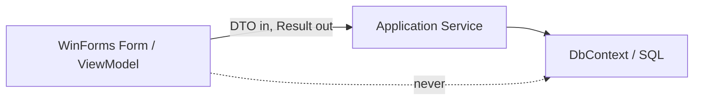

# Role Brief - Coder 3 (Shell, Authentication, Admin & Reports)

**Document Code:** `WKF-TEAM-C3-v2.0`
**Owner:** `<name>`
**Module C:** Desktop Shell, Authentication (`AUTH-01`, `ACC-01`), Administration (`SYS-01`, `AUD-01`), Reports (`RPT-01`-`RPT-03`)
**Companion docs:** [`../workflow/phase1-tasks.md`](../workflow/phase1-tasks.md) §5 · [`../architecture/srs.md`](../architecture/srs.md) §4.1 & §4.5

> [!TIP]
> You are the face of the application. You own the shell everyone else plugs into, so build it
> first and make it a place the other coders can drop screens into without friction.

---

## 1. What You Own

| Area | Tasks |
|---|---|
| Main shell | Sidebar navigation, content container, status bar |
| Authentication | Login, salted hashing, lockout, forced password change (`AUTH-01`) |
| Administration | Account management (`ACC-01`), system config (`SYS-01`), audit viewer (`AUD-01`) |
| Reports | Demographic, household-summary, and movement reports |

## 2. What You Can Start Today vs What Is Blocked

| Task | Status |
|---|---|
| `P1-C3` WinForms main shell layout | **Start now** - nothing blocks you |
| `P5-C3A` `AuthenticationService` + login | **Can start now** - no EF Core dependency |
| `P5-C3B` Admin UI & `P5-C3C` Reports | Later (need the DbContext + services) |

The shell is the highest-value thing you can do on day 1: it unblocks the others' UIs.

---

## 3. The One Rule for the UI Layer

> **No SQL. No `DbContext`. No business rules in a form.**

Forms call **Application services** through DTOs and receive
[`Result<T>`](../../src/Aris.Application/Common/Result.cs). That is the whole contract. If you find
yourself adding `using Microsoft.EntityFrameworkCore;` to a file in `src/Aris.UI/`, stop - that is
auto-rejection trap #9.



---

## 4. Step by Step - `P1-C3` (start now)

```powershell
git checkout develop
git pull origin develop
git checkout -b feature/p1-c3
```

### Step A - Build the shell layout

`src/Aris.UI/MainForm.cs` (currently a stub). Lay it out as **sidebar navigation + content
container + status bar**. Keep the layout in `MainForm.Designer.cs` (use the Visual Studio
designer) and keep only wiring logic in `MainForm.cs`.

Minimum pieces:

| Control | Name | Purpose |
|---|---|---|
| Panel (left) | `navPanel` | Navigation buttons |
| Panel (fill) | `contentPanel` | Hosts the active screen |
| StatusStrip (bottom) | `statusStrip` | `userLabel` (name + role), `connectionLabel` |

<details>
<summary><b>Template: <code>MainForm.cs</code> (wiring only)</b></summary>

```csharp
using Microsoft.Extensions.DependencyInjection;

namespace Aris.UI;

public partial class MainForm : Form
{
    private readonly IServiceProvider _services;

    public MainForm(IServiceProvider services)
    {
        _services = services;
        InitializeComponent();
    }

    /// <summary>Hosts a screen inside contentPanel. Every nav button calls this.</summary>
    private void ShowView<TForm>() where TForm : Form
    {
        var view = _services.GetRequiredService<TForm>();
        view.TopLevel = false;
        view.FormBorderStyle = FormBorderStyle.None;
        view.Dock = DockStyle.Fill;

        contentPanel.Controls.Clear();
        contentPanel.Controls.Add(view);
        view.Show();
    }

    private void citizenDirectoryButton_Click(object sender, EventArgs e) => ShowView<CitizenDirectoryForm>();
    private void householdDirectoryButton_Click(object sender, EventArgs e) => ShowView<HouseholdDirectoryForm>();
    private void transferInboxButton_Click(object sender, EventArgs e) => ShowView<TransferInboxForm>();
    private void reportsButton_Click(object sender, EventArgs e) => ShowView<ReportsForm>();

    private void adminButton_Click(object sender, EventArgs e)
    {
        // Role-based visibility: only ADMIN sees administration.
        if (_services.GetRequiredService<IUserSession>().Role != "ADMIN")
        {
            MessageBox.Show("Administration is available to administrators only.",
                "Access denied", MessageBoxButtons.OK, MessageBoxIcon.Warning);
            return;
        }

        ShowView<AdministrationForm>();
    }
}
```
</details>

> [!NOTE]
> The placeholder forms (`CitizenDirectoryForm`, etc.) are owned by Coders 1-2 and will arrive later.
> For now, create **empty stub forms** so the shell compiles, and let the owners replace the contents.

### Step B - Introduce the user session

The session is how every view knows who is logged in. Put the interface in the Application layer
(`src/Aris.Application/Common/IUserSession.cs`):

```csharp
namespace Aris.Application.Common;

public interface IUserSession
{
    bool IsAuthenticated { get; }
    int CurrentUserId { get; }
    string Username { get; }
    string Role { get; }   // OFFICER | ADMIN
}
```

Add a simple mutable implementation in the UI layer for now (the login flow fills it in later).

### Step C - Register forms in the composition root

Edit [`src/Aris.UI/Program.cs`](../../src/Aris.UI/Program.cs) - add each screen as a transient so
the shell can resolve it:

```csharp
services.AddTransient<MainForm>();
services.AddTransient<CitizenDirectoryForm>();
services.AddTransient<HouseholdDirectoryForm>();
services.AddTransient<TransferInboxForm>();
services.AddTransient<ReportsForm>();
services.AddTransient<AdministrationForm>();
```

### Step D - Establish the ViewModel pattern

Follow [`../standards/coding-conventions.md`](../standards/coding-conventions.md) §4: event handlers
delegate to an `async` ViewModel method; the form never blocks and shows `result.Errors` politely.

<details>
<summary><b>Template: a ViewModel method every screen should imitate</b></summary>

```csharp
public class RegisterHouseholdViewModel
{
    private readonly IHouseholdService _householdService;
    private readonly IUserSession _session;

    public RegisterHouseholdViewModel(IHouseholdService householdService, IUserSession session)
    {
        _householdService = householdService;
        _session = session;
    }

    public async Task<bool> SaveAsync(RegisterHouseholdDto dto)
    {
        var result = await _householdService.RegisterHouseholdAsync(dto, _session.CurrentUserId);
        if (!result.IsSuccess)
        {
            MessageBox.Show(
                string.Join(Environment.NewLine, result.Errors),
                "Validation Error", MessageBoxButtons.OK, MessageBoxIcon.Warning);
            return false;
        }

        MessageBox.Show("Saved.", "Success", MessageBoxButtons.OK, MessageBoxIcon.Information);
        return true;
    }
}
```
</details>

### Step E - Verify and open the PR

```powershell
dotnet build Aris.slnx     # 0 errors, 0 warnings
dotnet run --project src/Aris.UI
git add .
git commit -m "P1-C3: main shell with navigation and status bar"
git push -u origin feature/p1-c3
```

---

## 5. Phase 5 Preview - Authentication (can start early)

`AuthenticationService` has no EF Core dependency, so you may begin it before the database is ready.

- **Hash with salt.** PBKDF2 (or BCrypt) - never plaintext (`CON-SEC-01`).
- **Lockout:** after `MAX_FAILED_LOGINS` (default 5), lock for `LOCKOUT_MINUTES` (default 15).
  These values live in `SystemConfiguration`, not hardcoded.
- **Forced change:** when `MustChangePassword = 1`, the user must set a new password before use.
- **Audit login outcomes:** success → `_audit.LogAsync`; a failure with an unknown username has no
  `ActorUserId`, so use `AuditFailureEntry` with `AttemptedUsername` (`BR-AUD-03`).
- **Never** log the password, hash, or the attempted password.

---

## 6. Definition of Done for `P1-C3`

- [ ] `MainForm` shows sidebar navigation, a content container, and a status bar (user + role).
- [ ] Navigation hosts child forms without opening new top-level windows.
- [ ] Administration is hidden/blocked for `OFFICER` accounts.
- [ ] All forms registered in `Program.cs`; the app launches from the shell.
- [ ] **Zero** `DbContext`/SQL references anywhere in `src/Aris.UI/`.
- [ ] `dotnet build Aris.slnx` → 0 errors, 0 warnings; the app runs.
- [ ] PR reviewed against [`../standards/pr-review-checklist.md`](../standards/pr-review-checklist.md) §2.1.

---

## 7. Traps Specific to Your Module

| Trap | Why it fails |
|---|---|
| `using Microsoft.EntityFrameworkCore;` in a form | Layer violation (auto-rejection #9) |
| Calling a repository/DbContext directly | Bypasses validation and auditing |
| Blocking the UI thread with `.Result` / `.Wait()` | Freezes the app; use `await` |
| Showing raw exception stack traces to users | Show `result.Errors` in a friendly dialog |
| Hardcoding lockout/password rules | Read them from `SystemConfiguration` |
| Storing a plaintext password | `CON-SEC-01` violation |

**Stuck?** Use the escalation format in [`README.md`](README.md) §6.
