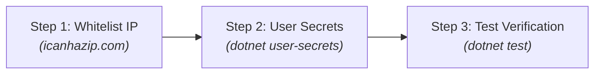
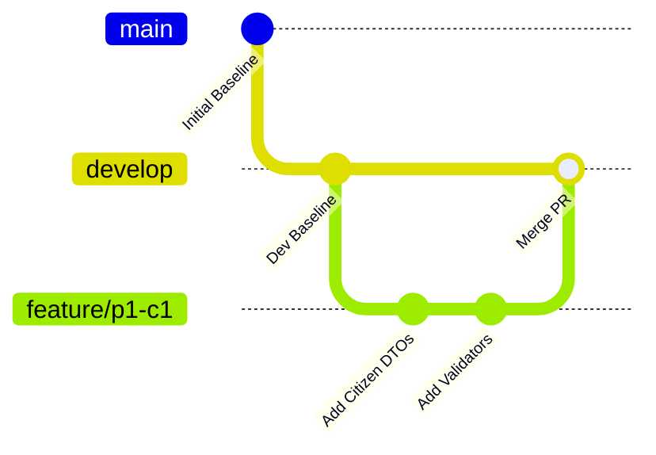

# Developer Onboarding & 5-Minute Quickstart

**Document Code:** `WKF-ONBOARD-v2.0`  
**Prerequisites:** .NET 10 SDK (`10.0.401`), Visual Studio 2026 or .NET CLI, Docker Desktop (for local DB)  
**Companion Documents:** [`work-breakdown.md`](work-breakdown.md) · [`phase1-tasks.md`](phase1-tasks.md)

---

## 1. Project Overview & Current Baseline

Before writing code, understand what is already built and validated:
- **Solution Architecture:** 4-layer clean architecture (`Aris.UI` $\rightarrow$ `Aris.Application` $\rightarrow$ `Aris.Domain` $\leftarrow$ `Aris.Infrastructure`) compiles cleanly with **0 errors and 0 warnings**.
- **Base Infrastructure:** `EntityBase`, `Result<T>`, `ValidationException`, `BaseService`, `IAuditService`, `AuditEntryValidator`, and `SqlResilience` are implemented and unit tested.
- **Shared Azure Database:** Deployed on Azure SQL (`aris-demo-b1805.database.windows.net`, db `ARIS-DB`), schema applied, least-privilege user `aris_officer` configured, and Golden Invariant verified.

---

## 2. 5-Minute Local Setup (Shared Azure SQL)



### Step 1: Whitelist Your Public IP Address
Azure SQL blocks all external client traffic by default:
1. Identify your public IPv4 address at: **[https://ipv4.icanhazip.com](https://ipv4.icanhazip.com)**
2. Provide this IP address to the Team Leader to add to the Azure SQL Server firewall.

### Step 2: Configure Local Application Secrets
Set your local developer user-secrets in PowerShell:

```powershell
cd src/Aris.UI
dotnet user-secrets init
dotnet user-secrets set "ConnectionStrings:ArisDb" "Server=tcp:aris-demo-b1805.database.windows.net,1433;Database=ARIS-DB;User Id=aris_officer;Password=<password>;Encrypt=True;TrustServerCertificate=False;Connect Timeout=60;"
```

> [!NOTE]
> Replace `<password>` with the team database password provided by your Team Leader. Never commit connection strings or passwords to Git.

### Step 3: Run the Verification Tests
From the root directory of the repository:

```powershell
$env:ARIS_TEST_CONNECTION = "Server=tcp:aris-demo-b1805.database.windows.net,1433;Database=ARIS-DB;User Id=aris_officer;Password=<password>;Encrypt=True;TrustServerCertificate=False;Connect Timeout=60;"
dotnet test Aris.slnx
```

**Expected Result:** All 37 tests pass (34 unit tests + 3 database integration tests).

> [!TIP]
> **Serverless Cold Start:** Azure SQL Serverless auto-pauses when idle. If the database was paused, the initial connection attempt may take 30–60 seconds while the compute resumes. This is expected behavior.

---

## 3. Alternative: Running Local SQL Server via Docker

For offline or local development without cloud connectivity:

```powershell
# 1. Copy environment template and start SQL container
Copy-Item .env.example .env
docker compose up -d

# 2. Deploy schema to the container
docker exec -i aris-sqlserver /opt/mssql-tools18/bin/sqlcmd -S localhost -U sa -P "<your_password>" -C -Q "CREATE DATABASE ArisDb"
docker cp docs/aris_schema_v2.sql aris-sqlserver:/tmp/schema.sql
docker exec -i aris-sqlserver /opt/mssql-tools18/bin/sqlcmd -S localhost -U sa -P "<your_password>" -C -d ArisDb -i /tmp/schema.sql

# 3. Point tests to local container
$env:ARIS_TEST_CONNECTION = "Server=localhost,1433;Database=ArisDb;User Id=sa;Password=<your_password>;TrustServerCertificate=True"
dotnet test Aris.slnx
```

---

## 4. Git Workflow & Branching Conventions



1. **Pull the latest `develop`:**
   ```powershell
   git checkout develop
   git pull origin develop
   ```
2. **Create your feature branch:**
   ```powershell
   git checkout -b feature/<task-id>    # e.g. feature/p1-c1
   ```
3. **Verify locally before pushing:**
   ```powershell
   dotnet build Aris.slnx               # Must be 0 errors, 0 warnings
   dotnet test Aris.slnx                # 0 failures (never pass --nologo)
   ```
4. **Submit Pull Request:**
   Submit a PR targeting `develop`. Complete the self-check in [`../standards/pr-review-checklist.md`](../standards/pr-review-checklist.md).
