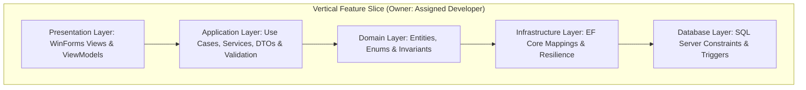
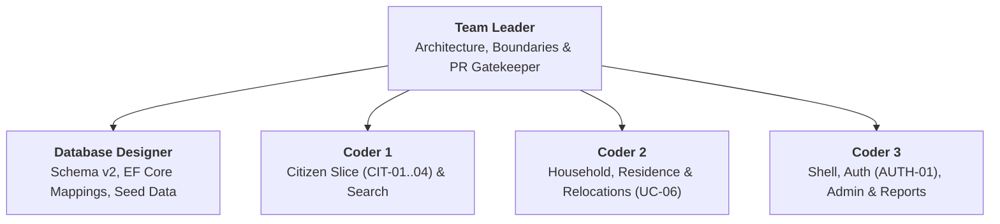
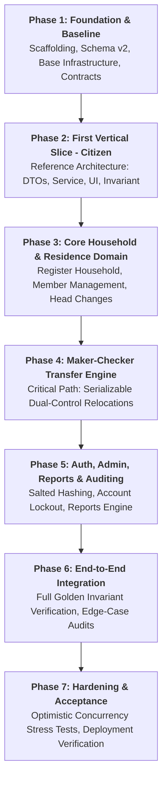

# Work Breakdown Structure (WBS) & Implementation Plan

**Document Code:** `WKF-WBS-v2.0`  
**Platform:** .NET 10 (C#) WinForms · Visual Studio 2026 · Microsoft SQL Server 2019+ · Entity Framework Core  
**Single Source of Truth:** [`../architecture/srs.md`](../architecture/srs.md) · [`../database/design-rationale.md`](../database/design-rationale.md)

---

## 1. Implementation Strategy: Vertical Feature Slicing

ARIS rejects horizontal layer silos ("one developer builds all UI, another builds all queries"). Instead, engineers deliver **complete vertical feature slices end-to-end**:

Each developer implements their assigned feature vertically from the UI controls down to the database transaction boundary.

---

## 2. Team Organization & Feature Ownership

| Role | Primary Feature Ownership | Key Deliverables |
|---|---|---|
| **Team Leader** | Solution architecture, project scaffolding, layer boundaries, PR reviews. | Base abstractions, PR review checklist, architectural reviews, invariant verification. |
| **Database Designer** | SQL Server schema v2 deployment, EF Core mappings, seed data, DB triggers/constraints. | `ArisDbContext`, entity Fluent API mappings, ADO.NET `AuditService`, constraint integration tests. |
| **Coder 1** | **Module A:** Citizen Management (`CIT-01`–`CIT-04`) & Directory Search (`SRCH-01`). | **First Vertical Slice** reference implementation, citizen DTOs/validators, `CitizenService`, Citizen UI forms. |
| **Coder 2** | **Module B:** Household, Residence & Relocations Engine (`HH-01`–`HH-06`, `UC-06`). | Maker-checker transfer engine, `HouseholdService`, `TransferService`, Household UI, Transfer Wizard/Inbox. |
| **Coder 3** | **Module C:** Authentication (`AUTH-01`, `ACC-01`), Main Desktop Shell, Reports (`RPT-01`–`RPT-03`). | Desktop navigation shell, `AuthenticationService`, role-based screen visibility, account management & reports UI. |

---

## 3. RACI Responsibility Assignment Matrix

**R** = Responsible (Does the work) | **A** = Accountable (Final architectural sign-off)  
**C** = Consulted (Two-way input) | **I** = Informed (Kept updated)

| Feature / Work Area | Team Leader | Database Designer | Coder 1 | Coder 2 | Coder 3 |
|---|:---:|:---:|:---:|:---:|:---:|
| **Solution Architecture & Layer Boundaries** | **A / R** | C | I | I | I |
| **Database Schema v2 & Migrations** | A | **R** | I | C | I |
| **EF Core DbContext & Entity Mappings** | A | **R** | C | C | C |
| **Citizen Management (`CIT-01`–`CIT-04`)** | A | C | **R** | I | I |
| **Directory Search (`SRCH-01`–`SRCH-03`)** | A | C | **R** | I | C |
| **Household & Membership (`HH-01`–`HH-04`)** | A | C | C | **R** | I |
| **Residence Tracking (`RES-01`–`RES-03`)** | A | C | I | **R** | I |
| **Maker-Checker Transfer Engine (`UC-06`)** | A | C | I | **R** | I |
| **Record Rectification (`HIST-01`)** | A | C | I | **R** | I |
| **Authentication & User Accounts (`AUTH-01`, `ACC-01`)** | A | I | I | I | **R** |
| **Desktop UI Shell & Navigation Container** | A | I | C | C | **R** |
| **Reports Engine (`RPT-01`–`RPT-03`)** | A | C | I | I | **R** |
| **Cross-Cutting Audit Logging** | **A / R** | C | C | C | C |
| **Golden Invariant Test Verification** | **A** | **R** | I | C | I |
| **Optimistic Concurrency Verification (`RowVersion`)** | A | **R** | I | C | I |

---

## 4. 7-Phase Implementation Roadmap

---

## 5. Definition of Done (DoD)

A user story or feature task is marked as **Done** only when all criteria below are satisfied:

1. **Functional Completeness:**
   - Happy path functions end-to-end through the WinForms UI.
   - Negative and boundary flows are tested (invalid inputs, duplicate entries, past dates).
   - Input payloads validated using FluentValidation before service execution.
2. **Architectural Boundary Adherence:**
   - UI code contains **zero direct SQL** and **zero `DbContext` references**.
   - UI communicates with Application services exclusively via DTOs and `Result<T>`.
   - All multi-table state changes are wrapped inside an atomic transaction.
3. **Database & Historical Integrity:**
   - Historical records are append-only (never updated in place or deleted).
   - Closed records have `EndDate = EffectiveDate - 1`.
   - Overlap check triggers pass without error.
   - `SELECT * FROM dbo.vw_GoldenInvariantViolations;` returns **0 rows**.
4. **Code Quality & CI Readiness:**
   - `dotnet build Aris.slnx` compiles with **0 errors and 0 warnings**.
   - Automated tests pass; PR reviewed and approved by Team Leader against [`../standards/pr-review-checklist.md`](../standards/pr-review-checklist.md).
